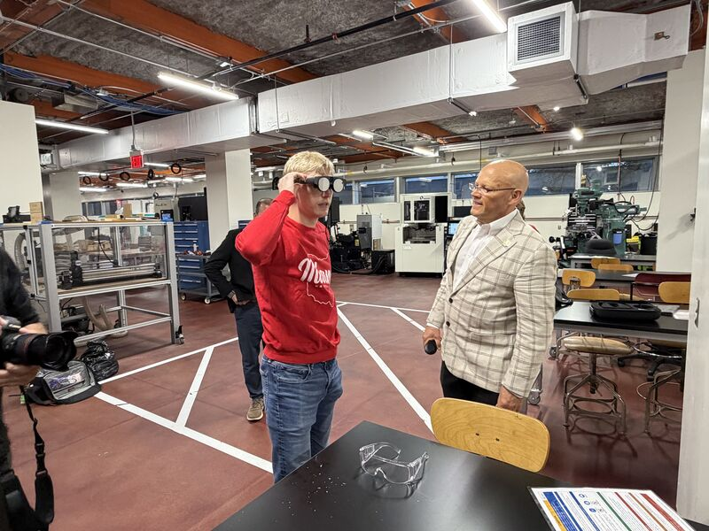
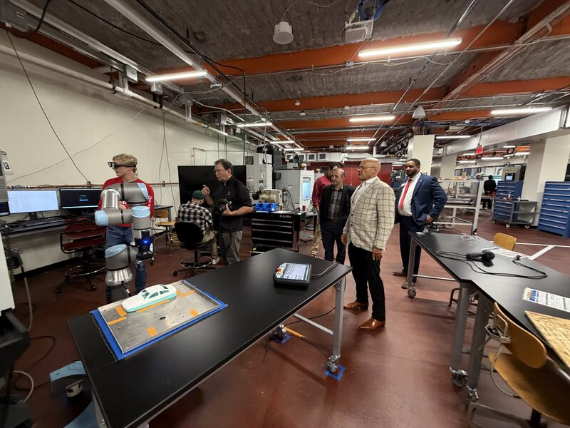
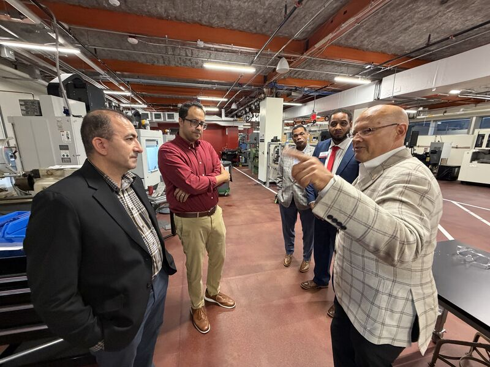
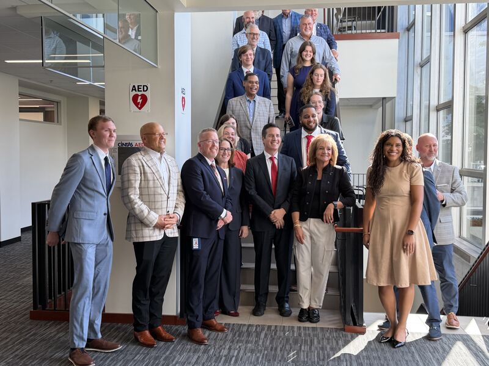
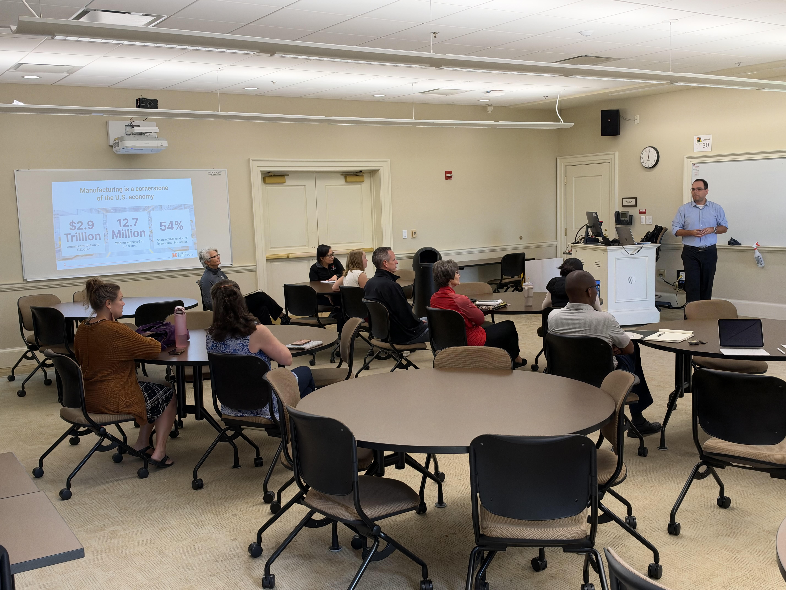
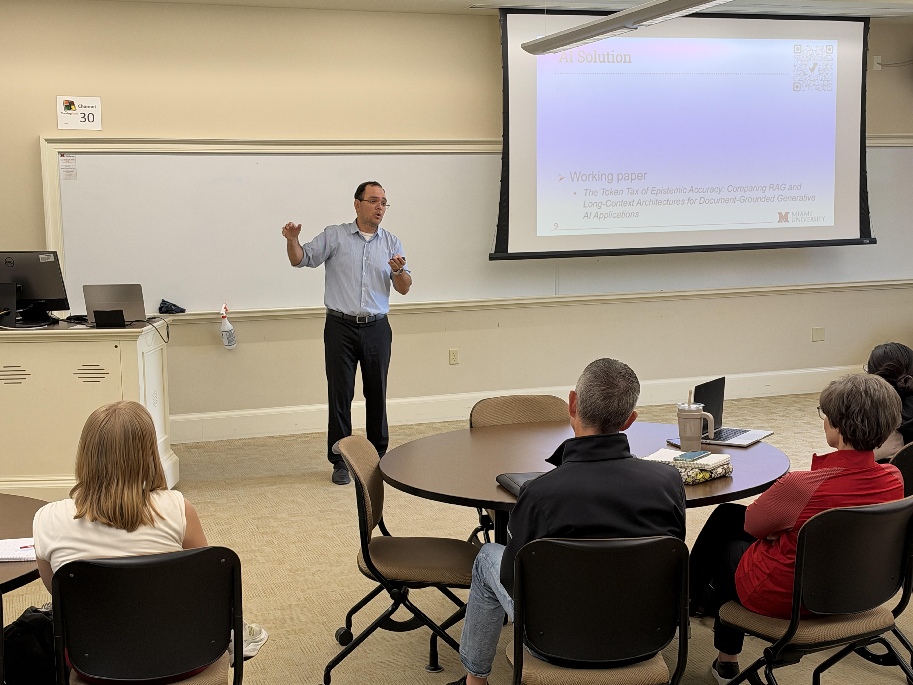

## Meeting Goals

```{=html}
<div class="agenda-bar">
  <div class="seg" style="flex:2;">1</div>
  <div class="seg" style="flex:10;">2</div>
  <div class="seg" style="flex:30;">3</div>
  <div class="seg" style="flex:10;">4</div>
  <div class="seg" style="flex:5;">5</div>
  <div class="seg" style="flex:3;">6</div>
</div>
<div class="agenda-grid g6">
  <div><div class="ag-n">1 <span>· 2 min</span></div><div class="ag-t">Minutes and action items</div><div class="ag-p">Fadel</div></div>
  <div><div class="ag-n">2 <span>· 10 min</span></div><div class="ag-t">Administrative updates</div><div class="ag-p">Mohammad: BWC status, Q6 deck review, Oct 14 visits, new AM Hub hire, OSC 2027, Makino</div></div>
  <div><div class="ag-n">3 <span>· 30 min</span></div><div class="ag-t">Technical updates</div><div class="ag-p">AM Hub subteam: Wissam, Leo, Michael, Ibrahim<br>Arthur: FSB presentation</div></div>
  <div><div class="ag-n">4 <span>· 10 min</span></div><div class="ag-t">Industry partner</div><div class="ag-p">Ram: MaxByte developments in the AM Hub</div></div>
  <div><div class="ag-n">5 <span>· 5 min</span></div><div class="ag-t">Risk log</div><div class="ag-p">All</div></div>
  <div><div class="ag-n">6 <span>· 3 min</span></div><div class="ag-t">Wrap-up</div><div class="ag-p">Action items, next steps</div></div>
</div>
```

::: {style="font-size: 0.62em; text-align:center; margin-top:0.8em;"}
Sixty minutes in six blocks; block widths are proportional to the minutes allotted in the agenda.
:::


## Recap: What We Covered in Meeting 26 (Oct 2)

::: {style="font-size: 0.74em;"}

::: {.columns}

::: {.column width="50%"}

[**Administrative / BWC**]{style="color:#c3142d;"}

- Q5 report (DO 7.4) due **Oct 9**; Deliverable 2.1 revised so that **Sep 4** is the reported September meeting and the November meeting is **Nov 13**.
- Farmer School dissemination session set for **Oct 9** (Arthur).
- Industrious Group visit (Sep 25): Jeff Malek tried the AR headset. Lesson: first-time AR users need a short onboarding. Cleveland visit targeted for early November.
- ASSP Safety 2027 proposal submitted (Fadel and Lora); decision expected around November.

:::

::: {.column width="50%"}

[**Technical**]{style="color:#c3142d;"}

- **SIGHT-VR v1.0**: production-ready after closing all 85 issues.
- **Makino**: D200Z training produced overnight and UX3i in about two days, versus four to six months for each of the first three machines.
- **First SOP-guided mill run** (Sep 29): Jay, a novice machinist, ran the Bridgeport mill from Michael's SOP and flagged items to tighten before AR.

[**MaxByte and closed session**]{style="color:#c3142d;"}

- 9,000+ CNC lathe and cobot images annotated in RoboFlow; all three machines in AR targeted for **Oct 23**.
- IRB amendment for screen capture and recording (Lora and Jay); pre-pilots with team members.

:::

:::

:::


## Action Items from Meeting 26

```{=html}
<table class="mu-table" style="font-size:0.54em; table-layout:fixed;">
<thead><tr><th style="width:17%;">Responsible Party</th><th style="width:35%;">Action Item</th><th style="width:13%;">Due Date</th><th style="width:35%;">Status</th></tr></thead>
<tbody>
<tr><td><strong>Fadel</strong></td><td>Share the Q5 report draft (partial, then full)</td><td>Oct 5 / Oct 6</td><td><span class="st-done">&#10003;</span> <strong>Done:</strong> Q5 report (DO 7.4) submitted; pending BWC review</td></tr>
<tr><td><strong>Arthur</strong></td><td>Lead the Farmer School dissemination session</td><td>Oct 9</td><td><span class="st-done">&#10003;</span> <strong>Done:</strong> held Oct 9 (Technical Updates)</td></tr>
<tr><td><strong>Fadel</strong></td><td>Add the AM Hub team to the next biweekly update agenda</td><td>Next meeting</td><td><span class="st-done">&#10003;</span> <strong>Done:</strong> agenda item 3 today</td></tr>
<tr><td><strong>Austin / Michael</strong></td><td>Develop onboarding for first-time AR headset users</td><td>Before the Cleveland visit</td><td><input type="checkbox"></td></tr>
<tr><td><strong>Ibrahim</strong></td><td>Provide the computer vision model to Austin</td><td>Carried over</td><td><input type="checkbox"></td></tr>
<tr><td><strong>Austin</strong></td><td>Verify the safety-zone circle stays centered after re-anchoring</td><td>Next update</td><td><input type="checkbox"></td></tr>
<tr><td><strong>Austin / Arthur</strong></td><td>Store AR evaluation data with the VR backend; one participant ID across VR and AR</td><td>Before pre-pilots</td><td><input type="checkbox"> Related: headset-hosted evaluator web page added (weekly summary, Sep 28 to Oct 2)</td></tr>
<tr><td><strong>Lora / Jay</strong></td><td>Prepare an IRB amendment for screen capture and recording</td><td>ASAP</td><td><input type="checkbox"></td></tr>
<tr><td><strong>MU, Lora, Discovery Center</strong></td><td>Finalize the experimental protocol and schedule pre-pilots</td><td>ASAP</td><td><input type="checkbox"></td></tr>
</tbody>
</table>
```

::: {style="font-size: 0.55em; margin-top:0.4em; color:#585E60;"}
MaxByte's four items from Meeting 26 are on the MaxByte slide.
:::


## Meeting 26 Minutes




# Administrative Updates {.center .inverse}

Mohammad Mayyas


## Status of BWC Deliverables and Requirements

<div style="font-size: 0.72em;">

- [**Approved by BWC:**]{style="color:#2e7d32;"} every deliverable due through Sep 11, 2026, the latest being D2.8 (July/August meeting documents).
- [**Pending BWC review:**]{style="color:#8a6d00;"} the Q5 report (D7.4) and the September/October meeting documents (D2.9).
- [**Next:**]{style="color:#c3142d;"} the Q6 deck (Oct 19), the quarterly grant meeting (Oct 23), and the Q5 expenditure report and invoice (Oct 30).

</div>

```{=html}
<table class="mu-table" style="font-size:0.52em; margin-top:0.4em;">
<thead><tr><th style="width:9%;">Deliverable</th><th>Description</th><th style="width:14%;">Due</th><th style="width:16%; text-align:center;">Portal status</th></tr></thead>
<tbody>
<tr><td>2.8</td><td>July/August project team meeting documents</td><td>Sep 11, 2026</td><td style="text-align:center;"><span class="pill pill-green">Approved</span></td></tr>
<tr><td>7.4</td><td>Quarterly progress report, Quarter 5</td><td>Oct 9, 2026</td><td style="text-align:center;"><span class="pill pill-gold">Pending review</span></td></tr>
<tr><td>2.9</td><td>September/October project team meeting documents</td><td>Nov 13, 2026</td><td style="text-align:center;"><span class="pill pill-gold">Pending review</span></td></tr>
<tr><td>3.4</td><td>Q4 quarterly grant meeting: PI and PM attendance (MS Teams verification)</td><td>Oct 23, 2026</td><td style="text-align:center;"><span class="pill pill-blue">Scheduled</span></td></tr>
<tr><td>2.10</td><td>November/December project team meeting documents</td><td>Jan 15, 2027</td><td style="text-align:center;"><span class="pill pill-blue">Scheduled</span></td></tr>
<tr><td>7.5</td><td>Quarterly progress report, Quarter 6</td><td>Jan 15, 2027</td><td style="text-align:center;"><span class="pill pill-blue">Scheduled</span></td></tr>
</tbody>
</table>
```

::: {style="font-size: 0.5em; text-align:right; color:#585E60; margin-top:0.3em;"}
Source: BWC OIA deliverables portal, Oct 16, 2026 ([page 2](imgs/deliverables_page2.png), [page 3](imgs/deliverables_page3.png)).
:::


## BWC Q6 Presentation: Slide Deck Review

<div style="font-size: 0.66em; margin-bottom: 0.3em;">
Four slides on Quarter 5 (Jul 1 to Sep 30, 2026). **Send any comments to Fadel by COB today (Fri, Oct 16)**; the deck is due to BWC by COB Monday, Oct 19.
</div>



::: {style="font-size: 0.45em; text-align:right; color:#585E60;"}
Video frames restored from the PPTX for this preview; in the deck itself, the videos play in PowerPoint.
:::


## Save the Date: Our OSC 2027 Session Was Accepted

```{=html}
<div class="event-card">
  <div class="event-date std-date"><span class="ev-mon">MAR</span><span class="ev-day">18</span><span class="ev-dow">Thursday, 2027</span></div>
  <div class="event-body std-body">
    <div style="font-size:1.25em; font-weight:bold; color:#c3142d;">Using GenAI to Develop Training Materials (WSIC)</div>
    <div><span class="ev-k">Time</span>10:30 to 11:30 AM (confirmed by BWC on Oct 9)</div>
    <div><span class="ev-k">Event</span>Ohio Safety Congress &amp; Expo (OSC27), Columbus</div>
    <div><span class="ev-k">Session</span>Submission #2268</div>
    <div><span class="ev-k">Reply by</span><strong>Monday, Oct 19</strong>: BWC asks us to confirm availability</div>
  </div>
</div>

<div class="pi-grid">
  <div class="pi-card ask"><div class="pi-name">Arthur Carvalho</div>Check Thursday, Mar 18, 10:30 to 11:30 AM against your spring 2027 teaching schedule.<label><input type="checkbox" data-key="osc-arthur-clear">No teaching conflict</label><label><input type="checkbox" data-key="osc-arthur-cal">On my calendar</label></div>
  <div class="pi-card ask"><div class="pi-name">Jay Shan</div>Check Thursday, Mar 18, 10:30 to 11:30 AM against your spring 2027 teaching schedule.<label><input type="checkbox" data-key="osc-jay-clear">No teaching conflict</label><label><input type="checkbox" data-key="osc-jay-cal">On my calendar</label></div>
  <div class="pi-card"><div class="pi-name">Fadel Megahed</div>Confirms our availability with BWC once Arthur and Jay are clear.<label><input type="checkbox" data-key="osc-fadel-reply">Replied to BWC</label><label><input type="checkbox" data-key="osc-fadel-cal">On my calendar</label></div>
  <div class="pi-card"><div class="pi-name">Mohammad Mayyas</div>Holds the date.<label><input type="checkbox" data-key="osc-mayyas-cal">On my calendar</label></div>
  <div class="pi-card"><div class="pi-name">Ibrahim Yousif</div>Holds the date.<label><input type="checkbox" data-key="osc-ibrahim-cal">On my calendar</label></div>
</div>
```

<div class="callout-red" style="font-size: 0.64em; margin-top: 0.8em;">
**Student researchers:** you are encouraged to attend if you can.
</div>

<div style="font-size: 0.6em; margin-top: 0.6em;">
Once Fadel confirms the time with BWC, add it to your calendar:
<a class="ics-btn gcal" href="https://calendar.google.com/calendar/render?action=TEMPLATE&amp;text=OSC27+session+%232268%3A+Using+GenAI+to+Develop+Training+Materials+%28WSIC%29&amp;dates=20270318T143000Z/20270318T153000Z&amp;ctz=America%2FNew_York&amp;details=SIGHT+project+session+at+the+2027+Ohio+Safety+Congress+%26+Expo.+Thursday%2C+March+18%2C+2027%2C+10%3A30+to+11%3A30+AM+EDT.+SIGHT+team%3A+Fadel+Megahed%2C+Arthur+Carvalho%2C+Mohammad+Mayyas%2C+Jay+Shan%2C+and+Ibrahim+Yousif%3B+student+researchers+welcome.&amp;location=Ohio+Safety+Congress+%26+Expo+%28OSC27%29%2C+Columbus%2C+OH" target="_blank" rel="noopener">Google Calendar</a>
<a class="ics-btn" href="osc27_save_the_date.ics" download>Outlook / Apple (.ics)</a>
</div>


## President Crawford and Senator Moreno Visit the AM Hub (Oct 14)

```{=html}
<div class="collage">
  
  
  
  
</div>
```

::: {style="font-size: 0.42em; text-align:right; color:#585E60; margin-top:0.3em;"}
Photos: Jay Shan's [LinkedIn post](https://www.linkedin.com/feed/update/urn:li:ugcPost:7515910284960641024/).
:::


## Joining the AM Hub Subteam: Usman Asif

```{=html}
<div class="prof">
  <div class="prof-left">
    <div class="avatar">UA</div>
    <div class="prof-name">Usman Asif</div>
    <div class="prof-role">Student Researcher<br>AM Hub subteam, Hamilton</div>
    <span class="pill pill-gold" style="font-size:0.5em;">Hiring in progress</span>
  </div>
  <div class="prof-right">
    <div class="hl-card">
      <div class="hl-big">~9 <span>years in safety</span></div>
      <div class="hl-h">Occupational Health and Safety Supervisor</div>
      <div class="hl-t">Saudi Arabia, 2014 to 2023: site inspections, safety reports, hazard identification, and safe work procedures.</div>
    </div>
    <div class="hl-card">
      <div class="hl-big">B.S. IT <span>expected Dec 2027</span></div>
      <div class="hl-h">Miami University Hamilton</div>
      <div class="hl-t">Fall 2026 coursework in programming, networking, databases, and Agile.</div>
    </div>
    <div class="hl-card hl-wide">
      <div class="hl-h" style="margin-top:0;">Technical skills</div>
      <div class="chips"><span>Git and GitHub</span><span>Linux command line</span><span>AWS EC2 and S3</span><span>HTML, CSS, JavaScript</span><span>SQL</span><span>Relational database design</span></div>
    </div>
  </div>
</div>
```

<div class="callout-red" style="font-size: 0.62em; margin-top: 0.8em;">
A **second AM Hub student researcher** hire is in progress.
</div>

::: {style="font-size: 0.45em; text-align:right; color:#585E60;"}
Source: Usman Asif's resume (Oct 2026).
:::


## Makino: Meeting Status (Mohammad Mayyas)

::: {.columns}

::: {.column width="45%"}

<div style="font-size: 0.64em;">

[**Where we left off**]{style="color:#c3142d;"}

- Two **self-initiated VR trainings** for AM Hub machines: the Makino **D200Z** (5-axis machining center) and **UX3i** (wire EDM), six guided modules each.
- Makino was contacted for feedback (Meeting 26).
- Q6 deck: *"Next: a meeting with Makino's Corporate Training Manager."*
- Michael covers the **Makino visit** in Technical Updates.

</div>

:::

::: {.column width="55%"}

<div style="font-size: 0.64em;">**Mohammad: status, date, attendees, and what Makino asked for:**</div>
<div class="can-edit" data-key="makino-notes" contenteditable="true" style="min-height: 12em; font-size:0.62em;" data-placeholder="Type live notes here; they persist in this browser."></div>

:::

:::


# Technical Updates {.center .inverse}

The AM Hub subteam (Wissam, Leo, Michael, and Ibrahim) and Arthur Carvalho


## AM Hub Subteam: Screen Share and Walkthrough

<div style="font-size: 0.74em; margin-bottom: 0.2em;">
The [**AM Hub subteam**]{style="color:#c3142d;"} will **share their screen or talk through** each update, in agenda order.
</div>

```{=html}
<div class="st-grid">
  <div class="st-card"><div class="st-who">1 · Wissam Nusair</div><div class="st-what">Packaging support for the digital twin assets, code, and GUI.</div><div class="can-edit" data-key="tech-wissam" contenteditable="true" data-placeholder="Notes"></div></div>
  <div class="st-card"><div class="st-who">2 · Leo Lyublinski</div><div class="st-what">Cost-benefit analysis investigations for the project.</div><div class="can-edit" data-key="tech-leo" contenteditable="true" data-placeholder="Notes"></div></div>
  <div class="st-card"><div class="st-who">3 · Michael Wise</div><div class="st-what">SOP updates and the Makino visit. <span style="color:#585E60;">The Bridgeport mill SOP is on the next slide.</span></div><div class="can-edit" data-key="tech-michael" contenteditable="true" data-placeholder="Notes"></div></div>
  <div class="st-card"><div class="st-who">4 · Ibrahim Yousif</div><div class="st-what">Development-to-dissemination efforts, provisional patent application figures, and items needed from Fadel.</div><div class="can-edit" data-key="tech-ibrahim" contenteditable="true" data-placeholder="Notes"></div></div>
</div>
```


## Bridgeport Mill SOP with AR Guidance (Michael Wise)




## SIGHT at the Farmer School: Arthur's Presentation (Oct 9)

```{=html}
<div class="photo-pair">
  
  
</div>
```


# Industry Partner Collaboration {.inverse .center}

MaxByte


## MaxByte: Recent Developments in the AM Hub

<div style="font-size: 0.8em; margin-bottom: 0.4em;">
[**Ram and the MaxByte team**]{style="color:#c3142d;"} will share their slides on recent developments deployed in the AM Hub.
</div>

```{=html}
<table class="mu-table" style="font-size:0.5em;">
<thead><tr><th style="width:62%;">Open items from Meeting 26 (Ramshankar / MaxByte)</th><th style="width:26%;">Due</th><th style="text-align:center;">Status</th></tr></thead>
<tbody>
<tr><td>Annotate the milling machine and deliver all three machines in AR (YOLO export, Unity), with Mohammad</td><td><strong>Oct 23, 2026</strong></td><td style="text-align:center;"><input type="checkbox"></td></tr>
<tr><td>Renew the Unity license</td><td>ASAP</td><td style="text-align:center;"><input type="checkbox"></td></tr>
<tr><td>Share a table of SOP objects versus annotated objects, and explain how accuracy is calculated</td><td>Before the next presentation</td><td style="text-align:center;"><input type="checkbox"></td></tr>
<tr><td>Review the email thread on the top-down camera annotations and respond</td><td>ASAP</td><td style="text-align:center;"><input type="checkbox"></td></tr>
</tbody>
</table>
```

<div style="font-size: 0.66em; margin-top: 0.5em;">**Live notes and questions:**</div>
<div class="can-edit" data-key="maxbyte-notes" contenteditable="true" style="min-height: 5em; font-size:0.62em;" data-placeholder="Type live notes here; they persist in this browser."></div>


# Risk Mitigation and Wrap-Up {.inverse .center}

All Project Members


## Risk Mitigation and Log Updates

```{=html}
<table class="mu-table" style="font-size:0.52em;">
<thead><tr><th style="width:30%;">Risk</th><th>Mitigation</th><th style="width:13%; text-align:center;">Status</th></tr></thead>
<tbody>
<tr><td>Only one AR headset (Magic Leap 2, now discontinued)</td><td>Backup headset bought with non-BWC funds; received and tested (Meeting 26).</td><td style="text-align:center;"><span class="pill pill-green">Mitigated</span></td></tr>
<tr><td>Testing cannot start before the IRB covers recording, screen capture, and any monitor change</td><td>IRB amendment (Lora and Jay); Kristen offered help with IRB and human-subjects questions.</td><td style="text-align:center;"><span class="pill pill-red">Open</span></td></tr>
<tr><td>Only Austin can set up and run the AR system</td><td>Austin is showing Michael how to set up and use the headset and edge-device program "so someone else can run the system" (AR weekly plan, week of Oct 5).</td><td style="text-align:center;"><span class="pill pill-gold">Proposed</span></td></tr>
</tbody>
</table>
```

<div style="font-size: 0.66em; margin-top: 0.6em;">**New or evolving risks and mitigation updates (Arthur maintains the log):**</div>
<div class="can-edit" data-key="risk-notes" contenteditable="true" style="min-height: 7em; font-size:0.62em;" data-placeholder="Risk: mitigation (owner)"></div>


## Upcoming BWC Deadlines

```{=html}
<div class="tl tl-short">
  <div class="tl-line"></div>
  <div class="tl-month" style="left:0%;">Oct 15</div>
  <div class="tl-month" style="left:54.8%;">Nov 1</div>
  <div class="tl-month" style="left:100%;">Nov 15</div>
  <div class="tl-today" style="left:3.2%;"><span>Today<br>Oct 16</span></div>
  <div class="tl-item down" style="left:12.9%;"><div class="tl-stub"></div><div class="tl-dot"></div><div class="tl-label"><b>Oct 19</b> (COB)<br>Q6 slide deck to BWC; OSC availability reply<br><span class="pill pill-red">Next up</span></div></div>
  <div class="tl-item up" style="left:25.8%;"><div class="tl-stub"></div><div class="tl-dot"></div><div class="tl-label"><b>Oct 23</b><br>BWC quarterly grant meeting: PI and PM (D3.4)<br><span class="pill pill-blue">Scheduled</span></div></div>
  <div class="tl-item down" style="left:48.4%;"><div class="tl-stub"></div><div class="tl-dot"></div><div class="tl-label"><b>Oct 30</b><br>Q5 expenditure report and Q5 invoice<br><span class="pill pill-gold">Due</span></div></div>
  <div class="tl-item up" style="left:93.5%;"><div class="tl-stub"></div><div class="tl-dot"></div><div class="tl-label"><b>Nov 13</b><br>November/December bi-monthly meeting<br><span class="pill pill-blue">Scheduled</span></div></div>
</div>
```

<div class="callout-red" style="font-size: 0.6em; margin-top:0;">
**Then Jan 15, 2027:** November/December meeting documents (D2.10) and the Q6 quarterly progress report (D7.5), via OIA as separate files.
</div>

::: {style="text-align:center; font-size: 0.6em; margin-top:0.4em;"}
Contacts: Fadel Megahed (fmegahed@miamioh.edu) · Mohamed Farrag, PM (farragm2@miamioh.edu).
:::


## Action Items and Next Steps

<div style="font-size: 0.72em;">**Captured live (owner, item, due date):**</div>
<div class="can-edit" data-key="action-items" contenteditable="true" style="min-height: 13em; font-size: 0.9em;" data-placeholder="Owner: item (due date)"></div>

::: {style="font-size: 0.66em; margin-top: 0.6em;"}
- **COB today:** any comments on the Q6 deck to Fadel.
- **COB Monday, Oct 19:** the Q6 deck goes to BWC, and Arthur's and Jay's OSC schedule checks are in.
- **Oct 23:** the BWC quarterly grant meeting.
:::
