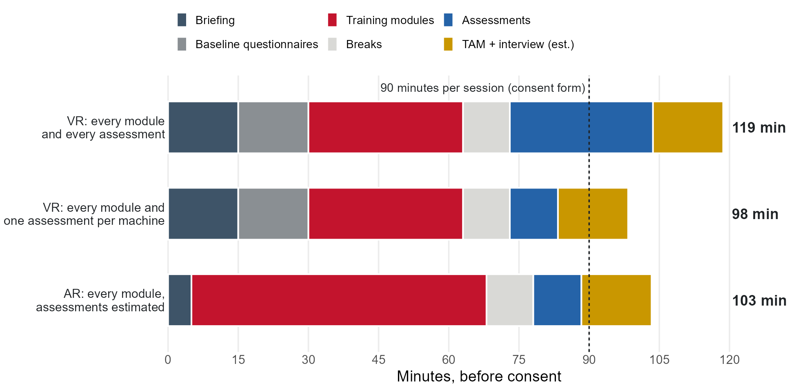

## Meeting Goals

```{=html}
<div class="agenda-bar">
  <div class="seg" style="flex:2;">1</div>
  <div class="seg" style="flex:15;">2</div>
  <div class="seg" style="flex:30;">3</div>
  <div class="seg" style="flex:5;">4</div>
  <div class="seg" style="flex:5;">5</div>
  <div class="seg" style="flex:3;">6</div>
</div>
<div class="agenda-grid g6">
  <div><div class="ag-n">1 <span>· 2 min</span></div><div class="ag-t">Minutes</div><div class="ag-p">Approve Meeting 27 minutes</div></div>
  <div><div class="ag-n">2 <span>· 15 min</span></div><div class="ag-t">Administrative updates</div><div class="ag-p">Meeting 27 follow-up, BWC, team requirements</div></div>
  <div><div class="ag-n">3 <span>· 30 min</span></div><div class="ag-t">Experimental plan</div><div class="ag-p">How we got here, assessments, protocol questions, timing, recruitment</div></div>
  <div><div class="ag-n">4 <span>· 5 min</span></div><div class="ag-t">Industry partners</div><div class="ag-p">MaxByte, Industrious Group</div></div>
  <div><div class="ag-n">5 <span>· 5 min</span></div><div class="ag-t">Risk log</div><div class="ag-p">All</div></div>
  <div><div class="ag-n">6 <span>· 3 min</span></div><div class="ag-t">Wrap-up</div><div class="ag-p">Action items, next steps</div></div>
</div>
```

::: {style="font-size: 0.62em; text-align:center; margin-top:0.8em;"}
Sixty minutes in six blocks; block widths are proportional to the minutes allotted in the [agenda](https://drive.google.com/open?id=1TcdqXR1UojHm-U1FcrVM6I9zKmrwCS8j&usp=drive_fs).
:::


## Action Items from Meeting 27

```{=html}
<table class="mu-table" style="font-size:0.62em; table-layout:fixed;">
<thead><tr><th style="width:16%;">Responsible</th><th style="width:40%;">Action item</th><th style="width:16%;">Due</th><th style="width:28%;">Status</th></tr></thead>
<tbody>
<tr><td><strong>Austin / Arthur</strong></td><td>AR data with the VR backend; one participant ID</td><td>Before pre-pilots</td><td><input type="checkbox" data-key="ai-id"></td></tr>
<tr><td><strong>Fadel</strong></td><td>Q6 deck to BWC; quarterly grant meeting</td><td>Oct 19 / Oct 23</td><td><span class="st-done">&#10003;</span> <strong>Done:</strong> D3.4 approved</td></tr>
<tr><td><strong>Fadel</strong></td><td>Q5 expenditure report and Q5 invoice</td><td>Oct 30</td><td><input type="checkbox" data-key="ai-q5inv"> <strong>Due today</strong></td></tr>
<tr><td><strong>Ibrahim</strong></td><td>Depth, pixels to distance, tests in extreme conditions</td><td>Next update</td><td><input type="checkbox" data-key="ai-ibrahim"> Next slide</td></tr>
<tr><td><strong>Jay</strong></td><td>IRB amendment, including the new hires</td><td>ASAP</td><td><input type="checkbox" data-key="ai-irb"> Draft of Oct 18</td></tr>
<tr><td><strong>Jay</strong></td><td>CITI training for Usman and Om</td><td>ASAP</td><td><input type="checkbox" data-key="ai-citi"> Requested Oct 27; due Nov 1</td></tr>
<tr><td><strong>Leo</strong></td><td>Contact Jeff Malek; second draft and case study</td><td>About Nov 13</td><td><input type="checkbox" data-key="ai-leo"> Next slide</td></tr>
<tr><td><strong>Michael / Ibrahim</strong></td><td>Protocol meeting with Lora, Jay, and Kristen</td><td>Oct 20</td><td><span class="st-done">&#10003;</span> <strong>Held Oct 23</strong></td></tr>
<tr><td><strong>Michael</strong></td><td>Feed hold and rapid traverse in the SOPs; sound example; volunteer test of the mill SOP</td><td>Next update</td><td><input type="checkbox" data-key="ai-michael"></td></tr>
<tr><td><strong>Mayyas</strong></td><td>Unity license and MaxByte items; Makino visit</td><td>ASAP</td><td><input type="checkbox" data-key="ai-mayyas"> Today's slides</td></tr>
</tbody>
</table>
```

::: {style="font-size: 0.62em; margin-top:0.6em; text-align:center;"}
**For approval:** [Meeting 27 minutes (PDF)](Meeting 27 Minutes.pdf). Any corrections?
:::


## Meeting 27: Two Things to Pick Up

```{=html}
<div class="two">
  <div>
    <div class="lead-q">Ibrahim: what are the plans for the experiment to test <em>"extreme cases"</em>?</div>
    <video controls preload="metadata" src="clips/m27_ibrahim_99.mp4"></video>
    <div class="can-edit note-line" data-key="extreme" contenteditable="true" data-placeholder="Which conditions, and when?"></div>
  </div>
  <div>
    <div class="lead-q"><em>Jeff</em> generously offered data for the cost-benefit study. Leo: have you reached out?</div>
    <video controls preload="metadata" src="clips/m27_jeff_offer.mp4"></video>
    <div class="can-edit note-line" data-key="leo-jeff" contenteditable="true" data-placeholder="Leo's answer"></div>
  </div>
</div>
```


## Makino: Where Does the Proposed Meeting Stand?

```{=html}
<div class="tl tl-m">
  <div class="tl-line"></div>
  <div class="tl-item up" style="left:4%;"><div class="tl-stub"></div><div class="tl-dot done"></div><div class="tl-label"><b>Sept 19</b><br>Email sent about Arthur's first demo (D200Z)</div></div>
  <div class="tl-item down" style="left:23%;"><div class="tl-stub"></div><div class="tl-dot done"></div><div class="tl-label"><b>Sept 27</b><br>Arthur builds the second demo (UX3i)</div></div>
  <div class="tl-item up" style="left:58%;"><div class="tl-stub"></div><div class="tl-dot"></div><div class="tl-label"><b>Oct 16</b><br>Still open: a Makino technical manager's visit, and a date for Michael's visit</div></div>
  <div class="tl-item down" style="left:74%;"><div class="tl-stub"></div><div class="tl-dot done"></div><div class="tl-label"><b>Oct 22</b><br>We mention it to BWC in the Q6 meeting</div></div>
  <div class="tl-item up" style="left:96%;"><div class="tl-stub"></div><div class="tl-dot"></div><div class="tl-label"><b style="color:#c3142d;">Oct 30</b><br>Today</div></div>
</div>
<div class="lead-q" style="margin-top:6px;">Mayyas: is there a date, who attends, and what does Makino want to see?</div>
<div class="can-edit" data-key="makino" contenteditable="true" style="min-height:3.4em; font-size:0.62em;" data-placeholder="Live notes"></div>
```


## BWC: Q5 Report Approved; Track 3 Abstract in 17 Days

```{=html}
<div class="stats">
  <div>
    <div class="stat-n ok">&#10003; Q5</div>
    <div class="stat-h">Quarterly report approved</div>
    <div class="stat-t">D7.4 and D3.4 (grant meeting) are approved. The September/October meeting documents (D2.9) are pending.</div>
  </div>
  <div>
    <div class="stat-n">17 days</div>
    <div class="stat-h">Track 3 abstract</div>
    <div class="stat-t">Due Monday, November 16, 5 PM ET.</div>
  </div>
  <div>
    <div class="stat-n" style="color:#3E5468;">Oct 22</div>
    <div class="stat-h">From the Q6 meeting</div>
    <div class="can-edit note-line" data-key="q6-notes" contenteditable="true" style="min-height:6.2em;" data-placeholder="Fadel: updates from the BWC meeting"></div>
  </div>
</div>
<div class="strip"><strong>Final presentation example (Deliverable-Objective 9.2):</strong> BWC shared a past project's video and asked teams not to distribute it, so Fadel is sending the link by email. <strong>Next documents:</strong> D2.10 and D7.5, January 15, 2027.</div>
```


## Team Requirements

```{=html}
<div class="req">
  <div>
    <div class="req-i">&#9878;&#65039;</div>
    <div class="req-h">COI training</div>
    <div class="req-t">CITI COI: Public Health Service course. It covers undergraduate assistants, graduate assistants, research staff, and investigators.</div>
    <a class="go-btn" href="https://miamioh.edu/research-innovation/departments-offices/research-compliance/financial-conflicts.html" target="_blank" rel="noopener">Miami's guidance</a>
  </div>
  <div>
    <div class="req-i">&#128221;</div>
    <div class="req-h">FCOI form</div>
    <div class="req-t">Disclose at least annually, and whenever something new comes up. Questions go to Amy Balk.</div>
    <a class="go-btn" href="https://docs.google.com/forms/d/e/1FAIpQLSf1QDG3jZprSQt2uBu152tPtiUBSWitN375k2tjgEr5s73kmg/viewform" target="_blank" rel="noopener">Open the form</a>
  </div>
  <div>
    <div class="req-i">&#127891;</div>
    <div class="req-h">CITI human subjects</div>
    <div class="req-t"><span class="req-d">Nov 1</span> for new hires, the deadline Mayyas shared in the Oct 26 email. Everyone else who has not finished: now. No certificate, no IRB listing.</div>
    <a class="go-btn" href="https://miamioh.edu/research-innovation/departments-offices/research-compliance/human-subjects/training.html" target="_blank" rel="noopener">Miami's instructions</a>
  </div>
</div>
<div class="flow">
  <div class="flow-tag">&#129534;&nbsp; Receipts</div>
  <div class="chev chev-hi"><b>The email arrives</b>Act on it right away</div>
  <div class="chev"><b>File it in Drive</b><code>SIGHT Project\PCard\&lt;Month YYYY&gt;\&lt;Vendor&gt;</code></div>
  <div class="chev"><b>Jacob processes it</b>This applies to everyone</div>
</div>
<div class="voice">No AI-generated emails. I want to know your voice.</div>
```


## The Evolution of our Experimental Plan

```{=html}
<div class="phases">
  <div>
    <div class="ph-h">2025: the commitment</div>
    <div class="ph-i"><b>Aug 15</b> Recruit 40 workers for the VR/AR evaluation <span>(Meeting 4)</span></div>
    <div class="ph-i"><b>Nov 20</b> IRB approves the study <span>(Meeting 10)</span></div>
  </div>
  <div>
    <div class="ph-h">Summer 2026: the plan</div>
    <div class="ph-i"><b>Jul 24</b> Testing set for December to March; within-subject design <span>(Meeting 23)</span></div>
    <div class="ph-i"><b>Aug 7</b> Two Hamilton students prioritized for usability testing <span>(Meeting 24)</span></div>
    <div class="ph-i"><b>Sep 4</b> Protocol moved to a dedicated breakout <span>(Meeting 25)</span></div>
  </div>
  <div>
    <div class="ph-h">Fall 2026: the protocol</div>
    <div class="ph-i"><b>Sep 11</b> Breakout: 40 participants, 36 complete both sessions; goals; $75 per session; mill risk <span>(after Meeting 25)</span></div>
    <div class="ph-i"><b>Sep 12-13</b> Experiment Materials folder: questionnaires, example papers, sample protocol</div>
    <div class="ph-i"><b>Oct 2</b> Lora presents the protocol; next steps are the amendment, final protocol, and pre-pilots <span>(Meeting 26)</span></div>
    <div class="ph-i"><b>Oct 16</b> Amendment and protocol meeting scheduled <span>(Meeting 27)</span></div>
    <div class="ph-i"><b>Oct 23-28</b> Protocol meeting, then a detailed review of the materials by email</div>
  </div>
</div>
<div class="so-what">The goal, the numbers, and the materials have been on the record for weeks. Today is about decisions and owners.</div>
```


## September 11: What We Already Worked Through

```{=html}
<div class="stage">
  <video controls preload="metadata" src="clips/sep11_40_36_34.mp4"></video>
  <div>
    <button class="pick on" data-src="clips/sep11_40_36_34.mp4"><b>The numbers</b>Fadel: recruit 40, expect four to drop, 36 to meet the metric, 34 for power.</button>
    <button class="pick" data-src="clips/sep11_untrain.mp4"><b>The design constraint</b>Lora: "once we train them once, they don't untrain."</button>
    <button class="pick" data-src="clips/sep11_minors.mp4"><b>Who we can recruit</b>Fadel and Lora: no participants under 18.</button>
    <button class="pick" data-src="clips/sep11_mill_risk.mp4"><b>The riskiest session</b>Fadel: AR on the mill is "the most dangerous experiment that we will have."</button>
  </div>
</div>
```


## Assessments: What Each Participant Will Answer

```{=html}
<div class="a-tabs">
  <div class="a-g g-b"><span>Before the session</span><div>
    <button class="a-t on" data-p="p-consent">Informed consent</button>
    <button class="a-t" data-p="p-demo">Demographics</button>
    <button class="a-t" data-p="p-nordic">Nordic</button>
    <button class="a-t" data-p="p-add">Possible addition</button>
    <button class="a-t" data-p="p-jha">JHA quiz</button>
    <button class="a-t" data-p="p-gatt">GATT</button>
  </div></div>
  <div class="a-g g-d"><span>During the session</span><div>
    <button class="a-t" data-p="p-vr">VR</button>
    <button class="a-t gap" data-p="p-ar">AR: none yet</button>
    <button class="a-t" data-p="p-obs">Observation</button>
  </div></div>
  <div class="a-g g-a"><span>After the session</span><div>
    <button class="a-t" data-p="p-tam">TAM</button>
    <button class="a-t" data-p="p-int">Interview</button>
  </div></div>
</div>

<div class="a-p on g-b" id="p-consent">
  <p class="why"><strong>Informed consent</strong> comes first, one participant at a time, before any questionnaire.</p>
  <div class="q-steps">
    <div><b>1</b>Read the consent form, alone or with the researcher</div>
    <div><b>2</b>Ask any questions about the study</div>
    <div><b>3</b>Sign one copy and keep the other</div>
    <div><b>4</b>Receive a participant ID</div>
  </div>
  <div class="say">"Before we continue, I would like you to read and sign this consent form. This explains the research study and your role and rights throughout the process. I am happy to answer any questions you might have. I also have a copy of the consent form that I will leave with you."<span>Researcher script, SIGHT experiment protocol</span></div>
</div>

<div class="a-p g-b" id="p-demo">
  <p class="why"><strong>Demographic questionnaire.</strong> Lora is fine with fixed categories for experience and training, if each has a clear definition.</p>
  <ol>
    <li>Age</li>
    <li>Gender: Male; Female</li>
    <li>Hand dominance: Left; Right; Ambidextrous</li>
    <li>Do you wear corrective lenses? Yes; No. If yes, are you wearing them now? Yes; No</li>
    <li>Current role</li>
    <li>Prior machine experience</li>
    <li>Prior relevant training</li>
  </ol>
</div>

<div class="a-p g-b" id="p-nordic">
  <p class="why"><strong>Nordic questionnaire: workers' safety commitment.</strong> With both students and industry participants, this is the most relevant part of NOSACQ-50. Four-point scale, strongly disagree to strongly agree. (R) marks items scored in reverse.</p>
  <ol start="23" class="big-list">
    <li>We who work here try hard together to achieve a high level of safety</li>
    <li>We who work here take joint responsibility to ensure that the workplace is always kept tidy</li>
    <li>We who work here do not care about each others' safety (R)</li>
    <li>We who work here avoid tackling risks that are discovered (R)</li>
    <li>We who work here help each other to work safely</li>
    <li>We who work here take no responsibility for each others' safety (R)</li>
  </ol>
</div>

<div class="a-p g-b" id="p-add">
  <p class="why" style="font-size:1.2em;"><strong>Possible addition: safety knowledge items we create or curate.</strong></p>
  <p class="why">An example of the kind of item we mean, inspired by ASP study material:</p>
  <div class="asp">
    <div class="asp-q">Which of these protects an operator at the mill without the operator having to do anything?</div>
    <div class="asp-o">A fixed guard around the cutting area</div>
    <div class="asp-o">A warning label on the machine</div>
    <div class="asp-o">A reminder in the SOP</div>
    <div class="asp-o">An E-stop button</div>
  </div>
</div>

<div class="a-p g-b" id="p-jha">
  <p class="why"><strong>OSHA Job Hazard Analysis quiz (12 questions).</strong> Lora: this measures general safety knowledge, so it does not need to match our hazards.</p>
  <ol class="cols2">
    <li>A job hazard analysis is most effective when carried out by:<span class="opts">a) The engineer who designed the equipment or process; b) The manager who oversees the area; c) A team of workers, supervisors, and subject matter experts who all understand the operation; d) A person with specialized JHA training, such as the safety manager</span></li>
    <li>When you cannot eliminate a hazard, what type of control measure should you use first to protect workers from it?<span class="opts">a) Engineering controls; b) Administrative controls; c) Personal protective equipment; d) Safety training</span></li>
    <li>True or false: The best way to control any potential hazard is to eliminate it entirely.</li>
    <li>Which of these could be a source of hazards?<span class="opts">a) Rotating parts on a machine; b) Repetitive lifting of objects; c) Walking on a wet floor; d) All of the above</span></li>
    <li>Which of these should you discuss when preparing a JHA?<span class="opts">a) Step or task, risk assessment to determine the worst-case injury, person responsible for implementing corrective action; b) Step or task, potential hazards, needed control measures; c) Potential hazards, risk assessment to determine the most likely injury, PPE needed; d) Potential hazards, PPE needed, person responsible for corrective action</span></li>
    <li>Which of these is not an engineering control?<span class="opts">a) A device that blocks the hazard at the source before it comes into contact with the worker; b) A ventilation system to reduce exposure to an air contaminant; c) Gloves; d) Guardrails on a scaffold</span></li>
    <li>Which of these is an administrative control?<span class="opts">a) Personal protective equipment; b) A changed procedure; c) An enclosure around a machine to reduce the noise it produces; d) Substituting a chemical in a process with a less hazardous one</span></li>
    <li>When choosing jobs to conduct JHAs for, you should prioritize:<span class="opts">a) Jobs that might cause severe or disabling injuries or illness, including those with no history of previous incidents; b) Jobs that are new or have undergone changes; c) Jobs that have detailed written instructions because they are complex; d) All of the above</span></li>
    <li>When should you review an existing JHA?<span class="opts">a) When there is a change in the job or if an injury or illness occurs on a specific job; b) Periodically (to ensure it is still accurate and to find hazards that the initial analysis did not identify); c) Never; d) Both answers (a) and (b)</span></li>
    <li>True or false: A JHA is a method for identifying hazards; it examines the steps in the job, then identifies ways to control the hazards found.</li>
    <li>Which of these is not a benefit of JHAs?<span class="opts">a) They prevent workplace injuries and illnesses; b) They raise workplace productivity; c) They qualify the workplace for an OSHA recognition program; d) They help a worksite comply with OSHA regulations</span></li>
    <li>Using PPE as a control strategy is acceptable:<span class="opts">a) While engineering controls are being developed and installed; b) When engineering controls are determined to be infeasible or impracticable; c) When all other controls are not enough to reduce the exposure to the hazard; d) All of the above</span></li>
  </ol>
</div>

<div class="a-p g-b" id="p-gatt">
  <p class="why"><strong>General Attitude Towards Technology (18 items).</strong> Six-point scale, strongly disagree to strongly agree. (R) marks items scored in reverse.</p>
  <ol class="cols2">
    <li>Technology makes our lives easier and more comfortable.</li>
    <li>Technology can sort out any problem.</li>
    <li>Continued technological innovation is essential for improving people's life satisfaction.</li>
    <li>Technology makes our way of life change too fast. (R)</li>
    <li>Technology expands our limits.</li>
    <li>Technology creates novel problems. (R)</li>
    <li>Technology can sometimes damage people's moral sense. (R)</li>
    <li>The applications of technology can threaten human rights. (R)</li>
    <li>New inventions will always be found that counteract any harmful effect of technological developments.</li>
    <li>The benefits of technology are greater than any harmful effects it may have.</li>
    <li>If a new technology poses risks that are uncertain and not yet fully understood, the development of this technology should be stopped even if benefits are expected. (R)</li>
    <li>If we attach too many risks that are not yet fully understood, we could miss out on technological progress.</li>
    <li>Limits need to be set for technological progress. (R)</li>
    <li>I am worried about new technologies fraught with uncertainties. (R)</li>
    <li>Without technological innovation the economy would be less stable.</li>
    <li>Technology means progress.</li>
    <li>The development of technologies is important for the economy.</li>
    <li>Technology kills jobs. (R)</li>
  </ol>
</div>

<div class="a-p g-d" id="p-vr">
  <p class="why"><strong>VR assessment modules.</strong> Participants complete these as tasks in the system. The protocol uses one per machine, the same one for everyone. <strong>Which one per machine?</strong></p>
  <div class="vr"><div class="vr-c"><div class="vr-h">CNC lathe<span>6 modules, 10:58</span></div><div class="vr-m"><div class="vr-n">Set Up PPE<span>1:35</span></div><div class="vr-t"><div style="width:38%"></div></div></div><div class="vr-m"><div class="vr-n">Set Up the CNC Machine<span>3:14</span></div><div class="vr-t"><div style="width:77%"></div></div></div><div class="vr-m"><div class="vr-n">Load the Workpiece<span>1:01</span></div><div class="vr-t"><div style="width:24%"></div></div></div><div class="vr-m"><div class="vr-n">Program the Machine<span>2:34</span></div><div class="vr-t"><div style="width:61%"></div></div></div><div class="vr-m"><div class="vr-n">Run the Machine<span>1:49</span></div><div class="vr-t"><div style="width:43%"></div></div></div><div class="vr-m"><div class="vr-n">Clean and Shut Down<span>0:45</span></div><div class="vr-t"><div style="width:18%"></div></div></div></div><div class="vr-c"><div class="vr-h">Cobot<span>5 modules, 8:48</span></div><div class="vr-m"><div class="vr-n">Set Up PPE<span>1:47</span></div><div class="vr-t"><div style="width:42%"></div></div></div><div class="vr-m"><div class="vr-n">Boot the Arm<span>1:06</span></div><div class="vr-t"><div style="width:26%"></div></div></div><div class="vr-m"><div class="vr-n">Generate a Program<span>2:51</span></div><div class="vr-t"><div style="width:68%"></div></div></div><div class="vr-m"><div class="vr-n">Run a Program<span>2:16</span></div><div class="vr-t"><div style="width:54%"></div></div></div><div class="vr-m"><div class="vr-n">Shut Down the Arm<span>0:48</span></div><div class="vr-t"><div style="width:19%"></div></div></div></div><div class="vr-c"><div class="vr-h">Manual mill<span>7 modules, 10:50</span></div><div class="vr-m"><div class="vr-n">Set Up PPE<span>1:21</span></div><div class="vr-t"><div style="width:32%"></div></div></div><div class="vr-m"><div class="vr-n">Set Up the Machine<span>4:12</span></div><div class="vr-t"><div style="width:100%"></div></div></div><div class="vr-m"><div class="vr-n">Move the XYZ Axes<span>1:06</span></div><div class="vr-t"><div style="width:26%"></div></div></div><div class="vr-m"><div class="vr-n">Load the Workpiece<span>1:18</span></div><div class="vr-t"><div style="width:31%"></div></div></div><div class="vr-m"><div class="vr-n">Configure the Spindle<span>0:58</span></div><div class="vr-t"><div style="width:23%"></div></div></div><div class="vr-m"><div class="vr-n">Run the Machine<span>1:16</span></div><div class="vr-t"><div style="width:30%"></div></div></div><div class="vr-m"><div class="vr-n">Clean and Shut Down<span>0:39</span></div><div class="vr-t"><div style="width:15%"></div></div></div></div></div>
</div>

<div class="a-p g-d" id="p-ar">
  <p class="why" style="color:#c3142d; font-size:1.3em;"><strong>We do not have assessment questions for AR.</strong> Lora: "the AR ones still need to be developed."</p>
  <p class="why">Starting point: the scenario-style items Ibrahim sent on Oct 26.</p>
  <h5>Mill: an operator clears chips from the vise area with a hand brush while the spindle is still spooling down.</h5>
  <ol>
    <li>Which two hazards are present?<span class="opts">a) Rotating tool contact and chip laceration; b) Falling workpiece and electrical shock; c) Dust inhalation and noise; d) Trip hazard and back strain</span></li>
    <li>Which control should be applied first?<span class="opts">a) Wear safety glasses and gloves; b) Wait for the spindle to stop completely, then clear chips with a brush, never by hand; c) Use compressed air to blow chips away; d) Clear chips while the machine is in feed hold</span></li>
  </ol>
  <h5>Lathe (Haas TL-1): an operator loads a 6-inch round bar into the three-jaw chuck and reaches in to check the grip before closing the door.</h5>
  <ol>
    <li>What is the main hazard at this step?<span class="opts">a) Flying chips from the cutting tool; b) The chuck starting to rotate while the operator's hand is inside the work envelope; c) Coolant on the floor; d) Noise from the spindle</span></li>
    <li>Which control removes that hazard rather than just reducing it?<span class="opts">a) Wearing cut-resistant gloves; b) Posting a warning sign on the machine; c) A door interlock that prevents spindle start while the door is open; d) Telling the operator to be careful</span></li>
  </ol>
</div>

<div class="a-p g-d" id="p-obs">
  <p class="why"><strong>Observation sheet,</strong> filled in by the experimenter for each session.</p>
  <ul>
    <li>Participant ID, date, interviewer/observer, and machines 1, 2, and 3</li>
    <li>General observations that are useful to the assessment of system usability and engagement</li>
    <li>Any instances of the participant asking for help</li>
    <li>Points of confusion or frustration, transcribed word for word and described as well as possible</li>
    <li>Note the time where you can, so it can be matched to the system logs (Lora)</li>
  </ul>
</div>

<div class="a-p g-a" id="p-tam">
  <p class="why"><strong>Original Technology Acceptance Model.</strong> Seven-point scale, extremely disagree to extremely agree. Lora: "we can go back to the original TAM questions," and we can drop personal innovativeness.</p>
  <h5>Perceived usefulness</h5>
  <ol>
    <li>Using this product in my job enables me to accomplish tasks more quickly than other products in its class.</li>
    <li>Using this product improves my job performance.</li>
    <li>Using this product in my job increases my productivity.</li>
    <li>Using this product enhances my effectiveness on the job.</li>
    <li>Using this product makes it easier to do my job.</li>
    <li>I have found this product useful in my job.</li>
  </ol>
  <h5>Perceived ease of use</h5>
  <ol start="7">
    <li>Learning to operate this product was easy for me.</li>
    <li>I found it easy to get this product to do what I want it to do.</li>
    <li>My interaction with this product has been clear and understandable.</li>
    <li>I found this product to be flexible to interact with.</li>
    <li>It was easy for me to become skillful at using this product.</li>
    <li>I found this product easy to use.</li>
  </ol>
</div>

<div class="a-p g-a" id="p-int">
  <p class="why"><strong>Interview questions.</strong> The draft names VR only, so it needs an AR version. Answers in writing or researcher notes, unless we add audio to the IRB.</p>
  <ol>
    <li>How does the SIGHT VR system compare to other machine safety trainings you have participated in?</li>
    <li>What part of your experience with SIGHT increased or reduced your engagement?</li>
    <li>Are there aspects of the SIGHT system that should be changed or altered so that it will be more effective?</li>
    <li>Are there aspects of the SIGHT system that should not be changed?</li>
    <li>What would make the system easier to understand or use?</li>
  </ol>
</div>
```


## Protocol: Where We Agree

```{=html}
<div class="two" style="gap:30px;">
  <div class="ag-col">
    <h3 class="ag-h">Settled</h3>
    <div class="ag-l"><b>Pre-pilot:</b> six team members, separate from the 40, can start now</div>
    <div class="ag-l"><b>30-minute metric:</b> get started and reach the first module</div>
    <div class="ag-l"><b>Recruiting:</b> other Ohio manufacturers and people with manufacturing experience are fine</div>
    <div class="ag-l"><b>Comparison:</b> follow Lora's design (usefulness, interview question 1)</div>
    <div class="ag-l"><b>Questionnaires:</b> keep Nordic, return to the original TAM, drop innovativeness</div>
    <div class="ag-l"><b>Participant IDs:</b> we create them on site, with no written link to names</div>
    <div class="ag-l"><b>Parallel sessions:</b> allowed; consent one at a time; AR needs two headsets</div>
    <div class="ag-l"><b>Consent form:</b> sickness risk stays under VR; the data-sharing wording stays</div>
  </div>
  <div class="ag-col irb">
    <h3 class="ag-h">Agreed, but the IRB must change</h3>
    <div class="ag-l ag-hot"><b>Compensation:</b> we already started ordering cards at <b>$75 per session</b>. The IRB recruitment script says $50 in total. Jay and Fadel fix this in the amendment.</div>
    <div class="ag-l"><b>Session order:</b> VR, then AR about one week later</div>
    <div class="ag-l"><b>Personnel:</b> add Om, Usman, and everyone handling the data</div>
    <div class="ag-l"><b>Headset:</b> the application still says HoloLens; we use Magic Leap 2</div>
    <div class="ag-l"><b>Recording:</b> screen capture and video (Meeting 26)</div>
    <div class="ag-l"><b>Consent form email:</b> fix the domain typo (<code>maimioh</code>)</div>
    <div class="sub" style="margin-top:10px;"><strong>One amendment:</strong> Jay, with Lora and Kristen.</div>
  </div>
</div>
```


## Protocol: What Is Still Open

```{=html}
<div class="op" style="padding-top:0; border-bottom:2px solid #c3142d;">
  <div class="sub"><strong>Question</strong></div><div class="sub"><strong>Where it stands</strong></div><div class="sub"><strong>Owner and date</strong></div>
</div>
<div class="op">
  <div class="op-q hot">No assessment questions exist for AR</div>
  <div class="op-a">Lora worked on the VR items; the AR items still need to be developed. Ibrahim sent examples on Oct 26.</div>
  <div class="op-o"><div class="can-edit" data-key="o-arq" contenteditable="true" data-placeholder="Owner, date"></div></div>
</div>
<div class="op">
  <div class="op-q">Do participants run the machines in AR?</div>
  <div class="op-a">The IRB asked for non-operational machines; the modules power on, run, and cut. Lora: running them needs a revised protocol, safety measures, and PPE. Ibrahim: cold run first, guarded operation later if needed.</div>
  <div class="op-o"><div class="can-edit" data-key="o-arrun" contenteditable="true" data-placeholder="Decide today"></div></div>
</div>
<div class="op">
  <div class="op-q">Do we measure hazard recognition before and after?</div>
  <div class="op-a">Ibrahim: pre and post items matched to the training, as the proposal says. Lora: recognition and recall come from the end-of-training assessments, with no retention period committed.</div>
  <div class="op-o"><div class="can-edit" data-key="o-prepost" contenteditable="true" data-placeholder="Decide today"></div></div>
</div>
<div class="op">
  <div class="op-q">Do the questions match what we train?</div>
  <div class="op-a">Ibrahim asked for every learning objective to map to a question, and Mayyas does not yet see the connection. Nobody owns that map.</div>
  <div class="op-o"><div class="can-edit" data-key="o-map" contenteditable="true" data-placeholder="Owner, date"></div></div>
</div>
<div class="op" style="border-bottom:none;">
  <div class="op-q">Audio in the interview?</div>
  <div class="op-a">Adding it needs the IRB. Without a full thematic analysis, written answers or notes are enough.</div>
  <div class="op-o"><div class="can-edit" data-key="o-audio" contenteditable="true" data-placeholder="Decide today"></div></div>
</div>
```


## Time Assessment

{fig-alt="Stacked horizontal bars of session minutes against the 90-minute session. VR with every assessment totals 119 minutes, VR with one assessment per machine totals 98 minutes, and AR totals 103 minutes. Each bar runs through briefing, baseline questionnaires for VR, training modules, breaks, assessments, and the TAM and interview. The TAM, interview, and AR assessment times are estimates." style="width:100%; margin:0;"}


## Recruitment: Plan and Next Steps

```{=html}
<iframe class="game-frame" style="height:556px; margin-top:2px;" data-src="https://sight-game-day.vercel.app/host" title="Game host screen"></iframe>
```


## A Final Exam Is Not Voluntary

```{=html}
<div class="two" style="grid-template-columns:1.15fr 1fr; gap:28px;">
  <div>
    <div class="big-quote">"You may refuse to participate in this study without penalty of loss of benefits to which you are otherwise entitled."<span>Our approved consent form (Protocol 02415r)</span></div>
    <div class="small-quote">"...participation is voluntary, refusal to participate will involve no penalty or loss of benefits..."<span>45 CFR 46.116(b), CITI informed consent refresher</span></div>
    <div class="small-quote">We told the IRB we recruit through flyers, email announcements, and informational meetings.<span>Our IRB application. A grade is not on that list.</span></div>
  </div>
  <div class="clip">
    <video controls preload="metadata" src="clips/sep11_consent_private.mp4"></video>
    <div class="lead-q" style="font-size:0.62em; margin-top:10px;">When the instructor holds the grade, a student cannot freely say no, however good our intentions and however much we need the 40.</div>
  </div>
</div>
<div class="path">
  <div class="path-tag">A path to ask the IRB about</div>
  <div class="chev">The class uses VR as a course activity, with no research data</div>
  <div class="chev">Someone other than the instructor invites students to the study</div>
  <div class="chev">No grade depends on joining; the instructor does not know who joined</div>
</div>
<div class="sub" style="margin-top:9px;"><strong>Kristen and Lora:</strong> what would the IRB need to see? &nbsp; <strong>Next:</strong> we owe the instructor a reply by Monday, November 2.</div>
```


## Preceding Steps to the Full Experiment

```{=html}
<div class="steps">
  <div class="step"><div class="chev done">Instructional AR</div><div class="step-d">Done</div><div class="step-t">23 modules, 143 steps, all three machines</div></div>
  <div class="step"><div class="chev dated">CITI: Om, Usman</div><div class="step-d">Nov 1</div><div class="step-t">Certificates uploaded</div></div>
  <div class="step"><div class="chev dated">Internal AR testing</div><div class="step-d">Next week</div><div class="step-t">About one hour per machine, in person. Austin shares the link.</div></div>
  <div class="step"><div class="chev dated">New-hire training</div><div class="step-d">Nov 4</div><div class="step-t">VR, AR, and machines, with Michael and Ibrahim</div></div>
  <div class="step"><div class="chev nodate">Pre-pilot</div><div class="step-d q">Date?</div><div class="step-t">Six team members; Om or Usman goes first</div></div>
  <div class="step"><div class="chev nodate">Dry run</div><div class="step-d q">Date?</div><div class="step-t">Lora leads a mock session</div></div>
  <div class="step"><div class="chev nodate">IRB amendment</div><div class="step-d q">Date?</div><div class="step-t">Jay, with Lora and Kristen</div></div>
  <div class="step"><div class="chev chev-hi">Full experiment</div><div class="step-d q">Date?</div><div class="step-t">40 recruited, 36 complete</div></div>
</div>
<div class="limits">
  <span><b>Plan of record:</b> testing December 2026 to March 2027</span>
  <span><b>Classes end:</b> Dec 4; finals Dec 7-11</span>
  <span><b>Winter break:</b> students likely away</span>
  <span><b>Makino lab booked:</b> weekdays 7:50-10:30 and 11:30-1:40 through Dec 22; Wed 6:00-9:45 PM</span>
</div>
<div class="lead-q" style="margin-top:14px;">Where can we accelerate, and what is the first full session date we can commit to?</div>
<div class="can-edit" data-key="accelerate" contenteditable="true" style="min-height:4.4em; font-size:0.56em;" data-placeholder="Dates and owners"></div>
```


## MaxByte: 10 Weeks Waiting on the Redlined First Amendment

```{=html}
<div class="wait">
  <div class="wait-n">10 weeks<span>August 20 to October 30, 2026</span></div>
  <div class="wait-l"><b>Aug 12:</b> Miami's counsel finishes the updated First Amendment.<br><b>Aug 20:</b> Mayyas sends the request to MaxByte.<br><b>Oct 30:</b> we are still waiting on this simple request.</div>
</div>
<div class="ask">Ram: when will we have the redlined document back?</div>
<div class="can-edit" data-key="maxbyte" contenteditable="true" style="min-height:2.2em; font-size:0.56em; margin-bottom:12px;" data-placeholder="Date"></div>
<div class="chk"><input type="checkbox" data-key="mb-ar"> Mill annotation and all three machines in AR (target was Oct 23)</div>
<div class="chk"><input type="checkbox" data-key="mb-unity"> Unity license renewal</div>
<div class="chk"><input type="checkbox" data-key="mb-table"> Table of SOP objects versus annotations, and how accuracy is calculated</div>
<div class="chk"><input type="checkbox" data-key="mb-camera"> Reply on the top-down camera annotations</div>
```


## Industrious Group: Thank You

```{=html}
<div class="thanks-h">Thank you, Jeff, and the whole Industrious Group team.</div>
<div class="thanks">
  <div>
    <div class="req-i" style="background:#3E5468;">&#129309;</div>
    <div class="req-h">Your time</div>
    <div class="req-t">You spent a morning with us at the AM Hub on September 25, touring the labs and trying the AR headset.</div>
  </div>
  <div>
    <div class="req-i" style="background:#3E5468;">&#128161;</div>
    <div class="req-h">Your feedback</div>
    <div class="req-t">Your first time in the headset showed us that new users need a short onboarding, which Austin and Michael are now building. You also pointed us to conferences for the team.</div>
  </div>
  <div>
    <div class="req-i" style="background:#3E5468;">&#128202;</div>
    <div class="req-h">Your generosity</div>
    <div class="req-t">You offered preliminary data, and a colleague's time, to help Leo test the cost-benefit model.</div>
  </div>
</div>
<div class="thanks-f">Your practical view keeps this work grounded in real shop floors. We would be delighted to visit you in Cleveland, whenever it suits your team.</div>
```


## Risk Mitigation and Log Updates

```{=html}
<table class="mu-table" style="font-size:0.62em;">
<thead><tr><th style="width:38%;">Risk</th><th>Mitigation</th><th style="width:13%; text-align:center;">Status</th></tr></thead>
<tbody>
<tr><td>IRB does not yet cover what we plan to run</td><td>One combined amendment; decide the AR option first.</td><td style="text-align:center;"><span class="pill pill-red">Open</span></td></tr>
<tr><td>Recruitment pressure compromises voluntary consent</td><td>IRB-approved recruitment only; keep grades and participation separate.</td><td style="text-align:center;"><span class="pill pill-red">New</span></td></tr>
<tr><td>Students are unavailable after classes end on Dec 4</td><td>Set the first session date today; add non-student participants.</td><td style="text-align:center;"><span class="pill pill-red">New</span></td></tr>
<tr><td>No AR assessment questions; other questions may not map to training</td><td>Name an owner today; map objectives to questions before the pre-pilot.</td><td style="text-align:center;"><span class="pill pill-red">New</span></td></tr>
<tr><td>Classes or visitors interrupt sessions in the shared lab</td><td>Reserve through 25Live; weekly schedule posted outside the labs.</td><td style="text-align:center;"><span class="pill pill-gold">In progress</span></td></tr>
<tr><td>Only one person could run the AR system</td><td>Michael backs up the CNC lathe and cobot; Jay is certified on the mill.</td><td style="text-align:center;"><span class="pill pill-green">Mitigated</span></td></tr>
<tr><td>Magic Leap 2 is discontinued</td><td>Backup headset received and tested.</td><td style="text-align:center;"><span class="pill pill-green">Mitigated</span></td></tr>
</tbody>
</table>
<div class="can-edit" data-key="risk-notes" contenteditable="true" style="min-height:3.6em; font-size:0.56em; margin-top:12px;" data-placeholder="New or evolving risks: risk, mitigation (owner)"></div>
```


## Action Items and Deadlines

```{=html}
<div class="two" style="grid-template-columns:1.3fr 1fr; gap:28px;">
  <div>
    <div class="sub" style="font-size:0.56em;"><strong>Captured live (owner, item, due date):</strong></div>
    <div class="can-edit" data-key="action-items" contenteditable="true" style="min-height:17em; font-size:0.62em; margin-top:4px;" data-placeholder="Owner: item (due date)"></div>
  </div>
  <div style="font-size:0.64em; line-height:1.52;">
    <strong style="color:#c3142d;">Deadlines</strong><br>
    <b>Oct 30:</b> Q5 expenditure report and invoice<br>
    <b>Nov 1:</b> CITI certificates for new hires<br>
    <b>Nov 2:</b> reply to the instructor<br>
    <b>Nov 4:</b> new-hire training<br>
    <b>Nov 13:</b> next project meeting<br>
    <b>Nov 16, 5 PM ET:</b> Track 3 abstract<br>
    <b>Jan 15, 2027:</b> D2.10 and D7.5<br><br>
    <strong style="color:#c3142d;">Owners we still need</strong><br>
    AR assessment questions<br>
    AR machine decision<br>
    Question-to-training map<br>
    Pre-pilot and dry run dates
  </div>
</div>
```

::: {style="text-align:center; font-size: 0.56em; margin-top:0.4em;"}
Contacts: Fadel Megahed (fmegahed@miamioh.edu) · Mohamed Farrag, PM (farragm2@miamioh.edu).
:::
