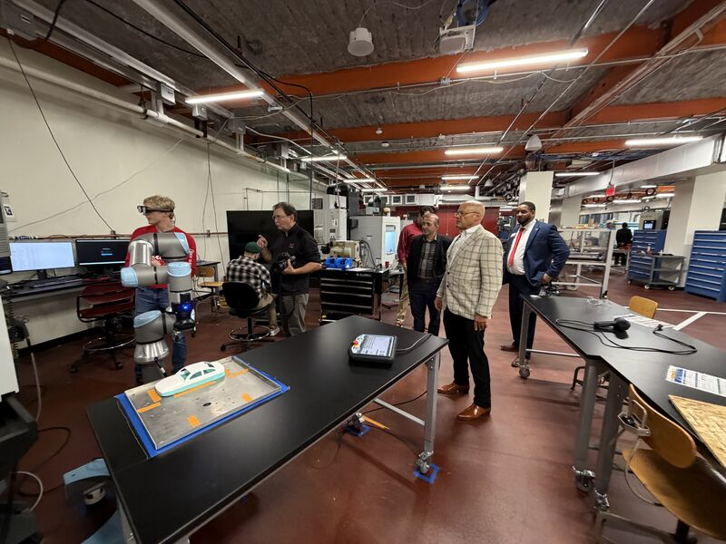

```{=html}
<div class="xp vs" data-stepper data-total="70">
  <div class="vs-track"><div class="vs-seg p" data-a="0" data-b="10" style="flex:10;">Welcome</div><div class="vs-seg b" data-a="10" data-b="20" style="flex:10;">Headset</div><div class="vs-seg v" data-a="20" data-b="30" style="flex:10;">CNC lathe</div><div class="vs-seg v" data-a="30" data-b="40" style="flex:10;">Mill</div><div class="vs-seg v" data-a="40" data-b="50" style="flex:10;">Cobot</div><div class="vs-seg e" data-a="50" data-b="60" style="flex:10;">TAM + interview</div><div class="vs-seg p" data-a="60" data-b="70" style="flex:10;">Close</div><div class="vs-marker"><span>P99</span></div></div><div class="vs-ticks"></div>
  <div class="xp-body"><div class="xp-step on" data-a="0" data-b="70"><div class="xp-intro"><div class="xp-intro-l"><div class="xp-title" style="font-size:1.15em;">P99 comes back for Session 2</div><p>About one week after the VR session, P99 trains on the same three machines, in the same order, with the Magic Leap 2 headset at the real machines.</p><p>The mill's spindle stays <b>off</b> (circuit breaker), but P99 can still move the table and turn the handwheels. The CNC lathe runs behind its <b>closed door</b>; the cobot runs at <b>reduced speed</b> with its collision sensors, and the AR shows a zone P99 must not enter. No machine assessment in AR: the session ends with the TAM and the interview. <em>Proposed to the IRB in the amendment.</em> <strong>Click to step through.</strong></p></div><div class="xp-intro-r" style="height:auto; border:none; box-shadow:none;"></div></div></div><div class="xp-step" data-a="0" data-b="10"><div class="xp-head"><span class="vs-time">Session 2</span><span class="xp-title">Welcome back, about one week later</span></div><div class="xp-panels"><div class="xp-panel"><div class="xp-pg on"><div class="xp-tag pt">Participant · Returns for Session 2</div><div class="xp-html"><div class="xp-rec"><div class="xp-mic">&#128075;</div><div class="xp-rec-t">P99, Session 2: AR</div><div class="xp-rec-s" style="margin-top:12px;">Same participant ID and the same three machines, now with the headset at the real machines. No baseline questionnaires this time: they were asked once, in Session 1.</div></div></div></div></div><div class="xp-panel"><div class="xp-seq" data-span="10.0"><div class="xp-pg on"><div class="xp-tag ra">Research assistant · Start of Session 2</div><div class="xp-html" style="align-items:flex-start;"><ul class="xp-notes"><li class="ink new" data-kind="note">Welcomes P99 back and reminds P99 of their rights, as in Session 1</li><li class="ink new" data-kind="note">Uses the same participant ID: P99</li><li class="ink new" data-kind="note">Asks how P99 felt after Session 1</li><li class="ink new" data-kind="note">Skips the demographics, JHA quiz, and GATT (Session 1 only)</li></ul></div></div></div></div></div></div><div class="xp-step" data-a="10" data-b="20"><div class="xp-head"><span class="vs-time">Session 2</span><span class="xp-title">The headset: fitting and orientation</span></div><div class="xp-panels"><div class="xp-panel"><div class="xp-pg on"><div class="xp-tag pt">Participant · Learns the headset</div><video class="xp-vid" muted playsinline preload="metadata" src="clips/ar_orient.mp4" poster="clips/ar_orient_poster.jpg"></video><div class="xp-cap">Hand gestures, the printed tags, and realigning the overlay</div></div></div><div class="xp-panel"><div class="xp-seq" data-span="22.8"><div class="xp-pg on"><div class="xp-tag ra">Research assistant · Orientation</div><div class="xp-html" style="align-items:flex-start;"><ul class="xp-notes"><li class="ink new" data-kind="note">Fits the Magic Leap 2 headset and checks that P99 can see clearly</li><li class="ink new" data-kind="note">Shows the hand gestures for each step</li><li class="ink new" data-kind="note">Shows how the printed tags anchor each step to the machine</li><li class="ink new" data-kind="note">Shows how to realign the overlay if it drifts</li><li class="ink new" data-kind="note">Checks for dizziness or eye strain</li></ul></div></div></div></div></div></div><div class="xp-step" data-a="20" data-b="30"><div class="xp-head"><span class="vs-time">Session 2</span><span class="xp-title">Machine 1: <span class="mchip m-lathe">CNC lathe</span></span></div><div class="xp-panels"><div class="xp-panel"><div class="xp-pg on"><div class="xp-tag pt">Participant · Follows the guidance at the real lathe</div><div class="xp-off">Team testing footage. In the study, the lathe runs with its <b>door closed</b>.</div><video class="xp-vid" muted playsinline preload="metadata" src="clips/ar_lathe.mp4" poster="clips/ar_lathe_poster.jpg"></video><div class="xp-cap">Module 1: machine setup. The headset highlights the doors and the panel.</div></div></div><div class="xp-panel"><div class="xp-seq" data-span="57.6"><div class="xp-pg on"><div class="xp-tag ra">Research assistant · Observation</div><div class="xp-html" style="align-items:flex-start;"><ul class="xp-notes"><li class="ink new" data-kind="note">Machine 1 in P99's order 3: the CNC lathe</li><li class="ink new" data-kind="note">The lathe runs only with its door (guard) closed</li><li class="ink new" data-kind="note">Records the steps reached, clock times, and help requests</li><li class="ink new" data-kind="note">Stops at 15:00, then a 5-minute break</li></ul></div></div></div></div></div></div><div class="xp-step" data-a="30" data-b="40"><div class="xp-head"><span class="vs-time">Session 2</span><span class="xp-title">Machine 2: <span class="mchip m-mill">Mill</span></span></div><div class="xp-panels"><div class="xp-panel"><div class="xp-pg on"><div class="xp-tag pt">Participant · Follows the guidance at the real mill</div><div class="xp-off">Team testing footage. In the study, the mill's circuit breaker is <b>off</b>: the spindle cannot run.</div><video class="xp-vid" muted playsinline preload="metadata" src="clips/ar_mill.mp4" poster="clips/ar_mill_poster.jpg"></video><div class="xp-cap">Module 3: loading the wax workpiece. The spindle cannot run.</div></div></div><div class="xp-panel"><div class="xp-seq" data-span="67.2"><div class="xp-pg on"><div class="xp-tag ra">Research assistant · Observation</div><div class="xp-html" style="align-items:flex-start;"><ul class="xp-notes"><li class="ink new" data-kind="note">Machine 2: the mill</li><li class="ink new" data-kind="note">Breaker off, so the spindle cannot run</li><li class="ink new" data-kind="note">P99 moves the table, turns the handwheels, and handles the vise and the wax block as guided</li><li class="ink new" data-kind="note">Records the steps reached, clock times, and help requests</li><li class="ink new" data-kind="note">Stops at 15:00, then a 5-minute break</li></ul></div></div></div></div></div></div><div class="xp-step" data-a="40" data-b="50"><div class="xp-head"><span class="vs-time">Session 2</span><span class="xp-title">Machine 3: <span class="mchip m-cobot">Cobot</span></span></div><div class="xp-panels"><div class="xp-panel"><div class="xp-pg on"><div class="xp-tag pt">Participant · Follows the guidance at the real cobot</div><div class="xp-off">Team testing footage. In the study, the cobot runs at reduced speed; the AR shows a <b>zone P99 must not enter</b>.</div><video class="xp-vid" muted playsinline preload="metadata" src="clips/ar_cobot.mp4" poster="clips/ar_cobot_poster.jpg"></video><div class="xp-cap">Module 2: the 4-foot boundary, the pendant, and the payload check.</div></div></div><div class="xp-panel"><div class="xp-seq" data-span="58.4"><div class="xp-pg on"><div class="xp-tag ra">Research assistant · Observation</div><div class="xp-html" style="align-items:flex-start;"><ul class="xp-notes"><li class="ink new" data-kind="note">Machine 3: the cobot</li><li class="ink new" data-kind="note">The cobot runs at reduced speed; P99 stays out of the zone the AR shows</li><li class="ink new" data-kind="note">Its collision sensors stop the arm on contact</li><li class="ink new" data-kind="note">Records the steps reached, clock times, and help requests</li></ul></div></div></div></div></div></div><div class="xp-step" data-a="50" data-b="60"><div class="xp-head"><span class="vs-time">Session 2</span><span class="xp-title">Their view of AR: the TAM and the interview</span></div><div class="xp-panels"><div class="xp-panel"><div class="xp-pg on"><div class="xp-tag pt">Participant · Rates AR, then answers four questions</div><div class="xp-html"><div class="xp-rec"><div class="xp-mic">&#127897;&#65039;</div><div class="xp-rec-s" style="margin-top:12px;">No machine assessment in AR: the assessments are in the VR session. The same TAM statements and the same four questions, now about the AR system. Comparing the two sessions is the point of the study.</div></div></div></div></div><div class="xp-panel"><div class="xp-seq" data-span="10.0"><div class="xp-pg on"><div class="xp-tag ra">Research assistant · End of Session 2</div><div class="xp-html" style="align-items:flex-start;"><ul class="xp-notes"><li class="ink new" data-kind="note">Hands over the TAM, now rating the AR system</li><li class="ink new" data-kind="note">Reads the four interview questions word for word</li><li class="ink new" data-kind="note">Records audio only with consent on the revised form, once the IRB approves it</li><li class="ink new" data-kind="note">Transcribes it on the SIGHT workstation, then deletes the recording once verified</li></ul></div></div></div></div></div></div><div class="xp-step" data-a="60" data-b="70"><div class="xp-head"><span class="vs-time">Session 2</span><span class="xp-title">Close-out: both sessions complete</span></div><div class="xp-panels"><div class="xp-panel"><div class="xp-pg on"><div class="xp-tag pt">Participant · Receives a second $75 Visa gift card</div><div class="xp-html"><div class="xp-gift"><div class="xp-card"><span>VISA</span><b>$75</b><em>Gift card, Session 2</em></div><div class="xp-gift-t">P99 has now completed both sessions, so P99 counts toward the 36 that BWC asks for.</div></div></div></div></div><div class="xp-panel"><div class="xp-seq" data-span="9.0"><div class="xp-pg on"><div class="xp-tag ra">Research assistant · Close-out</div><div class="xp-html" style="align-items:flex-start;"><ul class="xp-notes"><li class="ink new" data-kind="note">Gives the second $75 Visa gift card</li><li class="ink new" data-kind="note">Takes the headset back and cleans it</li><li class="ink new" data-kind="note">Within 24 hours: scans the AR packet into P99/AR and enters it in the Hub</li></ul></div></div></div></div></div></div></div>
</div>
<span class="fragment stepper"></span><span class="fragment stepper"></span><span class="fragment stepper"></span><span class="fragment stepper"></span><span class="fragment stepper"></span><span class="fragment stepper"></span><span class="fragment stepper"></span>
```
