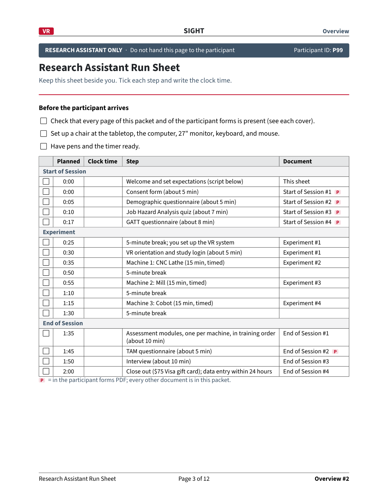

```{=html}
<div class="xp vs" data-stepper data-overview="1">
  <div class="vs-track">
    <div class="vs-seg p" data-a="0" data-b="5" style="flex:5;" title="Consent"></div>
    <div class="vs-seg p" data-a="5" data-b="10" style="flex:5;" title="Demographics"></div>
    <div class="vs-seg p" data-a="10" data-b="17" style="flex:7;">JHA</div>
    <div class="vs-seg p" data-a="17" data-b="25" style="flex:8;">GATT</div>
    <div class="vs-seg b" data-a="25" data-b="30" style="flex:5;" title="Break and setup"></div>
    <div class="vs-seg b" data-a="30" data-b="35" style="flex:5;" title="Orientation and login"></div>
    <div class="vs-seg v" data-a="35" data-b="50" style="flex:15;">CNC lathe</div>
    <div class="vs-seg b" data-a="50" data-b="55" style="flex:5;" title="Break"></div>
    <div class="vs-seg v" data-a="55" data-b="70" style="flex:15;">Mill</div>
    <div class="vs-seg b" data-a="70" data-b="75" style="flex:5;" title="Break"></div>
    <div class="vs-seg v" data-a="75" data-b="90" style="flex:15;">Cobot</div>
    <div class="vs-seg b" data-a="90" data-b="95" style="flex:5;" title="Break"></div>
    <div class="vs-seg e" data-a="95" data-b="105" style="flex:10;">Assess</div>
    <div class="vs-seg p" data-a="105" data-b="110" style="flex:5;" title="TAM"></div>
    <div class="vs-seg e" data-a="110" data-b="120" style="flex:10;">Interview</div>
    <div class="vs-marker"><span>P99</span></div>
  </div>
  <div class="vs-ticks"><span style="left:0%;">0:00</span><span style="left:25%;">0:30</span><span style="left:50%;">1:00</span><span style="left:75%;">1:30</span><span style="left:100%;">2:00</span></div>
  <div class="xp-body"><div class="xp-step on" data-a="0" data-b="120"><div class="xp-intro"><div class="xp-intro-l"><div class="xp-title" style="font-size:1.15em;">Follow P99 through about two hours</div><p>P99 is our made-up test participant. P99 uses machine order 3: <span class="mchip m-lathe">CNC lathe</span> &rarr; <span class="mchip m-mill">Mill</span> &rarr; <span class="mchip m-cobot">Cobot</span>.</p><p><b>Left:</b> what the participant does. <b>Right:</b> what the research assistant writes, as it happens. Every minute comes from the run sheet. Each step first shows the forms; the next click fills them in. <strong>Click to step through.</strong></p></div><div class="xp-intro-r"></div></div></div><div class="xp-step" data-a="0" data-b="5"><div class="xp-head"><span class="vs-time">0:00 to 0:05</span><span class="xp-title">Welcome and consent</span><span class="xp-ovtag">Here are the forms. Click to watch them filled in.</span></div><div class="xp-panels"><div class="xp-panel"><div class="xp-seq" data-span="10.0"><div class="xp-pg"><div class="xp-tag pt">Participant · Consent form, page 2</div><svg class="xp-page" viewBox="0 0 612 792" data-zoom="372" preserveAspectRatio="xMidYMid slice"><image href="imgs/xp/pt-2.png" x="0" y="0" width="612" height="792"/><g class="ink new" data-kind="text" data-n="12" data-cx="226.2" data-cy="658.6"><clipPath id="xc1"><rect class="cl" x="163.8" y="635.8" width="0" height="34.6"/></clipPath><text class="hw neat" x="166.8" y="658.6" font-size="19.8" clip-path="url(#xc1)">Jordan Avery</text></g><g class="ink new" data-kind="text" data-n="8" data-cx="392.0" data-cy="658.6"><clipPath id="xc2"><rect class="cl" x="358.7" y="641.1" width="0" height="26.6"/></clipPath><text class="hw neat" x="361.7" y="658.6" font-size="15.2" clip-path="url(#xc2)">11/10/26</text></g></svg></div></div></div><div class="xp-panel"><div class="xp-seq" data-span="10.0"><div class="xp-pg"><div class="xp-tag ra">Research assistant · Run sheet</div><svg class="xp-page" viewBox="0 0 612 792" data-zoom="345" preserveAspectRatio="xMidYMid slice"><image href="imgs/xp/ra-2.png" x="0" y="0" width="612" height="792"/><path class="ink stroke new" data-kind="path" d="M65.2,190.2 L67.4,193.6 L74.2,182.9" pathLength="1" stroke-width="1.49" data-cx="68.2" data-cy="189.8"/><path class="ink stroke new" data-kind="path" d="M65.2,210.3 L67.4,213.7 L74.2,203.0" pathLength="1" stroke-width="1.49" data-cx="68.2" data-cy="209.8"/><path class="ink stroke new" data-kind="path" d="M65.2,230.3 L67.4,233.7 L74.2,223.0" pathLength="1" stroke-width="1.49" data-cx="68.2" data-cy="229.8"/><path class="ink stroke new" data-kind="path" d="M69.1,285.7 L71.3,289.1 L78.1,278.4" pathLength="1" stroke-width="1.49" data-cx="72.2" data-cy="285.2"/><g class="ink new" data-kind="text" data-n="4" data-cx="151.6" data-cy="289.5"><clipPath id="xc7"><rect class="cl" x="138.0" y="277.3" width="0" height="18.6"/></clipPath><text class="hw rushed" x="141.0" y="289.5" font-size="10.6" clip-path="url(#xc7)">9:02</text></g><path class="ink stroke new" data-kind="path" d="M69.1,301.6 L71.3,305.0 L78.1,294.3" pathLength="1" stroke-width="1.49" data-cx="72.2" data-cy="301.1"/><g class="ink new" data-kind="text" data-n="4" data-cx="151.6" data-cy="305.4"><clipPath id="xc9"><rect class="cl" x="138.0" y="293.2" width="0" height="18.6"/></clipPath><text class="hw rushed" x="141.0" y="305.4" font-size="10.6" clip-path="url(#xc9)">9:04</text></g></svg></div></div></div></div></div><div class="xp-step" data-a="5" data-b="25"><div class="xp-head"><span class="vs-time">0:05 to 0:25</span><span class="xp-title">Three questionnaires, one at a time</span><span class="xp-ovtag">Here are the forms. Click to watch them filled in.</span></div><div class="xp-panels"><div class="xp-panel"><div class="xp-seq" data-span="44.0"><div class="xp-pg"><div class="xp-tag pt">Participant · Demographic questionnaire</div><svg class="xp-page" viewBox="0 0 612 792" data-zoom="372" preserveAspectRatio="xMidYMid slice"><image href="imgs/xp/pt-5.png" x="0" y="0" width="612" height="792"/><g class="ink new" data-kind="text" data-n="2" data-cx="247.6" data-cy="181.0"><clipPath id="xc10"><rect class="cl" x="237.0" y="163.5" width="0" height="26.6"/></clipPath><text class="hw neat" x="240.0" y="181.0" font-size="15.2" clip-path="url(#xc10)">24</text></g><path class="ink stroke new" data-kind="path" d="M294.5,199.9 L296.7,203.3 L303.5,192.6" pathLength="1" stroke-width="1.49" data-cx="297.6" data-cy="199.4"/><path class="ink stroke new" data-kind="path" d="M290.4,223.0 L292.6,226.4 L299.4,215.8" pathLength="1" stroke-width="1.49" data-cx="293.4" data-cy="222.6"/><path class="ink stroke new" data-kind="path" d="M233.4,246.0 L235.6,249.4 L242.4,238.8" pathLength="1" stroke-width="1.49" data-cx="236.4" data-cy="245.6"/><path class="ink stroke new" data-kind="path" d="M233.4,282.6 L235.6,286.0 L242.4,275.3" pathLength="1" stroke-width="1.49" data-cx="236.4" data-cy="282.1"/><g class="ink new" data-kind="text" data-n="25" data-cx="334.9" data-cy="311.0"><clipPath id="xc15"><rect class="cl" x="237.0" y="293.5" width="0" height="26.6"/></clipPath><text class="hw neat" x="240.0" y="311.0" font-size="15.2" clip-path="url(#xc15)">Mech. engineering student</text></g><g class="ink new" data-kind="text" data-n="11" data-cx="281.7" data-cy="348.0"><clipPath id="xc16"><rect class="cl" x="237.0" y="330.5" width="0" height="26.6"/></clipPath><text class="hw neat" x="240.0" y="348.0" font-size="15.2" clip-path="url(#xc16)">about 2 yrs</text></g><path class="ink stroke new" data-kind="path" d="M65.2,400.0 L67.4,403.4 L74.2,392.8" pathLength="1" stroke-width="1.49" data-cx="68.2" data-cy="399.6"/><path class="ink stroke new" data-kind="path" d="M65.2,440.0 L67.4,443.4 L74.2,432.8" pathLength="1" stroke-width="1.49" data-cx="68.2" data-cy="439.6"/><path class="ink stroke new" data-kind="path" d="M65.2,522.1 L67.4,525.5 L74.2,514.9" pathLength="1" stroke-width="1.49" data-cx="68.2" data-cy="521.6"/><path class="ink stroke new" data-kind="path" d="M62.0,516.4 L64.2,527.4 L66.4,516.4 L68.6,527.4 L70.8,516.4 L73.0,527.4 L75.2,516.4" pathLength="1" stroke-width="1.32" data-cx="69.0" data-cy="522.4"/><path class="ink stroke new" data-kind="path" d="M65.2,542.1 L67.4,545.5 L74.2,534.9" pathLength="1" stroke-width="1.49" data-cx="68.2" data-cy="541.6"/><path class="ink stroke new" data-kind="path" d="M65.2,624.2 L67.4,627.6 L74.2,617.0" pathLength="1" stroke-width="1.49" data-cx="68.2" data-cy="623.8"/><path class="ink stroke new" data-kind="path" d="M319.9,720.4 L322.1,723.8 L328.9,713.2" pathLength="1" stroke-width="1.49" data-cx="322.9" data-cy="720.0"/></svg></div><div class="xp-pg"><div class="xp-tag pt">Participant · Job Hazard Analysis quiz</div><svg class="xp-page" viewBox="0 0 612 792" data-zoom="372" preserveAspectRatio="xMidYMid slice"><image href="imgs/xp/pt-6.png" x="0" y="0" width="612" height="792"/><g class="ink new" data-kind="text" data-n="1" data-cx="75.4" data-cy="212.0"><clipPath id="xc24"><rect class="cl" x="66.8" y="186.2" width="0" height="39.3"/></clipPath><text class="hw neat" x="69.8" y="212.0" font-size="22.4" clip-path="url(#xc24)">c</text></g><g class="ink new" data-kind="text" data-n="1" data-cx="75.0" data-cy="306.0"><clipPath id="xc25"><rect class="cl" x="66.4" y="280.2" width="0" height="39.3"/></clipPath><text class="hw neat" x="69.4" y="306.0" font-size="22.4" clip-path="url(#xc25)">a</text></g><g class="ink new" data-kind="text" data-n="1" data-cx="75.0" data-cy="415.0"><clipPath id="xc26"><rect class="cl" x="66.4" y="389.2" width="0" height="39.3"/></clipPath><text class="hw neat" x="69.4" y="415.0" font-size="22.4" clip-path="url(#xc26)">T</text></g><g class="ink new" data-kind="text" data-n="1" data-cx="75.1" data-cy="448.0"><clipPath id="xc27"><rect class="cl" x="66.5" y="422.2" width="0" height="39.3"/></clipPath><text class="hw neat" x="69.5" y="448.0" font-size="22.4" clip-path="url(#xc27)">d</text></g><g class="ink new" data-kind="text" data-n="1" data-cx="76.1" data-cy="541.0"><clipPath id="xc28"><rect class="cl" x="67.5" y="515.2" width="0" height="39.3"/></clipPath><text class="hw neat" x="70.5" y="541.0" font-size="22.4" clip-path="url(#xc28)">b</text></g><g class="ink new" data-kind="text" data-n="1" data-cx="75.1" data-cy="648.0"><clipPath id="xc29"><rect class="cl" x="66.5" y="622.2" width="0" height="39.3"/></clipPath><text class="hw neat" x="69.5" y="648.0" font-size="22.4" clip-path="url(#xc29)">c</text></g></svg></div><div class="xp-pg"><div class="xp-tag pt">Participant · Attitudes toward technology (GATT)</div><svg class="xp-page" viewBox="0 0 612 792" data-zoom="372" preserveAspectRatio="xMidYMid slice"><image href="imgs/xp/pt-8.png" x="0" y="0" width="612" height="792"/><path class="ink stroke new" data-kind="path" d="M500.5,239.7 L501.4,241.1 L502.0,242.6 L502.2,244.1 L502.0,245.7 L501.3,247.2 L500.3,248.5 L499.0,249.7 L497.3,250.6 L495.5,251.2 L493.6,251.5 L491.6,251.5 L489.6,251.1 L487.8,250.5 L486.3,249.5 L484.9,248.4 L484.0,247.0 L483.4,245.5 L483.2,243.9 L483.4,242.4 L484.1,240.9 L485.1,239.5 L486.4,238.4 L488.0,237.5 L489.9,236.9 L491.8,236.6 L493.8,236.6 L495.7,236.9 L497.5,237.6 L499.1,238.5 L500.5,239.7 L501.4,241.1 L502.0,242.6 L502.2,244.1" pathLength="1" stroke-width="1.21" data-cx="492.7" data-cy="244.0"/><path class="ink stroke new" data-kind="path" d="M366.5,261.4 L368.3,260.9 L370.3,260.8 L372.3,260.9 L374.2,261.4 L375.9,262.2 L377.4,263.2 L378.6,264.5 L379.4,265.9 L379.8,267.4 L379.8,269.0 L379.4,270.6 L378.6,272.0 L377.5,273.3 L376.0,274.3 L374.3,275.1 L372.4,275.6 L370.4,275.8 L368.5,275.6 L366.6,275.1 L364.8,274.4 L363.4,273.3 L362.2,272.1 L361.4,270.6 L360.9,269.1 L360.9,267.5 L361.3,266.0 L362.1,264.6 L363.3,263.3 L364.7,262.2 L366.5,261.4 L368.3,260.9 L370.3,260.8 L372.3,260.9" pathLength="1" stroke-width="1.21" data-cx="370.4" data-cy="268.3"/><path class="ink stroke new" data-kind="path" d="M456.7,286.7 L458.2,287.7 L459.4,289.0 L460.2,290.4 L460.6,291.9 L460.6,293.5 L460.2,295.0 L459.4,296.5 L458.2,297.7 L456.7,298.8 L455.0,299.6 L453.1,300.1 L451.2,300.2 L449.2,300.1 L447.3,299.6 L445.6,298.8 L444.1,297.8 L442.9,296.5 L442.1,295.1 L441.7,293.5 L441.7,291.9 L442.1,290.4 L442.9,289.0 L444.1,287.7 L445.6,286.7 L447.3,285.9 L449.2,285.4 L451.2,285.2 L453.1,285.4 L455.0,285.9 L456.7,286.7 L458.2,287.7 L459.4,289.0 L460.2,290.4" pathLength="1" stroke-width="1.21" data-cx="451.2" data-cy="292.7"/><path class="ink stroke new" data-kind="path" d="M523.4,333.8 L524.0,332.3 L524.9,330.9 L526.2,329.7 L527.8,328.8 L529.6,328.1 L531.5,327.7 L533.5,327.7 L535.4,327.9 L537.3,328.5 L538.9,329.4 L540.3,330.6 L541.3,331.9 L542.0,333.4 L542.3,334.9 L542.1,336.5 L541.5,338.0 L540.6,339.4 L539.3,340.6 L537.7,341.5 L536.0,342.2 L534.0,342.6 L532.0,342.6 L530.1,342.3 L528.3,341.7 L526.6,340.9 L525.2,339.7 L524.2,338.4 L523.5,336.9 L523.3,335.4 L523.4,333.8 L524.0,332.3 L524.9,330.9 L526.2,329.7" pathLength="1" stroke-width="1.21" data-cx="532.8" data-cy="335.1"/><path class="ink stroke new" data-kind="path" d="M444.6,356.4 L443.7,355.1 L443.1,353.6 L442.9,352.0 L443.1,350.4 L443.8,349.0 L444.8,347.6 L446.2,346.5 L447.8,345.6 L449.6,345.0 L451.6,344.7 L453.6,344.7 L455.5,345.0 L457.3,345.7 L458.9,346.6 L460.2,347.8 L461.1,349.2 L461.7,350.7 L461.9,352.2 L461.7,353.8 L461.0,355.3 L460.0,356.6 L458.6,357.8 L457.0,358.7 L455.2,359.3 L453.2,359.6 L451.3,359.6 L449.3,359.2 L447.5,358.6 L445.9,357.6 L444.6,356.4 L443.7,355.1 L443.1,353.6 L442.9,352.0" pathLength="1" stroke-width="1.21" data-cx="452.4" data-cy="352.1"/><path class="ink stroke new" data-kind="path" d="M413.5,382.3 L411.6,382.6 L409.6,382.5 L407.6,382.2 L405.8,381.5 L404.3,380.6 L403.0,379.4 L402.0,378.0 L401.4,376.5 L401.3,374.9 L401.5,373.4 L402.2,371.9 L403.2,370.6 L404.6,369.4 L406.2,368.5 L408.1,367.9 L410.0,367.6 L412.0,367.7 L413.9,368.0 L415.7,368.7 L417.3,369.7 L418.6,370.8 L419.5,372.2 L420.1,373.7 L420.3,375.3 L420.0,376.8 L419.4,378.3 L418.3,379.7 L417.0,380.8 L415.3,381.7 L413.5,382.3 L411.6,382.6 L409.6,382.5 L407.6,382.2" pathLength="1" stroke-width="1.21" data-cx="410.8" data-cy="375.1"/><path class="ink stroke new" data-kind="path" d="M403.0,437.7 L402.7,436.2 L402.9,434.6 L403.4,433.1 L404.4,431.7 L405.7,430.5 L407.2,429.6 L409.0,428.9 L411.0,428.5 L412.9,428.5 L414.9,428.7 L416.7,429.3 L418.4,430.2 L419.7,431.4 L420.8,432.7 L421.5,434.2 L421.7,435.7 L421.6,437.3 L421.0,438.8 L420.1,440.2 L418.8,441.4 L417.2,442.3 L415.4,443.0 L413.5,443.4 L411.5,443.4 L409.5,443.1 L407.7,442.5 L406.1,441.7 L404.7,440.5 L403.7,439.2 L403.0,437.7 L402.7,436.2 L402.9,434.6 L403.4,433.1" pathLength="1" stroke-width="1.21" data-cx="412.2" data-cy="435.9"/><path class="ink stroke new" data-kind="path" d="M502.7,464.9 L502.8,466.4 L502.4,468.0 L501.7,469.4 L500.6,470.8 L499.2,471.9 L497.5,472.7 L495.6,473.2 L493.7,473.5 L491.7,473.4 L489.8,472.9 L488.0,472.2 L486.5,471.2 L485.2,470.0 L484.4,468.6 L483.9,467.1 L483.8,465.5 L484.1,464.0 L484.9,462.5 L486.0,461.2 L487.4,460.1 L489.0,459.3 L490.9,458.7 L492.9,458.5 L494.9,458.6 L496.8,459.0 L498.5,459.7 L500.1,460.7 L501.3,462.0 L502.2,463.4 L502.7,464.9 L502.8,466.4 L502.4,468.0 L501.7,469.4" pathLength="1" stroke-width="1.21" data-cx="493.3" data-cy="466.0"/><path class="ink stroke new" data-kind="path" d="M459.9,551.3 L460.7,552.7 L461.0,554.3 L461.0,555.8 L460.5,557.4 L459.7,558.8 L458.5,560.0 L457.0,561.0 L455.2,561.8 L453.3,562.2 L451.3,562.4 L449.4,562.1 L447.5,561.6 L445.8,560.8 L444.4,559.7 L443.2,558.4 L442.5,557.0 L442.1,555.4 L442.2,553.9 L442.6,552.4 L443.5,550.9 L444.7,549.7 L446.2,548.7 L447.9,547.9 L449.8,547.5 L451.8,547.4 L453.8,547.6 L455.7,548.1 L457.4,548.9 L458.8,550.0 L459.9,551.3 L460.7,552.7 L461.0,554.3 L461.0,555.8" pathLength="1" stroke-width="1.21" data-cx="451.6" data-cy="554.9"/><path class="ink stroke new" data-kind="path" d="M402.7,581.7 L404.0,580.5 L405.6,579.5 L407.4,578.8 L409.3,578.5 L411.3,578.4 L413.2,578.7 L415.1,579.3 L416.7,580.2 L418.1,581.3 L419.1,582.6 L419.8,584.1 L420.1,585.7 L419.9,587.2 L419.4,588.7 L418.4,590.1 L417.1,591.3 L415.5,592.3 L413.8,593.0 L411.8,593.3 L409.8,593.4 L407.9,593.1 L406.1,592.5 L404.4,591.6 L403.0,590.5 L402.0,589.1 L401.3,587.7 L401.1,586.1 L401.2,584.5 L401.8,583.0 L402.7,581.7 L404.0,580.5 L405.6,579.5 L407.4,578.8" pathLength="1" stroke-width="1.21" data-cx="410.6" data-cy="585.9"/><path class="ink stroke new" data-kind="path" d="M488.4,633.7 L490.1,633.0 L492.1,632.6 L494.0,632.5 L496.0,632.8 L497.9,633.4 L499.5,634.2 L500.9,635.4 L502.0,636.7 L502.6,638.1 L502.9,639.7 L502.8,641.3 L502.3,642.8 L501.3,644.2 L500.1,645.4 L498.5,646.3 L496.7,647.0 L494.8,647.4 L492.8,647.5 L490.9,647.2 L489.0,646.6 L487.4,645.8 L486.0,644.6 L484.9,643.3 L484.2,641.8 L483.9,640.3 L484.1,638.7 L484.6,637.2 L485.5,635.8 L486.8,634.6 L488.4,633.7 L490.1,633.0 L492.1,632.6 L494.0,632.5" pathLength="1" stroke-width="1.21" data-cx="493.4" data-cy="640.0"/><path class="ink stroke new" data-kind="path" d="M482.2,663.3 L482.1,661.7 L482.3,660.2 L483.0,658.7 L484.1,657.4 L485.5,656.3 L487.2,655.4 L489.0,654.8 L491.0,654.6 L493.0,654.7 L494.9,655.0 L496.7,655.7 L498.2,656.7 L499.5,657.9 L500.4,659.3 L500.9,660.8 L501.0,662.4 L500.7,663.9 L500.0,665.4 L499.0,666.7 L497.6,667.9 L495.9,668.7 L494.1,669.3 L492.1,669.6 L490.1,669.5 L488.2,669.1 L486.4,668.4 L484.9,667.4 L483.6,666.2 L482.7,664.8 L482.2,663.3 L482.1,661.7 L482.3,660.2 L483.0,658.7" pathLength="1" stroke-width="1.21" data-cx="491.5" data-cy="662.1"/><path class="ink stroke new" data-kind="path" d="M362.8,713.4 L362.1,711.9 L361.8,710.4 L361.9,708.8 L362.4,707.3 L363.3,705.9 L364.6,704.7 L366.1,703.7 L367.9,703.0 L369.8,702.6 L371.8,702.5 L373.8,702.8 L375.6,703.3 L377.3,704.2 L378.7,705.3 L379.7,706.6 L380.5,708.1 L380.8,709.6 L380.6,711.2 L380.1,712.7 L379.2,714.1 L378.0,715.3 L376.4,716.3 L374.6,717.0 L372.7,717.4 L370.7,717.5 L368.8,717.2 L366.9,716.7 L365.3,715.8 L363.9,714.7 L362.8,713.4 L362.1,711.9 L361.8,710.4 L361.9,708.8" pathLength="1" stroke-width="1.21" data-cx="371.3" data-cy="710.0"/></svg></div></div></div><div class="xp-panel"><div class="xp-seq" data-span="44.0"><div class="xp-pg"><div class="xp-tag ra">Research assistant · Run sheet</div><svg class="xp-page" viewBox="0 0 612 792" data-zoom="345" preserveAspectRatio="xMidYMid slice"><image href="imgs/xp/ra-2.png" x="0" y="0" width="612" height="792"/><path class="ink stroke pre" data-kind="path" d="M65.2,190.2 L67.4,193.6 L74.2,182.9" pathLength="1" stroke-width="1.49" data-cx="68.2" data-cy="189.8"/><path class="ink stroke pre" data-kind="path" d="M65.2,210.3 L67.4,213.7 L74.2,203.0" pathLength="1" stroke-width="1.49" data-cx="68.2" data-cy="209.8"/><path class="ink stroke pre" data-kind="path" d="M65.2,230.3 L67.4,233.7 L74.2,223.0" pathLength="1" stroke-width="1.49" data-cx="68.2" data-cy="229.8"/><path class="ink stroke pre" data-kind="path" d="M69.1,285.7 L71.3,289.1 L78.1,278.4" pathLength="1" stroke-width="1.49" data-cx="72.2" data-cy="285.2"/><g class="ink pre" data-kind="text" data-n="4" data-cx="151.6" data-cy="289.5"><clipPath id="xc47"><rect class="cl" x="138.0" y="277.3" width="900" height="18.6"/></clipPath><text class="hw rushed" x="141.0" y="289.5" font-size="10.6" clip-path="url(#xc47)">9:02</text></g><path class="ink stroke pre" data-kind="path" d="M69.1,301.6 L71.3,305.0 L78.1,294.3" pathLength="1" stroke-width="1.49" data-cx="72.2" data-cy="301.1"/><g class="ink pre" data-kind="text" data-n="4" data-cx="151.6" data-cy="305.4"><clipPath id="xc49"><rect class="cl" x="138.0" y="293.2" width="900" height="18.6"/></clipPath><text class="hw rushed" x="141.0" y="305.4" font-size="10.6" clip-path="url(#xc49)">9:04</text></g><path class="ink stroke new" data-kind="path" d="M69.1,317.5 L71.3,320.9 L78.1,310.2" pathLength="1" stroke-width="1.49" data-cx="72.2" data-cy="317.1"/><g class="ink new" data-kind="text" data-n="4" data-cx="151.6" data-cy="321.3"><clipPath id="xc51"><rect class="cl" x="138.0" y="309.1" width="0" height="18.6"/></clipPath><text class="hw rushed" x="141.0" y="321.3" font-size="10.6" clip-path="url(#xc51)">9:10</text></g><path class="ink stroke new" data-kind="path" d="M69.1,333.5 L71.3,336.9 L78.1,326.2" pathLength="1" stroke-width="1.49" data-cx="72.2" data-cy="333.1"/><g class="ink new" data-kind="text" data-n="4" data-cx="151.6" data-cy="337.3"><clipPath id="xc53"><rect class="cl" x="138.0" y="325.1" width="0" height="18.6"/></clipPath><text class="hw rushed" x="141.0" y="337.3" font-size="10.6" clip-path="url(#xc53)">9:15</text></g><path class="ink stroke new" data-kind="path" d="M69.1,349.4 L71.3,352.8 L78.1,342.1" pathLength="1" stroke-width="1.49" data-cx="72.2" data-cy="348.9"/><g class="ink new" data-kind="text" data-n="4" data-cx="151.6" data-cy="353.2"><clipPath id="xc55"><rect class="cl" x="138.0" y="341.0" width="0" height="18.6"/></clipPath><text class="hw rushed" x="141.0" y="353.2" font-size="10.6" clip-path="url(#xc55)">9.23</text></g></svg></div></div></div></div></div><div class="xp-step" data-a="25" data-b="35"><div class="xp-head"><span class="vs-time">0:25 to 0:35</span><span class="xp-title">A break, then orientation and the study login</span><span class="xp-ovtag">Here are the forms. Click to watch them filled in.</span></div><div class="xp-panels"><div class="xp-panel"><div class="xp-pg on"><div class="xp-tag pt">Participant · Signs in at sightvr.org</div><video class="xp-vid" muted playsinline preload="metadata" src="clips/vr_login.mp4" poster="clips/vr_login_poster.jpg"></video><div class="xp-cap">The study email printed for P99; no personal email.</div></div></div><div class="xp-panel"><div class="xp-seq" data-span="16.5"><div class="xp-pg"><div class="xp-tag ra">Research assistant · Run sheet</div><svg class="xp-page" viewBox="0 0 612 792" data-zoom="345" preserveAspectRatio="xMidYMid slice"><image href="imgs/xp/ra-2.png" x="0" y="0" width="612" height="792"/><path class="ink stroke pre" data-kind="path" d="M65.2,190.2 L67.4,193.6 L74.2,182.9" pathLength="1" stroke-width="1.49" data-cx="68.2" data-cy="189.8"/><path class="ink stroke pre" data-kind="path" d="M65.2,210.3 L67.4,213.7 L74.2,203.0" pathLength="1" stroke-width="1.49" data-cx="68.2" data-cy="209.8"/><path class="ink stroke pre" data-kind="path" d="M65.2,230.3 L67.4,233.7 L74.2,223.0" pathLength="1" stroke-width="1.49" data-cx="68.2" data-cy="229.8"/><path class="ink stroke pre" data-kind="path" d="M69.1,285.7 L71.3,289.1 L78.1,278.4" pathLength="1" stroke-width="1.49" data-cx="72.2" data-cy="285.2"/><g class="ink pre" data-kind="text" data-n="4" data-cx="151.6" data-cy="289.5"><clipPath id="xc60"><rect class="cl" x="138.0" y="277.3" width="900" height="18.6"/></clipPath><text class="hw rushed" x="141.0" y="289.5" font-size="10.6" clip-path="url(#xc60)">9:02</text></g><path class="ink stroke pre" data-kind="path" d="M69.1,301.6 L71.3,305.0 L78.1,294.3" pathLength="1" stroke-width="1.49" data-cx="72.2" data-cy="301.1"/><g class="ink pre" data-kind="text" data-n="4" data-cx="151.6" data-cy="305.4"><clipPath id="xc62"><rect class="cl" x="138.0" y="293.2" width="900" height="18.6"/></clipPath><text class="hw rushed" x="141.0" y="305.4" font-size="10.6" clip-path="url(#xc62)">9:04</text></g><path class="ink stroke pre" data-kind="path" d="M69.1,317.5 L71.3,320.9 L78.1,310.2" pathLength="1" stroke-width="1.49" data-cx="72.2" data-cy="317.1"/><g class="ink pre" data-kind="text" data-n="4" data-cx="151.6" data-cy="321.3"><clipPath id="xc64"><rect class="cl" x="138.0" y="309.1" width="900" height="18.6"/></clipPath><text class="hw rushed" x="141.0" y="321.3" font-size="10.6" clip-path="url(#xc64)">9:10</text></g><path class="ink stroke pre" data-kind="path" d="M69.1,333.5 L71.3,336.9 L78.1,326.2" pathLength="1" stroke-width="1.49" data-cx="72.2" data-cy="333.1"/><g class="ink pre" data-kind="text" data-n="4" data-cx="151.6" data-cy="337.3"><clipPath id="xc66"><rect class="cl" x="138.0" y="325.1" width="900" height="18.6"/></clipPath><text class="hw rushed" x="141.0" y="337.3" font-size="10.6" clip-path="url(#xc66)">9:15</text></g><path class="ink stroke pre" data-kind="path" d="M69.1,349.4 L71.3,352.8 L78.1,342.1" pathLength="1" stroke-width="1.49" data-cx="72.2" data-cy="348.9"/><g class="ink pre" data-kind="text" data-n="4" data-cx="151.6" data-cy="353.2"><clipPath id="xc68"><rect class="cl" x="138.0" y="341.0" width="900" height="18.6"/></clipPath><text class="hw rushed" x="141.0" y="353.2" font-size="10.6" clip-path="url(#xc68)">9.23</text></g><path class="ink stroke new" data-kind="path" d="M69.1,381.3 L71.3,384.7 L78.1,374.1" pathLength="1" stroke-width="1.49" data-cx="72.2" data-cy="380.9"/><g class="ink new" data-kind="text" data-n="4" data-cx="151.6" data-cy="385.1"><clipPath id="xc70"><rect class="cl" x="138.0" y="372.9" width="0" height="18.6"/></clipPath><text class="hw rushed" x="141.0" y="385.1" font-size="10.6" clip-path="url(#xc70)">9:31</text></g><path class="ink stroke new" data-kind="path" d="M69.1,397.2 L71.3,400.6 L78.1,389.9" pathLength="1" stroke-width="1.49" data-cx="72.2" data-cy="396.8"/><g class="ink new" data-kind="text" data-n="4" data-cx="151.6" data-cy="401.0"><clipPath id="xc72"><rect class="cl" x="138.0" y="388.8" width="0" height="18.6"/></clipPath><text class="hw rushed" x="141.0" y="401.0" font-size="10.6" clip-path="url(#xc72)">9:36</text></g></svg></div><div class="xp-pg"><div class="xp-tag ra">Research assistant · Setup, orientation and VR login</div><svg class="xp-page" viewBox="0 0 612 792" data-zoom="345" preserveAspectRatio="xMidYMid slice"><image href="imgs/xp/ra-4.png" x="0" y="0" width="612" height="792"/><path class="ink stroke new" data-kind="path" d="M65.2,190.2 L67.4,193.6 L74.2,182.9" pathLength="1" stroke-width="1.49" data-cx="68.2" data-cy="189.8"/><path class="ink stroke new" data-kind="path" d="M65.2,210.3 L67.4,213.7 L74.2,203.0" pathLength="1" stroke-width="1.49" data-cx="68.2" data-cy="209.8"/><path class="ink stroke new" data-kind="path" d="M65.2,230.3 L67.4,233.7 L74.2,223.0" pathLength="1" stroke-width="1.49" data-cx="68.2" data-cy="229.8"/><path class="ink stroke new" data-kind="path" d="M139.9,499.7 L142.1,503.1 L148.9,492.4" pathLength="1" stroke-width="1.49" data-cx="142.9" data-cy="499.2"/></svg></div></div></div></div></div><div class="xp-step" data-a="35" data-b="55"><div class="xp-head"><span class="vs-time">0:35 to 0:55</span><span class="xp-title">Machine 1: <span class="mchip m-lathe">CNC lathe</span>, 15 minutes</span><span class="xp-ovtag">Here are the forms. Click to watch them filled in.</span></div><div class="xp-panels"><div class="xp-panel"><div class="xp-pg on"><div class="xp-tag pt">Participant · Works in SIGHT VR</div><video class="xp-vid" muted playsinline preload="metadata" src="clips/vr_cnc.mp4" poster="clips/vr_cnc_poster.jpg"></video><div class="xp-cap">CNC lathe, Module 1 (Set Up PPE): dress the avatar for the machine (sped up)</div></div></div><div class="xp-panel"><div class="xp-seq" data-span="45.7"><div class="xp-pg"><div class="xp-tag ra">Research assistant · Run sheet</div><svg class="xp-page" viewBox="0 0 612 792" data-zoom="345" preserveAspectRatio="xMidYMid slice"><image href="imgs/xp/ra-2.png" x="0" y="0" width="612" height="792"/><path class="ink stroke pre" data-kind="path" d="M65.2,190.2 L67.4,193.6 L74.2,182.9" pathLength="1" stroke-width="1.49" data-cx="68.2" data-cy="189.8"/><path class="ink stroke pre" data-kind="path" d="M65.2,210.3 L67.4,213.7 L74.2,203.0" pathLength="1" stroke-width="1.49" data-cx="68.2" data-cy="209.8"/><path class="ink stroke pre" data-kind="path" d="M65.2,230.3 L67.4,233.7 L74.2,223.0" pathLength="1" stroke-width="1.49" data-cx="68.2" data-cy="229.8"/><path class="ink stroke pre" data-kind="path" d="M69.1,285.7 L71.3,289.1 L78.1,278.4" pathLength="1" stroke-width="1.49" data-cx="72.2" data-cy="285.2"/><g class="ink pre" data-kind="text" data-n="4" data-cx="151.6" data-cy="289.5"><clipPath id="xc81"><rect class="cl" x="138.0" y="277.3" width="900" height="18.6"/></clipPath><text class="hw rushed" x="141.0" y="289.5" font-size="10.6" clip-path="url(#xc81)">9:02</text></g><path class="ink stroke pre" data-kind="path" d="M69.1,301.6 L71.3,305.0 L78.1,294.3" pathLength="1" stroke-width="1.49" data-cx="72.2" data-cy="301.1"/><g class="ink pre" data-kind="text" data-n="4" data-cx="151.6" data-cy="305.4"><clipPath id="xc83"><rect class="cl" x="138.0" y="293.2" width="900" height="18.6"/></clipPath><text class="hw rushed" x="141.0" y="305.4" font-size="10.6" clip-path="url(#xc83)">9:04</text></g><path class="ink stroke pre" data-kind="path" d="M69.1,317.5 L71.3,320.9 L78.1,310.2" pathLength="1" stroke-width="1.49" data-cx="72.2" data-cy="317.1"/><g class="ink pre" data-kind="text" data-n="4" data-cx="151.6" data-cy="321.3"><clipPath id="xc85"><rect class="cl" x="138.0" y="309.1" width="900" height="18.6"/></clipPath><text class="hw rushed" x="141.0" y="321.3" font-size="10.6" clip-path="url(#xc85)">9:10</text></g><path class="ink stroke pre" data-kind="path" d="M69.1,333.5 L71.3,336.9 L78.1,326.2" pathLength="1" stroke-width="1.49" data-cx="72.2" data-cy="333.1"/><g class="ink pre" data-kind="text" data-n="4" data-cx="151.6" data-cy="337.3"><clipPath id="xc87"><rect class="cl" x="138.0" y="325.1" width="900" height="18.6"/></clipPath><text class="hw rushed" x="141.0" y="337.3" font-size="10.6" clip-path="url(#xc87)">9:15</text></g><path class="ink stroke pre" data-kind="path" d="M69.1,349.4 L71.3,352.8 L78.1,342.1" pathLength="1" stroke-width="1.49" data-cx="72.2" data-cy="348.9"/><g class="ink pre" data-kind="text" data-n="4" data-cx="151.6" data-cy="353.2"><clipPath id="xc89"><rect class="cl" x="138.0" y="341.0" width="900" height="18.6"/></clipPath><text class="hw rushed" x="141.0" y="353.2" font-size="10.6" clip-path="url(#xc89)">9.23</text></g><path class="ink stroke pre" data-kind="path" d="M69.1,381.3 L71.3,384.7 L78.1,374.1" pathLength="1" stroke-width="1.49" data-cx="72.2" data-cy="380.9"/><g class="ink pre" data-kind="text" data-n="4" data-cx="151.6" data-cy="385.1"><clipPath id="xc91"><rect class="cl" x="138.0" y="372.9" width="900" height="18.6"/></clipPath><text class="hw rushed" x="141.0" y="385.1" font-size="10.6" clip-path="url(#xc91)">9:31</text></g><path class="ink stroke pre" data-kind="path" d="M69.1,397.2 L71.3,400.6 L78.1,389.9" pathLength="1" stroke-width="1.49" data-cx="72.2" data-cy="396.8"/><g class="ink pre" data-kind="text" data-n="4" data-cx="151.6" data-cy="401.0"><clipPath id="xc93"><rect class="cl" x="138.0" y="388.8" width="900" height="18.6"/></clipPath><text class="hw rushed" x="141.0" y="401.0" font-size="10.6" clip-path="url(#xc93)">9:36</text></g><path class="ink stroke new" data-kind="path" d="M69.1,413.2 L71.3,416.6 L78.1,405.9" pathLength="1" stroke-width="1.49" data-cx="72.2" data-cy="412.8"/><g class="ink new" data-kind="text" data-n="4" data-cx="151.6" data-cy="417.0"><clipPath id="xc95"><rect class="cl" x="138.0" y="404.8" width="0" height="18.6"/></clipPath><text class="hw rushed" x="141.0" y="417.0" font-size="10.6" clip-path="url(#xc95)">9:41</text></g><path class="ink stroke new" data-kind="path" d="M69.1,429.1 L71.3,432.5 L78.1,421.8" pathLength="1" stroke-width="1.49" data-cx="72.2" data-cy="428.6"/><g class="ink new" data-kind="text" data-n="4" data-cx="151.6" data-cy="432.9"><clipPath id="xc97"><rect class="cl" x="138.0" y="420.7" width="0" height="18.6"/></clipPath><text class="hw rushed" x="141.0" y="432.9" font-size="10.6" clip-path="url(#xc97)">9:56</text></g></svg></div><div class="xp-pg"><div class="xp-tag ra">Research assistant · Observation sheet: Machine 1 (CNC lathe)</div><svg class="xp-page" viewBox="0 0 612 792" data-zoom="345" preserveAspectRatio="xMidYMid slice"><image href="imgs/xp/ra-5.png" x="0" y="0" width="612" height="792"/><g class="ink new" data-kind="text" data-n="4" data-cx="125.3" data-cy="175.7"><clipPath id="xc98"><rect class="cl" x="111.2" y="162.9" width="0" height="19.5"/></clipPath><text class="hw rushed" x="114.2" y="175.7" font-size="11.1" clip-path="url(#xc98)">9:41</text></g><g class="ink new" data-kind="text" data-n="4" data-cx="297.2" data-cy="175.7"><clipPath id="xc99"><rect class="cl" x="283.1" y="162.9" width="0" height="19.5"/></clipPath><text class="hw rushed" x="286.1" y="175.7" font-size="11.1" clip-path="url(#xc99)">9:56</text></g><g class="ink new" data-kind="text" data-n="4" data-cx="460.3" data-cy="175.7"><clipPath id="xc100"><rect class="cl" x="446.2" y="162.9" width="0" height="19.5"/></clipPath><text class="hw rushed" x="449.2" y="175.7" font-size="11.1" clip-path="url(#xc100)">S.T.</text></g><path class="ink stroke new" data-kind="path" d="M62.7,191.6 L64.9,195.0 L71.7,184.3" pathLength="1" stroke-width="1.49" data-cx="65.8" data-cy="191.2"/><path class="ink stroke new" data-kind="path" d="M195.5,298.9 L197.7,302.3 L204.5,291.6" pathLength="1" stroke-width="1.49" data-cx="198.6" data-cy="298.4"/><path class="ink stroke new" data-kind="path" d="M195.5,315.4 L197.7,318.8 L204.5,308.1" pathLength="1" stroke-width="1.49" data-cx="198.6" data-cy="314.9"/><path class="ink stroke new" data-kind="path" d="M195.5,331.9 L197.7,335.3 L204.5,324.6" pathLength="1" stroke-width="1.49" data-cx="198.6" data-cy="331.4"/><path class="ink stroke new" data-kind="path" d="M195.5,348.5 L197.7,351.9 L204.5,341.2" pathLength="1" stroke-width="1.49" data-cx="198.6" data-cy="348.1"/><g class="ink new" data-kind="text" data-n="4" data-cx="80.1" data-cy="452.1"><clipPath id="xc106"><rect class="cl" x="67.0" y="440.5" width="0" height="17.6"/></clipPath><text class="hw rushed" x="70.0" y="452.1" font-size="10.1" clip-path="url(#xc106)">9:47</text></g><g class="ink new" data-kind="text" data-n="24" data-cx="184.4" data-cy="452.1"><clipPath id="xc107"><rect class="cl" x="121.0" y="440.5" width="0" height="17.6"/></clipPath><text class="hw rushed" x="124.0" y="452.1" font-size="10.1" clip-path="url(#xc107)">could not find tool menu</text></g><path class="ink stroke new" data-kind="path" d="M467.7,452.2 L467.0,451.1 L466.5,449.9 L466.3,448.7 L466.5,447.4 L466.9,446.2 L467.6,445.1 L468.6,444.2 L469.8,443.5 L471.1,442.9 L472.6,442.7 L474.0,442.7 L475.5,442.9 L476.8,443.4 L478.0,444.2 L479.0,445.1 L479.7,446.2 L480.2,447.4 L480.3,448.6 L480.2,449.9 L479.7,451.1 L479.0,452.1 L478.0,453.1 L476.9,453.8 L475.5,454.3 L474.1,454.6 L472.6,454.6 L471.2,454.4 L469.9,453.9 L468.7,453.1 L467.7,452.2 L467.0,451.1 L466.5,449.9 L466.3,448.7" pathLength="1" stroke-width="1.21" data-cx="473.3" data-cy="448.6"/><path class="ink stroke new" data-kind="path" d="M119.2,536.2 L121.4,539.6 L128.2,529.0" pathLength="1" stroke-width="1.49" data-cx="122.2" data-cy="535.8"/><g class="ink new" data-kind="text" data-n="37" data-cx="168.1" data-cy="601.0"><clipPath id="xc110"><rect class="cl" x="67.0" y="588.8" width="0" height="18.6"/></clipPath><text class="hw rushed" x="70.0" y="601.0" font-size="10.6" clip-path="url(#xc110)">9:44 read the intro fully, slow start</text></g><g class="ink new" data-kind="text" data-n="42" data-cx="181.3" data-cy="619.0"><clipPath id="xc111"><rect class="cl" x="67.0" y="606.8" width="0" height="18.6"/></clipPath><text class="hw rushed" x="70.0" y="619.0" font-size="10.6" clip-path="url(#xc111)">9:47 asked where the tool menu is (help 2)</text></g><g class="ink new" data-kind="text" data-n="42" data-cx="181.3" data-cy="637.0"><clipPath id="xc112"><rect class="cl" x="67.0" y="624.8" width="0" height="18.6"/></clipPath><text class="hw rushed" x="70.0" y="637.0" font-size="10.6" clip-path="url(#xc112)">9:53 &#x27;oh the guard has to be closed first&#x27;</text></g></svg></div></div></div></div></div><div class="xp-step" data-a="55" data-b="75"><div class="xp-head"><span class="vs-time">0:55 to 1:15</span><span class="xp-title">Machine 2: <span class="mchip m-mill">Mill</span>, 15 minutes</span><span class="xp-ovtag">Here are the forms. Click to watch them filled in.</span></div><div class="xp-panels"><div class="xp-panel"><div class="xp-pg on"><div class="xp-tag pt">Participant · Works in SIGHT VR</div><video class="xp-vid" muted playsinline preload="metadata" src="clips/vr_mill.mp4" poster="clips/vr_mill_poster.jpg"></video><div class="xp-cap">Mill, Module 2 (Set Up the Milling Machine): read each safety label, then the danger zones (sped up)</div></div></div><div class="xp-panel"><div class="xp-seq" data-span="43.8"><div class="xp-pg"><div class="xp-tag ra">Research assistant · Run sheet</div><svg class="xp-page" viewBox="0 0 612 792" data-zoom="345" preserveAspectRatio="xMidYMid slice"><image href="imgs/xp/ra-2.png" x="0" y="0" width="612" height="792"/><path class="ink stroke pre" data-kind="path" d="M65.2,190.2 L67.4,193.6 L74.2,182.9" pathLength="1" stroke-width="1.49" data-cx="68.2" data-cy="189.8"/><path class="ink stroke pre" data-kind="path" d="M65.2,210.3 L67.4,213.7 L74.2,203.0" pathLength="1" stroke-width="1.49" data-cx="68.2" data-cy="209.8"/><path class="ink stroke pre" data-kind="path" d="M65.2,230.3 L67.4,233.7 L74.2,223.0" pathLength="1" stroke-width="1.49" data-cx="68.2" data-cy="229.8"/><path class="ink stroke pre" data-kind="path" d="M69.1,285.7 L71.3,289.1 L78.1,278.4" pathLength="1" stroke-width="1.49" data-cx="72.2" data-cy="285.2"/><g class="ink pre" data-kind="text" data-n="4" data-cx="151.6" data-cy="289.5"><clipPath id="xc117"><rect class="cl" x="138.0" y="277.3" width="900" height="18.6"/></clipPath><text class="hw rushed" x="141.0" y="289.5" font-size="10.6" clip-path="url(#xc117)">9:02</text></g><path class="ink stroke pre" data-kind="path" d="M69.1,301.6 L71.3,305.0 L78.1,294.3" pathLength="1" stroke-width="1.49" data-cx="72.2" data-cy="301.1"/><g class="ink pre" data-kind="text" data-n="4" data-cx="151.6" data-cy="305.4"><clipPath id="xc119"><rect class="cl" x="138.0" y="293.2" width="900" height="18.6"/></clipPath><text class="hw rushed" x="141.0" y="305.4" font-size="10.6" clip-path="url(#xc119)">9:04</text></g><path class="ink stroke pre" data-kind="path" d="M69.1,317.5 L71.3,320.9 L78.1,310.2" pathLength="1" stroke-width="1.49" data-cx="72.2" data-cy="317.1"/><g class="ink pre" data-kind="text" data-n="4" data-cx="151.6" data-cy="321.3"><clipPath id="xc121"><rect class="cl" x="138.0" y="309.1" width="900" height="18.6"/></clipPath><text class="hw rushed" x="141.0" y="321.3" font-size="10.6" clip-path="url(#xc121)">9:10</text></g><path class="ink stroke pre" data-kind="path" d="M69.1,333.5 L71.3,336.9 L78.1,326.2" pathLength="1" stroke-width="1.49" data-cx="72.2" data-cy="333.1"/><g class="ink pre" data-kind="text" data-n="4" data-cx="151.6" data-cy="337.3"><clipPath id="xc123"><rect class="cl" x="138.0" y="325.1" width="900" height="18.6"/></clipPath><text class="hw rushed" x="141.0" y="337.3" font-size="10.6" clip-path="url(#xc123)">9:15</text></g><path class="ink stroke pre" data-kind="path" d="M69.1,349.4 L71.3,352.8 L78.1,342.1" pathLength="1" stroke-width="1.49" data-cx="72.2" data-cy="348.9"/><g class="ink pre" data-kind="text" data-n="4" data-cx="151.6" data-cy="353.2"><clipPath id="xc125"><rect class="cl" x="138.0" y="341.0" width="900" height="18.6"/></clipPath><text class="hw rushed" x="141.0" y="353.2" font-size="10.6" clip-path="url(#xc125)">9.23</text></g><path class="ink stroke pre" data-kind="path" d="M69.1,381.3 L71.3,384.7 L78.1,374.1" pathLength="1" stroke-width="1.49" data-cx="72.2" data-cy="380.9"/><g class="ink pre" data-kind="text" data-n="4" data-cx="151.6" data-cy="385.1"><clipPath id="xc127"><rect class="cl" x="138.0" y="372.9" width="900" height="18.6"/></clipPath><text class="hw rushed" x="141.0" y="385.1" font-size="10.6" clip-path="url(#xc127)">9:31</text></g><path class="ink stroke pre" data-kind="path" d="M69.1,397.2 L71.3,400.6 L78.1,389.9" pathLength="1" stroke-width="1.49" data-cx="72.2" data-cy="396.8"/><g class="ink pre" data-kind="text" data-n="4" data-cx="151.6" data-cy="401.0"><clipPath id="xc129"><rect class="cl" x="138.0" y="388.8" width="900" height="18.6"/></clipPath><text class="hw rushed" x="141.0" y="401.0" font-size="10.6" clip-path="url(#xc129)">9:36</text></g><path class="ink stroke pre" data-kind="path" d="M69.1,413.2 L71.3,416.6 L78.1,405.9" pathLength="1" stroke-width="1.49" data-cx="72.2" data-cy="412.8"/><g class="ink pre" data-kind="text" data-n="4" data-cx="151.6" data-cy="417.0"><clipPath id="xc131"><rect class="cl" x="138.0" y="404.8" width="900" height="18.6"/></clipPath><text class="hw rushed" x="141.0" y="417.0" font-size="10.6" clip-path="url(#xc131)">9:41</text></g><path class="ink stroke pre" data-kind="path" d="M69.1,429.1 L71.3,432.5 L78.1,421.8" pathLength="1" stroke-width="1.49" data-cx="72.2" data-cy="428.6"/><g class="ink pre" data-kind="text" data-n="4" data-cx="151.6" data-cy="432.9"><clipPath id="xc133"><rect class="cl" x="138.0" y="420.7" width="900" height="18.6"/></clipPath><text class="hw rushed" x="141.0" y="432.9" font-size="10.6" clip-path="url(#xc133)">9:56</text></g><path class="ink stroke new" data-kind="path" d="M69.1,445.1 L71.3,448.5 L78.1,437.8" pathLength="1" stroke-width="1.49" data-cx="72.2" data-cy="444.6"/><g class="ink new" data-kind="text" data-n="8" data-cx="162.2" data-cy="448.9"><clipPath id="xc135"><rect class="cl" x="138.0" y="436.7" width="0" height="18.6"/></clipPath><text class="hw rushed" x="141.0" y="448.9" font-size="10.6" clip-path="url(#xc135)">10:01 am</text></g><path class="ink stroke new" data-kind="path" d="M69.1,461.0 L71.3,464.4 L78.1,453.8" pathLength="1" stroke-width="1.49" data-cx="72.2" data-cy="460.6"/><g class="ink new" data-kind="text" data-n="5" data-cx="154.2" data-cy="464.8"><clipPath id="xc137"><rect class="cl" x="138.0" y="452.6" width="0" height="18.6"/></clipPath><text class="hw rushed" x="141.0" y="464.8" font-size="10.6" clip-path="url(#xc137)">10:16</text></g></svg></div><div class="xp-pg"><div class="xp-tag ra">Research assistant · Observation sheet: Machine 2 (Mill)</div><svg class="xp-page" viewBox="0 0 612 792" data-zoom="345" preserveAspectRatio="xMidYMid slice"><image href="imgs/xp/ra-6.png" x="0" y="0" width="612" height="792"/><g class="ink new" data-kind="text" data-n="5" data-cx="128.1" data-cy="175.7"><clipPath id="xc138"><rect class="cl" x="111.2" y="162.9" width="0" height="19.5"/></clipPath><text class="hw rushed" x="114.2" y="175.7" font-size="11.1" clip-path="url(#xc138)">10:01</text></g><g class="ink new" data-kind="text" data-n="5" data-cx="300.0" data-cy="175.7"><clipPath id="xc139"><rect class="cl" x="283.1" y="162.9" width="0" height="19.5"/></clipPath><text class="hw rushed" x="286.1" y="175.7" font-size="11.1" clip-path="url(#xc139)">10:16</text></g><g class="ink new" data-kind="text" data-n="4" data-cx="460.3" data-cy="175.7"><clipPath id="xc140"><rect class="cl" x="446.2" y="162.9" width="0" height="19.5"/></clipPath><text class="hw rushed" x="449.2" y="175.7" font-size="11.1" clip-path="url(#xc140)">S.T.</text></g><path class="ink stroke new" data-kind="path" d="M178.6,191.6 L180.8,195.0 L187.6,184.3" pathLength="1" stroke-width="1.49" data-cx="181.7" data-cy="191.2"/><g class="ink new" data-kind="text" data-n="5" data-cx="287.0" data-cy="196.2"><clipPath id="xc142"><rect class="cl" x="270.1" y="183.4" width="0" height="19.5"/></clipPath><text class="hw rushed" x="273.1" y="196.2" font-size="11.1" clip-path="url(#xc142)">10:14</text></g><path class="ink stroke new" data-kind="path" d="M195.5,298.9 L197.7,302.3 L204.5,291.6" pathLength="1" stroke-width="1.49" data-cx="198.6" data-cy="298.4"/><path class="ink stroke new" data-kind="path" d="M195.5,315.4 L197.7,318.8 L204.5,308.1" pathLength="1" stroke-width="1.49" data-cx="198.6" data-cy="314.9"/><path class="ink stroke new" data-kind="path" d="M195.5,331.9 L197.7,335.3 L204.5,324.6" pathLength="1" stroke-width="1.49" data-cx="198.6" data-cy="331.4"/><path class="ink stroke new" data-kind="path" d="M195.5,348.5 L197.7,351.9 L204.5,341.2" pathLength="1" stroke-width="1.49" data-cx="198.6" data-cy="348.1"/><path class="ink stroke new" data-kind="path" d="M195.5,365.0 L197.7,368.4 L204.5,357.8" pathLength="1" stroke-width="1.49" data-cx="198.6" data-cy="364.6"/><path class="ink stroke new" data-kind="path" d="M195.5,381.5 L197.7,384.9 L204.5,374.2" pathLength="1" stroke-width="1.49" data-cx="198.6" data-cy="381.1"/><path class="ink stroke new" data-kind="path" d="M163.5,536.2 L165.7,539.6 L172.5,529.0" pathLength="1" stroke-width="1.49" data-cx="166.6" data-cy="535.8"/><g class="ink new" data-kind="text" data-n="66" data-cx="244.9" data-cy="601.0"><clipPath id="xc150"><rect class="cl" x="67.0" y="588.8" width="0" height="18.6"/></clipPath><text class="hw rushed" x="70.0" y="601.0" font-size="10.6" clip-path="url(#xc150)">fast, confident. Said a friend from her lab showed her a mill once</text></g><g class="ink new" data-kind="text" data-n="40" data-cx="176.0" data-cy="619.0"><clipPath id="xc151"><rect class="cl" x="67.0" y="606.8" width="0" height="18.6"/></clipPath><text class="hw rushed" x="70.0" y="619.0" font-size="10.6" clip-path="url(#xc151)">10:09 skipped the video, went back to it</text></g></svg></div></div></div></div></div><div class="xp-step" data-a="75" data-b="95"><div class="xp-head"><span class="vs-time">1:15 to 1:35</span><span class="xp-title">Machine 3: <span class="mchip m-cobot">Cobot</span>, 15 minutes</span><span class="xp-ovtag">Here are the forms. Click to watch them filled in.</span></div><div class="xp-panels"><div class="xp-panel"><div class="xp-pg on"><div class="xp-tag pt">Participant · Works in SIGHT VR</div><video class="xp-vid" muted playsinline preload="metadata" src="clips/vr_cobot.mp4" poster="clips/vr_cobot_poster.jpg"></video><div class="xp-cap">Cobot, Module 2 (Boot the Cobot Arm): boot the pendant, power on, release the brakes (sped up)</div></div></div><div class="xp-panel"><div class="xp-seq" data-span="49.0"><div class="xp-pg"><div class="xp-tag ra">Research assistant · Run sheet</div><svg class="xp-page" viewBox="0 0 612 792" data-zoom="345" preserveAspectRatio="xMidYMid slice"><image href="imgs/xp/ra-2.png" x="0" y="0" width="612" height="792"/><path class="ink stroke pre" data-kind="path" d="M65.2,190.2 L67.4,193.6 L74.2,182.9" pathLength="1" stroke-width="1.49" data-cx="68.2" data-cy="189.8"/><path class="ink stroke pre" data-kind="path" d="M65.2,210.3 L67.4,213.7 L74.2,203.0" pathLength="1" stroke-width="1.49" data-cx="68.2" data-cy="209.8"/><path class="ink stroke pre" data-kind="path" d="M65.2,230.3 L67.4,233.7 L74.2,223.0" pathLength="1" stroke-width="1.49" data-cx="68.2" data-cy="229.8"/><path class="ink stroke pre" data-kind="path" d="M69.1,285.7 L71.3,289.1 L78.1,278.4" pathLength="1" stroke-width="1.49" data-cx="72.2" data-cy="285.2"/><g class="ink pre" data-kind="text" data-n="4" data-cx="151.6" data-cy="289.5"><clipPath id="xc156"><rect class="cl" x="138.0" y="277.3" width="900" height="18.6"/></clipPath><text class="hw rushed" x="141.0" y="289.5" font-size="10.6" clip-path="url(#xc156)">9:02</text></g><path class="ink stroke pre" data-kind="path" d="M69.1,301.6 L71.3,305.0 L78.1,294.3" pathLength="1" stroke-width="1.49" data-cx="72.2" data-cy="301.1"/><g class="ink pre" data-kind="text" data-n="4" data-cx="151.6" data-cy="305.4"><clipPath id="xc158"><rect class="cl" x="138.0" y="293.2" width="900" height="18.6"/></clipPath><text class="hw rushed" x="141.0" y="305.4" font-size="10.6" clip-path="url(#xc158)">9:04</text></g><path class="ink stroke pre" data-kind="path" d="M69.1,317.5 L71.3,320.9 L78.1,310.2" pathLength="1" stroke-width="1.49" data-cx="72.2" data-cy="317.1"/><g class="ink pre" data-kind="text" data-n="4" data-cx="151.6" data-cy="321.3"><clipPath id="xc160"><rect class="cl" x="138.0" y="309.1" width="900" height="18.6"/></clipPath><text class="hw rushed" x="141.0" y="321.3" font-size="10.6" clip-path="url(#xc160)">9:10</text></g><path class="ink stroke pre" data-kind="path" d="M69.1,333.5 L71.3,336.9 L78.1,326.2" pathLength="1" stroke-width="1.49" data-cx="72.2" data-cy="333.1"/><g class="ink pre" data-kind="text" data-n="4" data-cx="151.6" data-cy="337.3"><clipPath id="xc162"><rect class="cl" x="138.0" y="325.1" width="900" height="18.6"/></clipPath><text class="hw rushed" x="141.0" y="337.3" font-size="10.6" clip-path="url(#xc162)">9:15</text></g><path class="ink stroke pre" data-kind="path" d="M69.1,349.4 L71.3,352.8 L78.1,342.1" pathLength="1" stroke-width="1.49" data-cx="72.2" data-cy="348.9"/><g class="ink pre" data-kind="text" data-n="4" data-cx="151.6" data-cy="353.2"><clipPath id="xc164"><rect class="cl" x="138.0" y="341.0" width="900" height="18.6"/></clipPath><text class="hw rushed" x="141.0" y="353.2" font-size="10.6" clip-path="url(#xc164)">9.23</text></g><path class="ink stroke pre" data-kind="path" d="M69.1,381.3 L71.3,384.7 L78.1,374.1" pathLength="1" stroke-width="1.49" data-cx="72.2" data-cy="380.9"/><g class="ink pre" data-kind="text" data-n="4" data-cx="151.6" data-cy="385.1"><clipPath id="xc166"><rect class="cl" x="138.0" y="372.9" width="900" height="18.6"/></clipPath><text class="hw rushed" x="141.0" y="385.1" font-size="10.6" clip-path="url(#xc166)">9:31</text></g><path class="ink stroke pre" data-kind="path" d="M69.1,397.2 L71.3,400.6 L78.1,389.9" pathLength="1" stroke-width="1.49" data-cx="72.2" data-cy="396.8"/><g class="ink pre" data-kind="text" data-n="4" data-cx="151.6" data-cy="401.0"><clipPath id="xc168"><rect class="cl" x="138.0" y="388.8" width="900" height="18.6"/></clipPath><text class="hw rushed" x="141.0" y="401.0" font-size="10.6" clip-path="url(#xc168)">9:36</text></g><path class="ink stroke pre" data-kind="path" d="M69.1,413.2 L71.3,416.6 L78.1,405.9" pathLength="1" stroke-width="1.49" data-cx="72.2" data-cy="412.8"/><g class="ink pre" data-kind="text" data-n="4" data-cx="151.6" data-cy="417.0"><clipPath id="xc170"><rect class="cl" x="138.0" y="404.8" width="900" height="18.6"/></clipPath><text class="hw rushed" x="141.0" y="417.0" font-size="10.6" clip-path="url(#xc170)">9:41</text></g><path class="ink stroke pre" data-kind="path" d="M69.1,429.1 L71.3,432.5 L78.1,421.8" pathLength="1" stroke-width="1.49" data-cx="72.2" data-cy="428.6"/><g class="ink pre" data-kind="text" data-n="4" data-cx="151.6" data-cy="432.9"><clipPath id="xc172"><rect class="cl" x="138.0" y="420.7" width="900" height="18.6"/></clipPath><text class="hw rushed" x="141.0" y="432.9" font-size="10.6" clip-path="url(#xc172)">9:56</text></g><path class="ink stroke pre" data-kind="path" d="M69.1,445.1 L71.3,448.5 L78.1,437.8" pathLength="1" stroke-width="1.49" data-cx="72.2" data-cy="444.6"/><g class="ink pre" data-kind="text" data-n="8" data-cx="162.2" data-cy="448.9"><clipPath id="xc174"><rect class="cl" x="138.0" y="436.7" width="900" height="18.6"/></clipPath><text class="hw rushed" x="141.0" y="448.9" font-size="10.6" clip-path="url(#xc174)">10:01 am</text></g><path class="ink stroke pre" data-kind="path" d="M69.1,461.0 L71.3,464.4 L78.1,453.8" pathLength="1" stroke-width="1.49" data-cx="72.2" data-cy="460.6"/><g class="ink pre" data-kind="text" data-n="5" data-cx="154.2" data-cy="464.8"><clipPath id="xc176"><rect class="cl" x="138.0" y="452.6" width="900" height="18.6"/></clipPath><text class="hw rushed" x="141.0" y="464.8" font-size="10.6" clip-path="url(#xc176)">10:16</text></g><path class="ink stroke new" data-kind="path" d="M69.1,476.9 L71.3,480.3 L78.1,469.6" pathLength="1" stroke-width="1.49" data-cx="72.2" data-cy="476.4"/><g class="ink new" data-kind="text" data-n="5" data-cx="154.2" data-cy="480.7"><clipPath id="xc178"><rect class="cl" x="138.0" y="468.5" width="0" height="18.6"/></clipPath><text class="hw rushed" x="141.0" y="480.7" font-size="10.6" clip-path="url(#xc178)">10:21</text></g><path class="ink stroke new" data-kind="path" d="M69.1,492.9 L71.3,496.3 L78.1,485.6" pathLength="1" stroke-width="1.49" data-cx="72.2" data-cy="492.4"/><g class="ink new" data-kind="text" data-n="5" data-cx="154.2" data-cy="496.7"><clipPath id="xc180"><rect class="cl" x="138.0" y="484.5" width="0" height="18.6"/></clipPath><text class="hw rushed" x="141.0" y="496.7" font-size="10.6" clip-path="url(#xc180)">10:36</text></g></svg></div><div class="xp-pg"><div class="xp-tag ra">Research assistant · Observation sheet: Machine 3 (Cobot)</div><svg class="xp-page" viewBox="0 0 612 792" data-zoom="345" preserveAspectRatio="xMidYMid slice"><image href="imgs/xp/ra-7.png" x="0" y="0" width="612" height="792"/><g class="ink new" data-kind="text" data-n="5" data-cx="128.1" data-cy="175.7"><clipPath id="xc181"><rect class="cl" x="111.2" y="162.9" width="0" height="19.5"/></clipPath><text class="hw rushed" x="114.2" y="175.7" font-size="11.1" clip-path="url(#xc181)">10:21</text></g><g class="ink new" data-kind="text" data-n="5" data-cx="300.0" data-cy="175.7"><clipPath id="xc182"><rect class="cl" x="283.1" y="162.9" width="0" height="19.5"/></clipPath><text class="hw rushed" x="286.1" y="175.7" font-size="11.1" clip-path="url(#xc182)">10:36</text></g><g class="ink new" data-kind="text" data-n="4" data-cx="460.3" data-cy="175.7"><clipPath id="xc183"><rect class="cl" x="446.2" y="162.9" width="0" height="19.5"/></clipPath><text class="hw rushed" x="449.2" y="175.7" font-size="11.1" clip-path="url(#xc183)">S.T.</text></g><path class="ink stroke new" data-kind="path" d="M62.7,191.6 L64.9,195.0 L71.7,184.3" pathLength="1" stroke-width="1.49" data-cx="65.8" data-cy="191.2"/><path class="ink stroke new" data-kind="path" d="M195.5,298.9 L197.7,302.3 L204.5,291.6" pathLength="1" stroke-width="1.49" data-cx="198.6" data-cy="298.4"/><path class="ink stroke new" data-kind="path" d="M195.5,315.4 L197.7,318.8 L204.5,308.1" pathLength="1" stroke-width="1.49" data-cx="198.6" data-cy="314.9"/><path class="ink stroke new" data-kind="path" d="M195.5,331.9 L197.7,335.3 L204.5,324.6" pathLength="1" stroke-width="1.49" data-cx="198.6" data-cy="331.4"/><g class="ink new" data-kind="text" data-n="5" data-cx="82.6" data-cy="452.1"><clipPath id="xc188"><rect class="cl" x="67.0" y="440.5" width="0" height="17.6"/></clipPath><text class="hw rushed" x="70.0" y="452.1" font-size="10.1" clip-path="url(#xc188)">10:25</text></g><g class="ink new" data-kind="text" data-n="20" data-cx="174.3" data-cy="452.1"><clipPath id="xc189"><rect class="cl" x="121.0" y="440.5" width="0" height="17.6"/></clipPath><text class="hw rushed" x="124.0" y="452.1" font-size="10.1" clip-path="url(#xc189)">robot would not move</text></g><path class="ink stroke new" data-kind="path" d="M488.3,443.3 L489.6,443.9 L490.6,444.8 L491.4,445.8 L492.0,447.0 L492.2,448.2 L492.2,449.5 L491.8,450.7 L491.2,451.8 L490.3,452.8 L489.2,453.6 L487.9,454.2 L486.5,454.6 L485.0,454.6 L483.6,454.5 L482.2,454.0 L480.9,453.4 L479.9,452.5 L479.1,451.5 L478.5,450.3 L478.3,449.1 L478.3,447.8 L478.7,446.6 L479.3,445.5 L480.2,444.5 L481.3,443.7 L482.6,443.1 L484.0,442.7 L485.5,442.6 L487.0,442.8 L488.3,443.3 L489.6,443.9 L490.6,444.8 L491.4,445.8" pathLength="1" stroke-width="1.21" data-cx="485.3" data-cy="448.6"/><g class="ink new" data-kind="text" data-n="5" data-cx="82.6" data-cy="473.4"><clipPath id="xc191"><rect class="cl" x="67.0" y="461.9" width="0" height="17.6"/></clipPath><text class="hw rushed" x="70.0" y="473.4" font-size="10.1" clip-path="url(#xc191)">10:33</text></g><g class="ink new" data-kind="text" data-n="18" data-cx="169.3" data-cy="473.4"><clipPath id="xc192"><rect class="cl" x="121.0" y="461.9" width="0" height="17.6"/></clipPath><text class="hw rushed" x="124.0" y="473.4" font-size="10.1" clip-path="url(#xc192)">speed setting step</text></g><path class="ink stroke new" data-kind="path" d="M506.8,473.5 L505.4,472.4 L504.5,471.2 L504.3,470.0 L504.5,468.7 L505.4,467.5 L506.7,466.5 L508.5,465.5 L510.7,464.8 L513.2,464.3 L515.8,464.0 L518.6,464.0 L521.2,464.3 L523.7,464.8 L525.9,465.5 L527.7,466.4 L529.1,467.5 L530.0,468.7 L530.2,469.9 L530.0,471.2 L529.1,472.4 L527.8,473.5 L526.0,474.4 L523.8,475.1 L521.3,475.7 L518.7,475.9 L515.9,475.9 L513.3,475.7 L510.8,475.2 L508.6,474.4 L506.8,473.5 L505.4,472.4 L504.5,471.2 L504.3,470.0" pathLength="1" stroke-width="1.21" data-cx="517.3" data-cy="470.0"/><path class="ink stroke new" data-kind="path" d="M119.2,536.2 L121.4,539.6 L128.2,529.0" pathLength="1" stroke-width="1.49" data-cx="122.2" data-cy="535.8"/><g class="ink new" data-kind="text" data-n="72" data-cx="260.8" data-cy="601.0"><clipPath id="xc195"><rect class="cl" x="67.0" y="588.8" width="0" height="18.6"/></clipPath><text class="hw rushed" x="70.0" y="601.0" font-size="10.6" clip-path="url(#xc195)">10:24 cobot teach pendant confusing, tried 3 times before it moved, said</text></g><g class="ink new" data-kind="text" data-n="83" data-cx="290.0" data-cy="619.0"><clipPath id="xc196"><rect class="cl" x="67.0" y="606.8" width="0" height="18.6"/></clipPath><text class="hw rushed" x="70.0" y="619.0" font-size="10.6" clip-path="url(#xc196)">&#x27;I&#x27;d want a real person to show me this part first, the arrows are backwards to me&#x27;</text></g><g class="ink new" data-kind="text" data-n="81" data-cx="284.7" data-cy="637.0"><clipPath id="xc197"><rect class="cl" x="67.0" y="624.8" width="0" height="18.6"/></clipPath><text class="hw rushed" x="70.0" y="637.0" font-size="10.6" clip-path="url(#xc197)">10:33 got stuck on the speed setting step, then found it on her own after a while</text></g></svg></div></div></div></div></div><div class="xp-step" data-a="95" data-b="105"><div class="xp-head"><span class="vs-time">1:35 to 1:45</span><span class="xp-title">Assessments: one module per machine (agreed Nov 10)</span><span class="xp-ovtag">Here are the forms. Click to watch them filled in.</span></div><div class="xp-panels"><div class="xp-panel"><div class="xp-pg on"><div class="xp-tag pt">Participant · Takes the CNC assessment</div><video class="xp-vid" muted playsinline preload="metadata" src="clips/vr_assess.mp4" poster="clips/vr_assess_poster.jpg"></video><div class="xp-cap">Spot the Hazard: P99 finds 3 of 4 PPE hazards (75%). SIGHT VR opens every assessment at Module 1, not the assigned module (here, CNC Module 4): a follow-up for Arthur.</div></div></div><div class="xp-panel"><div class="xp-seq" data-span="57.8"><div class="xp-pg"><div class="xp-tag ra">Research assistant · Run sheet</div><svg class="xp-page" viewBox="0 0 612 792" data-zoom="345" preserveAspectRatio="xMidYMid slice"><image href="imgs/xp/ra-2.png" x="0" y="0" width="612" height="792"/><path class="ink stroke pre" data-kind="path" d="M65.2,190.2 L67.4,193.6 L74.2,182.9" pathLength="1" stroke-width="1.49" data-cx="68.2" data-cy="189.8"/><path class="ink stroke pre" data-kind="path" d="M65.2,210.3 L67.4,213.7 L74.2,203.0" pathLength="1" stroke-width="1.49" data-cx="68.2" data-cy="209.8"/><path class="ink stroke pre" data-kind="path" d="M65.2,230.3 L67.4,233.7 L74.2,223.0" pathLength="1" stroke-width="1.49" data-cx="68.2" data-cy="229.8"/><path class="ink stroke pre" data-kind="path" d="M69.1,285.7 L71.3,289.1 L78.1,278.4" pathLength="1" stroke-width="1.49" data-cx="72.2" data-cy="285.2"/><g class="ink pre" data-kind="text" data-n="4" data-cx="151.6" data-cy="289.5"><clipPath id="xc202"><rect class="cl" x="138.0" y="277.3" width="900" height="18.6"/></clipPath><text class="hw rushed" x="141.0" y="289.5" font-size="10.6" clip-path="url(#xc202)">9:02</text></g><path class="ink stroke pre" data-kind="path" d="M69.1,301.6 L71.3,305.0 L78.1,294.3" pathLength="1" stroke-width="1.49" data-cx="72.2" data-cy="301.1"/><g class="ink pre" data-kind="text" data-n="4" data-cx="151.6" data-cy="305.4"><clipPath id="xc204"><rect class="cl" x="138.0" y="293.2" width="900" height="18.6"/></clipPath><text class="hw rushed" x="141.0" y="305.4" font-size="10.6" clip-path="url(#xc204)">9:04</text></g><path class="ink stroke pre" data-kind="path" d="M69.1,317.5 L71.3,320.9 L78.1,310.2" pathLength="1" stroke-width="1.49" data-cx="72.2" data-cy="317.1"/><g class="ink pre" data-kind="text" data-n="4" data-cx="151.6" data-cy="321.3"><clipPath id="xc206"><rect class="cl" x="138.0" y="309.1" width="900" height="18.6"/></clipPath><text class="hw rushed" x="141.0" y="321.3" font-size="10.6" clip-path="url(#xc206)">9:10</text></g><path class="ink stroke pre" data-kind="path" d="M69.1,333.5 L71.3,336.9 L78.1,326.2" pathLength="1" stroke-width="1.49" data-cx="72.2" data-cy="333.1"/><g class="ink pre" data-kind="text" data-n="4" data-cx="151.6" data-cy="337.3"><clipPath id="xc208"><rect class="cl" x="138.0" y="325.1" width="900" height="18.6"/></clipPath><text class="hw rushed" x="141.0" y="337.3" font-size="10.6" clip-path="url(#xc208)">9:15</text></g><path class="ink stroke pre" data-kind="path" d="M69.1,349.4 L71.3,352.8 L78.1,342.1" pathLength="1" stroke-width="1.49" data-cx="72.2" data-cy="348.9"/><g class="ink pre" data-kind="text" data-n="4" data-cx="151.6" data-cy="353.2"><clipPath id="xc210"><rect class="cl" x="138.0" y="341.0" width="900" height="18.6"/></clipPath><text class="hw rushed" x="141.0" y="353.2" font-size="10.6" clip-path="url(#xc210)">9.23</text></g><path class="ink stroke pre" data-kind="path" d="M69.1,381.3 L71.3,384.7 L78.1,374.1" pathLength="1" stroke-width="1.49" data-cx="72.2" data-cy="380.9"/><g class="ink pre" data-kind="text" data-n="4" data-cx="151.6" data-cy="385.1"><clipPath id="xc212"><rect class="cl" x="138.0" y="372.9" width="900" height="18.6"/></clipPath><text class="hw rushed" x="141.0" y="385.1" font-size="10.6" clip-path="url(#xc212)">9:31</text></g><path class="ink stroke pre" data-kind="path" d="M69.1,397.2 L71.3,400.6 L78.1,389.9" pathLength="1" stroke-width="1.49" data-cx="72.2" data-cy="396.8"/><g class="ink pre" data-kind="text" data-n="4" data-cx="151.6" data-cy="401.0"><clipPath id="xc214"><rect class="cl" x="138.0" y="388.8" width="900" height="18.6"/></clipPath><text class="hw rushed" x="141.0" y="401.0" font-size="10.6" clip-path="url(#xc214)">9:36</text></g><path class="ink stroke pre" data-kind="path" d="M69.1,413.2 L71.3,416.6 L78.1,405.9" pathLength="1" stroke-width="1.49" data-cx="72.2" data-cy="412.8"/><g class="ink pre" data-kind="text" data-n="4" data-cx="151.6" data-cy="417.0"><clipPath id="xc216"><rect class="cl" x="138.0" y="404.8" width="900" height="18.6"/></clipPath><text class="hw rushed" x="141.0" y="417.0" font-size="10.6" clip-path="url(#xc216)">9:41</text></g><path class="ink stroke pre" data-kind="path" d="M69.1,429.1 L71.3,432.5 L78.1,421.8" pathLength="1" stroke-width="1.49" data-cx="72.2" data-cy="428.6"/><g class="ink pre" data-kind="text" data-n="4" data-cx="151.6" data-cy="432.9"><clipPath id="xc218"><rect class="cl" x="138.0" y="420.7" width="900" height="18.6"/></clipPath><text class="hw rushed" x="141.0" y="432.9" font-size="10.6" clip-path="url(#xc218)">9:56</text></g><path class="ink stroke pre" data-kind="path" d="M69.1,445.1 L71.3,448.5 L78.1,437.8" pathLength="1" stroke-width="1.49" data-cx="72.2" data-cy="444.6"/><g class="ink pre" data-kind="text" data-n="8" data-cx="162.2" data-cy="448.9"><clipPath id="xc220"><rect class="cl" x="138.0" y="436.7" width="900" height="18.6"/></clipPath><text class="hw rushed" x="141.0" y="448.9" font-size="10.6" clip-path="url(#xc220)">10:01 am</text></g><path class="ink stroke pre" data-kind="path" d="M69.1,461.0 L71.3,464.4 L78.1,453.8" pathLength="1" stroke-width="1.49" data-cx="72.2" data-cy="460.6"/><g class="ink pre" data-kind="text" data-n="5" data-cx="154.2" data-cy="464.8"><clipPath id="xc222"><rect class="cl" x="138.0" y="452.6" width="900" height="18.6"/></clipPath><text class="hw rushed" x="141.0" y="464.8" font-size="10.6" clip-path="url(#xc222)">10:16</text></g><path class="ink stroke pre" data-kind="path" d="M69.1,476.9 L71.3,480.3 L78.1,469.6" pathLength="1" stroke-width="1.49" data-cx="72.2" data-cy="476.4"/><g class="ink pre" data-kind="text" data-n="5" data-cx="154.2" data-cy="480.7"><clipPath id="xc224"><rect class="cl" x="138.0" y="468.5" width="900" height="18.6"/></clipPath><text class="hw rushed" x="141.0" y="480.7" font-size="10.6" clip-path="url(#xc224)">10:21</text></g><path class="ink stroke pre" data-kind="path" d="M69.1,492.9 L71.3,496.3 L78.1,485.6" pathLength="1" stroke-width="1.49" data-cx="72.2" data-cy="492.4"/><g class="ink pre" data-kind="text" data-n="5" data-cx="154.2" data-cy="496.7"><clipPath id="xc226"><rect class="cl" x="138.0" y="484.5" width="900" height="18.6"/></clipPath><text class="hw rushed" x="141.0" y="496.7" font-size="10.6" clip-path="url(#xc226)">10:36</text></g><path class="ink stroke new" data-kind="path" d="M69.1,524.8 L71.3,528.2 L78.1,517.6" pathLength="1" stroke-width="1.49" data-cx="72.2" data-cy="524.4"/><g class="ink new" data-kind="text" data-n="5" data-cx="154.2" data-cy="528.6"><clipPath id="xc228"><rect class="cl" x="138.0" y="516.4" width="0" height="18.6"/></clipPath><text class="hw rushed" x="141.0" y="528.6" font-size="10.6" clip-path="url(#xc228)">10:41</text></g></svg></div><div class="xp-pg"><div class="xp-tag ra">Research assistant · Assessment modules</div><svg class="xp-page" viewBox="0 0 612 792" data-zoom="455" preserveAspectRatio="xMidYMid slice"><image href="imgs/xp/ra-8.png" x="0" y="0" width="612" height="792"/><g class="ink new" data-kind="text" data-n="5" data-cx="317.9" data-cy="271.5"><clipPath id="xc229"><rect class="cl" x="301.7" y="259.3" width="0" height="18.6"/></clipPath><text class="hw rushed" x="304.7" y="271.5" font-size="10.6" clip-path="url(#xc229)">10:41</text></g><g class="ink new" data-kind="text" data-n="5" data-cx="371.4" data-cy="271.5"><clipPath id="xc230"><rect class="cl" x="355.1" y="259.3" width="0" height="18.6"/></clipPath><text class="hw rushed" x="358.1" y="271.5" font-size="10.6" clip-path="url(#xc230)">10:44</text></g><path class="ink stroke new" data-kind="path" d="M413.1,265.0 L415.3,268.4 L422.1,257.8" pathLength="1" stroke-width="1.49" data-cx="416.1" data-cy="264.6"/><g class="ink new" data-kind="text" data-n="5" data-cx="317.9" data-cy="304.9"><clipPath id="xc232"><rect class="cl" x="301.7" y="292.8" width="0" height="18.6"/></clipPath><text class="hw rushed" x="304.7" y="304.9" font-size="10.6" clip-path="url(#xc232)">10:44</text></g><g class="ink new" data-kind="text" data-n="5" data-cx="371.4" data-cy="304.9"><clipPath id="xc233"><rect class="cl" x="355.1" y="292.8" width="0" height="18.6"/></clipPath><text class="hw rushed" x="358.1" y="304.9" font-size="10.6" clip-path="url(#xc233)">10:48</text></g><path class="ink stroke new" data-kind="path" d="M413.1,298.5 L415.3,301.9 L422.1,291.2" pathLength="1" stroke-width="1.49" data-cx="416.1" data-cy="298.1"/><g class="ink new" data-kind="text" data-n="5" data-cx="317.9" data-cy="338.4"><clipPath id="xc235"><rect class="cl" x="301.7" y="326.2" width="0" height="18.6"/></clipPath><text class="hw rushed" x="304.7" y="338.4" font-size="10.6" clip-path="url(#xc235)">10:48</text></g><g class="ink new" data-kind="text" data-n="5" data-cx="371.4" data-cy="338.4"><clipPath id="xc236"><rect class="cl" x="355.1" y="326.2" width="0" height="18.6"/></clipPath><text class="hw rushed" x="358.1" y="338.4" font-size="10.6" clip-path="url(#xc236)">10:51</text></g><path class="ink stroke new" data-kind="path" d="M413.1,332.0 L415.3,335.4 L422.1,324.8" pathLength="1" stroke-width="1.49" data-cx="416.1" data-cy="331.6"/><g class="ink new" data-kind="text" data-n="49" data-cx="207.3" data-cy="394.0"><clipPath id="xc238"><rect class="cl" x="68.0" y="381.2" width="0" height="19.5"/></clipPath><text class="hw rushed" x="71.0" y="394.0" font-size="11.1" clip-path="url(#xc238)">All three done. Mill spindle module took longest.</text></g></svg></div></div></div></div></div><div class="xp-step" data-a="105" data-b="110"><div class="xp-head"><span class="vs-time">1:45 to 1:50</span><span class="xp-title">Their view of the system: the TAM</span><span class="xp-ovtag">Here are the forms. Click to watch them filled in.</span></div><div class="xp-panels"><div class="xp-panel"><div class="xp-seq" data-span="22.0"><div class="xp-pg"><div class="xp-tag pt">Participant · Technology acceptance (TAM)</div><svg class="xp-page" viewBox="0 0 612 792" data-zoom="372" preserveAspectRatio="xMidYMid slice"><image href="imgs/xp/pt-9.png" x="0" y="0" width="612" height="792"/><path class="ink stroke new" data-kind="path" d="M498.5,304.8 L498.2,306.3 L497.5,307.8 L496.4,309.1 L495.1,310.2 L493.4,311.1 L491.6,311.7 L489.6,312.0 L487.6,311.9 L485.7,311.5 L483.9,310.8 L482.4,309.9 L481.1,308.7 L480.1,307.3 L479.6,305.8 L479.5,304.2 L479.7,302.7 L480.4,301.2 L481.5,299.9 L482.9,298.7 L484.5,297.9 L486.3,297.3 L488.3,297.0 L490.3,297.1 L492.2,297.4 L494.0,298.1 L495.6,299.1 L496.8,300.3 L497.8,301.7 L498.3,303.2 L498.5,304.8 L498.2,306.3 L497.5,307.8 L496.4,309.1" pathLength="1" stroke-width="1.21" data-cx="489.0" data-cy="304.5"/><path class="ink stroke new" data-kind="path" d="M450.6,351.5 L448.7,351.8 L446.7,351.8 L444.7,351.5 L442.9,350.8 L441.3,349.9 L440.0,348.7 L439.0,347.4 L438.4,345.9 L438.2,344.3 L438.4,342.8 L439.0,341.3 L440.0,339.9 L441.4,338.8 L443.0,337.9 L444.8,337.2 L446.8,336.9 L448.7,336.9 L450.7,337.2 L452.5,337.9 L454.1,338.8 L455.4,340.0 L456.4,341.3 L457.0,342.8 L457.2,344.4 L457.0,346.0 L456.4,347.4 L455.4,348.8 L454.0,350.0 L452.4,350.9 L450.6,351.5 L448.7,351.8 L446.7,351.8 L444.7,351.5" pathLength="1" stroke-width="1.21" data-cx="447.7" data-cy="344.4"/><path class="ink stroke new" data-kind="path" d="M450.9,384.2 L448.9,384.4 L447.0,384.3 L445.0,383.9 L443.3,383.1 L441.8,382.1 L440.6,380.9 L439.7,379.5 L439.2,377.9 L439.1,376.4 L439.5,374.8 L440.2,373.4 L441.4,372.1 L442.8,371.0 L444.5,370.2 L446.3,369.6 L448.3,369.4 L450.3,369.5 L452.2,370.0 L453.9,370.7 L455.5,371.7 L456.7,372.9 L457.6,374.4 L458.0,375.9 L458.1,377.4 L457.7,379.0 L457.0,380.4 L455.9,381.7 L454.5,382.8 L452.8,383.7 L450.9,384.2 L448.9,384.4 L447.0,384.3 L445.0,383.9" pathLength="1" stroke-width="1.21" data-cx="448.6" data-cy="376.9"/><path class="ink stroke new" data-kind="path" d="M490.1,409.6 L492.1,409.9 L493.9,410.5 L495.5,411.4 L496.9,412.5 L497.9,413.9 L498.6,415.4 L498.8,416.9 L498.6,418.5 L498.0,420.0 L497.1,421.4 L495.8,422.5 L494.2,423.5 L492.4,424.1 L490.5,424.5 L488.5,424.5 L486.5,424.2 L484.7,423.6 L483.1,422.7 L481.7,421.6 L480.7,420.2 L480.0,418.7 L479.8,417.2 L480.0,415.6 L480.6,414.1 L481.5,412.8 L482.8,411.6 L484.4,410.6 L486.2,410.0 L488.1,409.6 L490.1,409.6 L492.1,409.9 L493.9,410.5 L495.5,411.4" pathLength="1" stroke-width="1.21" data-cx="489.3" data-cy="417.1"/><path class="ink stroke new" data-kind="path" d="M539.6,453.6 L540.4,455.0 L540.7,456.6 L540.6,458.1 L540.2,459.7 L539.3,461.1 L538.1,462.3 L536.5,463.3 L534.8,464.0 L532.9,464.5 L530.9,464.6 L528.9,464.4 L527.1,463.8 L525.4,463.0 L524.0,461.9 L522.8,460.6 L522.1,459.2 L521.8,457.6 L521.8,456.0 L522.3,454.5 L523.2,453.1 L524.4,451.9 L525.9,450.9 L527.7,450.1 L529.6,449.7 L531.6,449.6 L533.5,449.8 L535.4,450.3 L537.1,451.2 L538.5,452.3 L539.6,453.6 L540.4,455.0 L540.7,456.6 L540.6,458.1" pathLength="1" stroke-width="1.21" data-cx="531.2" data-cy="457.1"/><path class="ink stroke new" data-kind="path" d="M439.6,486.5 L440.9,485.3 L442.5,484.4 L444.4,483.8 L446.3,483.4 L448.3,483.4 L450.2,483.8 L452.0,484.4 L453.6,485.3 L455.0,486.5 L456.0,487.8 L456.6,489.3 L456.8,490.9 L456.6,492.4 L456.0,493.9 L455.0,495.3 L453.7,496.5 L452.1,497.4 L450.3,498.0 L448.3,498.4 L446.3,498.4 L444.4,498.0 L442.6,497.4 L441.0,496.5 L439.6,495.3 L438.6,494.0 L438.0,492.5 L437.8,490.9 L438.0,489.4 L438.6,487.9 L439.6,486.5 L440.9,485.3 L442.5,484.4 L444.4,483.8" pathLength="1" stroke-width="1.21" data-cx="447.3" data-cy="490.9"/><path class="ink stroke new" data-kind="path" d="M482.3,494.5 L481.4,493.1 L480.9,491.6 L480.8,490.0 L481.1,488.4 L481.8,487.0 L482.9,485.7 L484.3,484.6 L486.0,483.7 L487.8,483.1 L489.8,482.9 L491.8,483.0 L493.7,483.4 L495.5,484.1 L497.0,485.1 L498.2,486.3 L499.1,487.7 L499.7,489.2 L499.8,490.8 L499.5,492.3 L498.7,493.8 L497.7,495.1 L496.3,496.2 L494.6,497.1 L492.7,497.6 L490.8,497.9 L488.8,497.8 L486.9,497.4 L485.1,496.7 L483.6,495.7 L482.3,494.5 L481.4,493.1 L480.9,491.6 L480.8,490.0" pathLength="1" stroke-width="1.21" data-cx="490.3" data-cy="490.4"/><path class="ink stroke new" data-kind="path" d="M493.3,529.6 L491.5,530.2 L489.5,530.4 L487.5,530.3 L485.6,529.9 L483.8,529.2 L482.3,528.3 L481.0,527.1 L480.1,525.7 L479.6,524.1 L479.5,522.6 L479.8,521.0 L480.5,519.6 L481.6,518.2 L483.0,517.1 L484.6,516.3 L486.5,515.7 L488.4,515.4 L490.4,515.5 L492.3,515.9 L494.1,516.6 L495.7,517.6 L496.9,518.8 L497.8,520.2 L498.4,521.7 L498.5,523.3 L498.2,524.8 L497.5,526.3 L496.4,527.6 L495.0,528.7 L493.3,529.6 L491.5,530.2 L489.5,530.4 L487.5,530.3" pathLength="1" stroke-width="1.21" data-cx="489.0" data-cy="522.9"/><path class="ink stroke new" data-kind="path" d="M449.9,563.6 L447.9,563.9 L446.0,563.8 L444.0,563.4 L442.3,562.7 L440.7,561.7 L439.5,560.5 L438.5,559.1 L438.0,557.6 L437.9,556.1 L438.2,554.5 L438.9,553.0 L440.0,551.7 L441.4,550.6 L443.0,549.7 L444.9,549.2 L446.9,548.9 L448.8,549.0 L450.8,549.4 L452.5,550.1 L454.1,551.1 L455.3,552.3 L456.3,553.7 L456.8,555.2 L456.9,556.8 L456.6,558.3 L455.9,559.8 L454.8,561.1 L453.4,562.2 L451.8,563.1 L449.9,563.6 L447.9,563.9 L446.0,563.8 L444.0,563.4" pathLength="1" stroke-width="1.21" data-cx="447.4" data-cy="556.4"/><path class="ink stroke new" data-kind="path" d="M492.7,584.0 L494.6,584.6 L496.2,585.5 L497.5,586.6 L498.5,588.0 L499.2,589.5 L499.4,591.0 L499.2,592.6 L498.6,594.1 L497.7,595.5 L496.4,596.6 L494.8,597.6 L493.0,598.2 L491.0,598.6 L489.0,598.6 L487.1,598.3 L485.3,597.7 L483.6,596.8 L482.3,595.6 L481.3,594.3 L480.6,592.8 L480.4,591.2 L480.6,589.7 L481.2,588.2 L482.2,586.8 L483.5,585.6 L485.1,584.7 L486.9,584.0 L488.8,583.7 L490.8,583.7 L492.7,584.0 L494.6,584.6 L496.2,585.5 L497.5,586.6" pathLength="1" stroke-width="1.21" data-cx="489.9" data-cy="591.1"/><path class="ink stroke new" data-kind="path" d="M411.2,616.6 L412.9,617.4 L414.3,618.5 L415.4,619.8 L416.1,621.2 L416.5,622.8 L416.4,624.4 L415.9,625.9 L415.1,627.3 L413.8,628.5 L412.3,629.5 L410.6,630.3 L408.6,630.7 L406.7,630.8 L404.7,630.6 L402.8,630.0 L401.1,629.2 L399.7,628.1 L398.6,626.8 L397.9,625.4 L397.5,623.8 L397.6,622.3 L398.1,620.7 L398.9,619.3 L400.2,618.1 L401.7,617.1 L403.4,616.3 L405.4,615.9 L407.3,615.8 L409.3,616.0 L411.2,616.6 L412.9,617.4 L414.3,618.5 L415.4,619.8" pathLength="1" stroke-width="1.21" data-cx="407.0" data-cy="623.3"/><path class="ink stroke new" data-kind="path" d="M486.9,664.0 L485.1,663.5 L483.4,662.6 L481.9,661.6 L480.8,660.3 L480.0,658.8 L479.7,657.3 L479.7,655.7 L480.2,654.2 L481.1,652.8 L482.3,651.5 L483.8,650.5 L485.5,649.8 L487.4,649.3 L489.4,649.2 L491.4,649.4 L493.3,649.9 L495.0,650.7 L496.4,651.8 L497.5,653.1 L498.3,654.6 L498.6,656.1 L498.6,657.7 L498.1,659.2 L497.3,660.6 L496.0,661.9 L494.5,662.9 L492.8,663.6 L490.9,664.1 L488.9,664.2 L486.9,664.0 L485.1,663.5 L483.4,662.6 L481.9,661.6" pathLength="1" stroke-width="1.21" data-cx="489.2" data-cy="656.7"/><path class="ink stroke new" data-kind="path" d="M492.0,691.5 L490.0,691.6 L488.0,691.5 L486.1,691.0 L484.4,690.2 L482.9,689.2 L481.7,687.9 L480.9,686.5 L480.5,684.9 L480.5,683.4 L480.9,681.8 L481.7,680.4 L482.9,679.1 L484.4,678.1 L486.1,677.3 L488.0,676.8 L489.9,676.6 L491.9,676.8 L493.8,677.3 L495.5,678.1 L497.0,679.1 L498.2,680.4 L499.0,681.8 L499.4,683.3 L499.4,684.9 L499.0,686.4 L498.2,687.9 L497.0,689.1 L495.6,690.2 L493.8,691.0 L492.0,691.5 L490.0,691.6 L488.0,691.5 L486.1,691.0" pathLength="1" stroke-width="1.21" data-cx="490.0" data-cy="684.1"/></svg></div></div></div><div class="xp-panel"><div class="xp-seq" data-span="22.0"><div class="xp-pg"><div class="xp-tag ra">Research assistant · Run sheet</div><svg class="xp-page" viewBox="0 0 612 792" data-zoom="345" preserveAspectRatio="xMidYMid slice"><image href="imgs/xp/ra-2.png" x="0" y="0" width="612" height="792"/><path class="ink stroke pre" data-kind="path" d="M65.2,190.2 L67.4,193.6 L74.2,182.9" pathLength="1" stroke-width="1.49" data-cx="68.2" data-cy="189.8"/><path class="ink stroke pre" data-kind="path" d="M65.2,210.3 L67.4,213.7 L74.2,203.0" pathLength="1" stroke-width="1.49" data-cx="68.2" data-cy="209.8"/><path class="ink stroke pre" data-kind="path" d="M65.2,230.3 L67.4,233.7 L74.2,223.0" pathLength="1" stroke-width="1.49" data-cx="68.2" data-cy="229.8"/><path class="ink stroke pre" data-kind="path" d="M69.1,285.7 L71.3,289.1 L78.1,278.4" pathLength="1" stroke-width="1.49" data-cx="72.2" data-cy="285.2"/><g class="ink pre" data-kind="text" data-n="4" data-cx="151.6" data-cy="289.5"><clipPath id="xc256"><rect class="cl" x="138.0" y="277.3" width="900" height="18.6"/></clipPath><text class="hw rushed" x="141.0" y="289.5" font-size="10.6" clip-path="url(#xc256)">9:02</text></g><path class="ink stroke pre" data-kind="path" d="M69.1,301.6 L71.3,305.0 L78.1,294.3" pathLength="1" stroke-width="1.49" data-cx="72.2" data-cy="301.1"/><g class="ink pre" data-kind="text" data-n="4" data-cx="151.6" data-cy="305.4"><clipPath id="xc258"><rect class="cl" x="138.0" y="293.2" width="900" height="18.6"/></clipPath><text class="hw rushed" x="141.0" y="305.4" font-size="10.6" clip-path="url(#xc258)">9:04</text></g><path class="ink stroke pre" data-kind="path" d="M69.1,317.5 L71.3,320.9 L78.1,310.2" pathLength="1" stroke-width="1.49" data-cx="72.2" data-cy="317.1"/><g class="ink pre" data-kind="text" data-n="4" data-cx="151.6" data-cy="321.3"><clipPath id="xc260"><rect class="cl" x="138.0" y="309.1" width="900" height="18.6"/></clipPath><text class="hw rushed" x="141.0" y="321.3" font-size="10.6" clip-path="url(#xc260)">9:10</text></g><path class="ink stroke pre" data-kind="path" d="M69.1,333.5 L71.3,336.9 L78.1,326.2" pathLength="1" stroke-width="1.49" data-cx="72.2" data-cy="333.1"/><g class="ink pre" data-kind="text" data-n="4" data-cx="151.6" data-cy="337.3"><clipPath id="xc262"><rect class="cl" x="138.0" y="325.1" width="900" height="18.6"/></clipPath><text class="hw rushed" x="141.0" y="337.3" font-size="10.6" clip-path="url(#xc262)">9:15</text></g><path class="ink stroke pre" data-kind="path" d="M69.1,349.4 L71.3,352.8 L78.1,342.1" pathLength="1" stroke-width="1.49" data-cx="72.2" data-cy="348.9"/><g class="ink pre" data-kind="text" data-n="4" data-cx="151.6" data-cy="353.2"><clipPath id="xc264"><rect class="cl" x="138.0" y="341.0" width="900" height="18.6"/></clipPath><text class="hw rushed" x="141.0" y="353.2" font-size="10.6" clip-path="url(#xc264)">9.23</text></g><path class="ink stroke pre" data-kind="path" d="M69.1,381.3 L71.3,384.7 L78.1,374.1" pathLength="1" stroke-width="1.49" data-cx="72.2" data-cy="380.9"/><g class="ink pre" data-kind="text" data-n="4" data-cx="151.6" data-cy="385.1"><clipPath id="xc266"><rect class="cl" x="138.0" y="372.9" width="900" height="18.6"/></clipPath><text class="hw rushed" x="141.0" y="385.1" font-size="10.6" clip-path="url(#xc266)">9:31</text></g><path class="ink stroke pre" data-kind="path" d="M69.1,397.2 L71.3,400.6 L78.1,389.9" pathLength="1" stroke-width="1.49" data-cx="72.2" data-cy="396.8"/><g class="ink pre" data-kind="text" data-n="4" data-cx="151.6" data-cy="401.0"><clipPath id="xc268"><rect class="cl" x="138.0" y="388.8" width="900" height="18.6"/></clipPath><text class="hw rushed" x="141.0" y="401.0" font-size="10.6" clip-path="url(#xc268)">9:36</text></g><path class="ink stroke pre" data-kind="path" d="M69.1,413.2 L71.3,416.6 L78.1,405.9" pathLength="1" stroke-width="1.49" data-cx="72.2" data-cy="412.8"/><g class="ink pre" data-kind="text" data-n="4" data-cx="151.6" data-cy="417.0"><clipPath id="xc270"><rect class="cl" x="138.0" y="404.8" width="900" height="18.6"/></clipPath><text class="hw rushed" x="141.0" y="417.0" font-size="10.6" clip-path="url(#xc270)">9:41</text></g><path class="ink stroke pre" data-kind="path" d="M69.1,429.1 L71.3,432.5 L78.1,421.8" pathLength="1" stroke-width="1.49" data-cx="72.2" data-cy="428.6"/><g class="ink pre" data-kind="text" data-n="4" data-cx="151.6" data-cy="432.9"><clipPath id="xc272"><rect class="cl" x="138.0" y="420.7" width="900" height="18.6"/></clipPath><text class="hw rushed" x="141.0" y="432.9" font-size="10.6" clip-path="url(#xc272)">9:56</text></g><path class="ink stroke pre" data-kind="path" d="M69.1,445.1 L71.3,448.5 L78.1,437.8" pathLength="1" stroke-width="1.49" data-cx="72.2" data-cy="444.6"/><g class="ink pre" data-kind="text" data-n="8" data-cx="162.2" data-cy="448.9"><clipPath id="xc274"><rect class="cl" x="138.0" y="436.7" width="900" height="18.6"/></clipPath><text class="hw rushed" x="141.0" y="448.9" font-size="10.6" clip-path="url(#xc274)">10:01 am</text></g><path class="ink stroke pre" data-kind="path" d="M69.1,461.0 L71.3,464.4 L78.1,453.8" pathLength="1" stroke-width="1.49" data-cx="72.2" data-cy="460.6"/><g class="ink pre" data-kind="text" data-n="5" data-cx="154.2" data-cy="464.8"><clipPath id="xc276"><rect class="cl" x="138.0" y="452.6" width="900" height="18.6"/></clipPath><text class="hw rushed" x="141.0" y="464.8" font-size="10.6" clip-path="url(#xc276)">10:16</text></g><path class="ink stroke pre" data-kind="path" d="M69.1,476.9 L71.3,480.3 L78.1,469.6" pathLength="1" stroke-width="1.49" data-cx="72.2" data-cy="476.4"/><g class="ink pre" data-kind="text" data-n="5" data-cx="154.2" data-cy="480.7"><clipPath id="xc278"><rect class="cl" x="138.0" y="468.5" width="900" height="18.6"/></clipPath><text class="hw rushed" x="141.0" y="480.7" font-size="10.6" clip-path="url(#xc278)">10:21</text></g><path class="ink stroke pre" data-kind="path" d="M69.1,492.9 L71.3,496.3 L78.1,485.6" pathLength="1" stroke-width="1.49" data-cx="72.2" data-cy="492.4"/><g class="ink pre" data-kind="text" data-n="5" data-cx="154.2" data-cy="496.7"><clipPath id="xc280"><rect class="cl" x="138.0" y="484.5" width="900" height="18.6"/></clipPath><text class="hw rushed" x="141.0" y="496.7" font-size="10.6" clip-path="url(#xc280)">10:36</text></g><path class="ink stroke pre" data-kind="path" d="M69.1,524.8 L71.3,528.2 L78.1,517.6" pathLength="1" stroke-width="1.49" data-cx="72.2" data-cy="524.4"/><g class="ink pre" data-kind="text" data-n="5" data-cx="154.2" data-cy="528.6"><clipPath id="xc282"><rect class="cl" x="138.0" y="516.4" width="900" height="18.6"/></clipPath><text class="hw rushed" x="141.0" y="528.6" font-size="10.6" clip-path="url(#xc282)">10:41</text></g><path class="ink stroke new" data-kind="path" d="M69.1,552.7 L71.3,556.1 L78.1,545.5" pathLength="1" stroke-width="1.49" data-cx="72.2" data-cy="552.2"/><g class="ink new" data-kind="text" data-n="5" data-cx="154.2" data-cy="556.5"><clipPath id="xc284"><rect class="cl" x="138.0" y="544.3" width="0" height="18.6"/></clipPath><text class="hw rushed" x="141.0" y="556.5" font-size="10.6" clip-path="url(#xc284)">10:52</text></g></svg></div></div></div></div></div><div class="xp-step" data-a="110" data-b="120"><div class="xp-head"><span class="vs-time">1:50 to 2:00</span><span class="xp-title">A four-question interview</span><span class="xp-ovtag">Here are the forms. Click to watch them filled in.</span></div><div class="xp-panels"><div class="xp-panel"><div class="xp-pg on"><div class="xp-tag pt">Participant · Answers out loud</div><div class="xp-html"><div class="xp-rec"><div class="xp-mic">&#127897;&#65039;</div><div class="xp-rec-t"><span class="xp-dot"></span>Recording <span class="xp-clock" data-from="0" data-to="340">00:00</span></div><div class="xp-wave"><i></i><i></i><i></i><i></i><i></i><i></i><i></i><i></i><i></i><i></i><i></i><i></i><i></i><i></i><i></i><i></i><i></i><i></i><i></i><i></i><i></i><i></i><i></i><i></i><i></i><i></i><i></i><i></i></div><div class="xp-rec-s">Four questions, read word for word. Recorded only with the participant&#39;s agreement on the revised consent form, once the IRB approves it.</div></div></div></div></div><div class="xp-panel"><div class="xp-seq" data-span="26.0"><div class="xp-pg"><div class="xp-tag ra">Research assistant · Run sheet</div><svg class="xp-page" viewBox="0 0 612 792" data-zoom="345" preserveAspectRatio="xMidYMid slice"><image href="imgs/xp/ra-2.png" x="0" y="0" width="612" height="792"/><path class="ink stroke pre" data-kind="path" d="M65.2,190.2 L67.4,193.6 L74.2,182.9" pathLength="1" stroke-width="1.49" data-cx="68.2" data-cy="189.8"/><path class="ink stroke pre" data-kind="path" d="M65.2,210.3 L67.4,213.7 L74.2,203.0" pathLength="1" stroke-width="1.49" data-cx="68.2" data-cy="209.8"/><path class="ink stroke pre" data-kind="path" d="M65.2,230.3 L67.4,233.7 L74.2,223.0" pathLength="1" stroke-width="1.49" data-cx="68.2" data-cy="229.8"/><path class="ink stroke pre" data-kind="path" d="M69.1,285.7 L71.3,289.1 L78.1,278.4" pathLength="1" stroke-width="1.49" data-cx="72.2" data-cy="285.2"/><g class="ink pre" data-kind="text" data-n="4" data-cx="151.6" data-cy="289.5"><clipPath id="xc289"><rect class="cl" x="138.0" y="277.3" width="900" height="18.6"/></clipPath><text class="hw rushed" x="141.0" y="289.5" font-size="10.6" clip-path="url(#xc289)">9:02</text></g><path class="ink stroke pre" data-kind="path" d="M69.1,301.6 L71.3,305.0 L78.1,294.3" pathLength="1" stroke-width="1.49" data-cx="72.2" data-cy="301.1"/><g class="ink pre" data-kind="text" data-n="4" data-cx="151.6" data-cy="305.4"><clipPath id="xc291"><rect class="cl" x="138.0" y="293.2" width="900" height="18.6"/></clipPath><text class="hw rushed" x="141.0" y="305.4" font-size="10.6" clip-path="url(#xc291)">9:04</text></g><path class="ink stroke pre" data-kind="path" d="M69.1,317.5 L71.3,320.9 L78.1,310.2" pathLength="1" stroke-width="1.49" data-cx="72.2" data-cy="317.1"/><g class="ink pre" data-kind="text" data-n="4" data-cx="151.6" data-cy="321.3"><clipPath id="xc293"><rect class="cl" x="138.0" y="309.1" width="900" height="18.6"/></clipPath><text class="hw rushed" x="141.0" y="321.3" font-size="10.6" clip-path="url(#xc293)">9:10</text></g><path class="ink stroke pre" data-kind="path" d="M69.1,333.5 L71.3,336.9 L78.1,326.2" pathLength="1" stroke-width="1.49" data-cx="72.2" data-cy="333.1"/><g class="ink pre" data-kind="text" data-n="4" data-cx="151.6" data-cy="337.3"><clipPath id="xc295"><rect class="cl" x="138.0" y="325.1" width="900" height="18.6"/></clipPath><text class="hw rushed" x="141.0" y="337.3" font-size="10.6" clip-path="url(#xc295)">9:15</text></g><path class="ink stroke pre" data-kind="path" d="M69.1,349.4 L71.3,352.8 L78.1,342.1" pathLength="1" stroke-width="1.49" data-cx="72.2" data-cy="348.9"/><g class="ink pre" data-kind="text" data-n="4" data-cx="151.6" data-cy="353.2"><clipPath id="xc297"><rect class="cl" x="138.0" y="341.0" width="900" height="18.6"/></clipPath><text class="hw rushed" x="141.0" y="353.2" font-size="10.6" clip-path="url(#xc297)">9.23</text></g><path class="ink stroke pre" data-kind="path" d="M69.1,381.3 L71.3,384.7 L78.1,374.1" pathLength="1" stroke-width="1.49" data-cx="72.2" data-cy="380.9"/><g class="ink pre" data-kind="text" data-n="4" data-cx="151.6" data-cy="385.1"><clipPath id="xc299"><rect class="cl" x="138.0" y="372.9" width="900" height="18.6"/></clipPath><text class="hw rushed" x="141.0" y="385.1" font-size="10.6" clip-path="url(#xc299)">9:31</text></g><path class="ink stroke pre" data-kind="path" d="M69.1,397.2 L71.3,400.6 L78.1,389.9" pathLength="1" stroke-width="1.49" data-cx="72.2" data-cy="396.8"/><g class="ink pre" data-kind="text" data-n="4" data-cx="151.6" data-cy="401.0"><clipPath id="xc301"><rect class="cl" x="138.0" y="388.8" width="900" height="18.6"/></clipPath><text class="hw rushed" x="141.0" y="401.0" font-size="10.6" clip-path="url(#xc301)">9:36</text></g><path class="ink stroke pre" data-kind="path" d="M69.1,413.2 L71.3,416.6 L78.1,405.9" pathLength="1" stroke-width="1.49" data-cx="72.2" data-cy="412.8"/><g class="ink pre" data-kind="text" data-n="4" data-cx="151.6" data-cy="417.0"><clipPath id="xc303"><rect class="cl" x="138.0" y="404.8" width="900" height="18.6"/></clipPath><text class="hw rushed" x="141.0" y="417.0" font-size="10.6" clip-path="url(#xc303)">9:41</text></g><path class="ink stroke pre" data-kind="path" d="M69.1,429.1 L71.3,432.5 L78.1,421.8" pathLength="1" stroke-width="1.49" data-cx="72.2" data-cy="428.6"/><g class="ink pre" data-kind="text" data-n="4" data-cx="151.6" data-cy="432.9"><clipPath id="xc305"><rect class="cl" x="138.0" y="420.7" width="900" height="18.6"/></clipPath><text class="hw rushed" x="141.0" y="432.9" font-size="10.6" clip-path="url(#xc305)">9:56</text></g><path class="ink stroke pre" data-kind="path" d="M69.1,445.1 L71.3,448.5 L78.1,437.8" pathLength="1" stroke-width="1.49" data-cx="72.2" data-cy="444.6"/><g class="ink pre" data-kind="text" data-n="8" data-cx="162.2" data-cy="448.9"><clipPath id="xc307"><rect class="cl" x="138.0" y="436.7" width="900" height="18.6"/></clipPath><text class="hw rushed" x="141.0" y="448.9" font-size="10.6" clip-path="url(#xc307)">10:01 am</text></g><path class="ink stroke pre" data-kind="path" d="M69.1,461.0 L71.3,464.4 L78.1,453.8" pathLength="1" stroke-width="1.49" data-cx="72.2" data-cy="460.6"/><g class="ink pre" data-kind="text" data-n="5" data-cx="154.2" data-cy="464.8"><clipPath id="xc309"><rect class="cl" x="138.0" y="452.6" width="900" height="18.6"/></clipPath><text class="hw rushed" x="141.0" y="464.8" font-size="10.6" clip-path="url(#xc309)">10:16</text></g><path class="ink stroke pre" data-kind="path" d="M69.1,476.9 L71.3,480.3 L78.1,469.6" pathLength="1" stroke-width="1.49" data-cx="72.2" data-cy="476.4"/><g class="ink pre" data-kind="text" data-n="5" data-cx="154.2" data-cy="480.7"><clipPath id="xc311"><rect class="cl" x="138.0" y="468.5" width="900" height="18.6"/></clipPath><text class="hw rushed" x="141.0" y="480.7" font-size="10.6" clip-path="url(#xc311)">10:21</text></g><path class="ink stroke pre" data-kind="path" d="M69.1,492.9 L71.3,496.3 L78.1,485.6" pathLength="1" stroke-width="1.49" data-cx="72.2" data-cy="492.4"/><g class="ink pre" data-kind="text" data-n="5" data-cx="154.2" data-cy="496.7"><clipPath id="xc313"><rect class="cl" x="138.0" y="484.5" width="900" height="18.6"/></clipPath><text class="hw rushed" x="141.0" y="496.7" font-size="10.6" clip-path="url(#xc313)">10:36</text></g><path class="ink stroke pre" data-kind="path" d="M69.1,524.8 L71.3,528.2 L78.1,517.6" pathLength="1" stroke-width="1.49" data-cx="72.2" data-cy="524.4"/><g class="ink pre" data-kind="text" data-n="5" data-cx="154.2" data-cy="528.6"><clipPath id="xc315"><rect class="cl" x="138.0" y="516.4" width="900" height="18.6"/></clipPath><text class="hw rushed" x="141.0" y="528.6" font-size="10.6" clip-path="url(#xc315)">10:41</text></g><path class="ink stroke pre" data-kind="path" d="M69.1,552.7 L71.3,556.1 L78.1,545.5" pathLength="1" stroke-width="1.49" data-cx="72.2" data-cy="552.2"/><g class="ink pre" data-kind="text" data-n="5" data-cx="154.2" data-cy="556.5"><clipPath id="xc317"><rect class="cl" x="138.0" y="544.3" width="900" height="18.6"/></clipPath><text class="hw rushed" x="141.0" y="556.5" font-size="10.6" clip-path="url(#xc317)">10:52</text></g><path class="ink stroke new" data-kind="path" d="M69.1,568.6 L71.3,572.0 L78.1,561.4" pathLength="1" stroke-width="1.49" data-cx="72.2" data-cy="568.1"/><g class="ink new" data-kind="text" data-n="5" data-cx="154.2" data-cy="572.4"><clipPath id="xc319"><rect class="cl" x="138.0" y="560.2" width="0" height="18.6"/></clipPath><text class="hw rushed" x="141.0" y="572.4" font-size="10.6" clip-path="url(#xc319)">10.58</text></g></svg></div><div class="xp-pg"><div class="xp-tag ra">Research assistant · Interview, page 1</div><svg class="xp-page" viewBox="0 0 612 792" data-zoom="345" preserveAspectRatio="xMidYMid slice"><image href="imgs/xp/ra-9.png" x="0" y="0" width="612" height="792"/><path class="ink stroke new" data-kind="path" d="M73.0,230.5 L75.2,233.9 L82.0,223.2" pathLength="1" stroke-width="1.49" data-cx="76.0" data-cy="230.1"/><g class="ink new" data-kind="text" data-n="5" data-cx="287.1" data-cy="235.1"><clipPath id="xc321"><rect class="cl" x="270.2" y="222.3" width="0" height="19.5"/></clipPath><text class="hw rushed" x="273.2" y="235.1" font-size="11.1" clip-path="url(#xc321)">10:53</text></g><g class="ink new" data-kind="text" data-n="82" data-cx="286.3" data-cy="343.7"><clipPath id="xc322"><rect class="cl" x="66.0" y="331.5" width="0" height="18.6"/></clipPath><text class="hw rushed" x="69.0" y="343.7" font-size="10.6" clip-path="url(#xc322)">Online video course (internship) and one class session. VR felt more hands-on: had</text></g><g class="ink new" data-kind="text" data-n="79" data-cx="278.4" data-cy="365.8"><clipPath id="xc323"><rect class="cl" x="66.0" y="353.6" width="0" height="18.6"/></clipPath><text class="hw rushed" x="69.0" y="365.8" font-size="10.6" clip-path="url(#xc323)">to close the guard herself, machine would not start until she did (01:10). Slow</text></g><g class="ink new" data-kind="text" data-n="28" data-cx="143.2" data-cy="387.9"><clipPath id="xc324"><rect class="cl" x="66.0" y="375.7" width="0" height="18.6"/></clipPath><text class="hw rushed" x="69.0" y="387.9" font-size="10.6" clip-path="url(#xc324)">start learning the controls.</text></g><g class="ink new" data-kind="text" data-n="83" data-cx="289.0" data-cy="542.7"><clipPath id="xc325"><rect class="cl" x="66.0" y="530.5" width="0" height="18.6"/></clipPath><text class="hw rushed" x="69.0" y="542.7" font-size="10.6" clip-path="url(#xc325)">Lathe module: checking the guard and taking the chuck key out before starting, felt</text></g><g class="ink new" data-kind="text" data-n="74" data-cx="265.1" data-cy="564.8"><clipPath id="xc326"><rect class="cl" x="66.0" y="552.6" width="0" height="18.6"/></clipPath><text class="hw rushed" x="69.0" y="564.8" font-size="10.6" clip-path="url(#xc326)">like a real shop (02:40). Liked getting the checklist feedback right away.</text></g></svg></div><div class="xp-pg"><div class="xp-tag ra">Research assistant · Interview, page 2</div><svg class="xp-page" viewBox="0 0 612 792" data-zoom="345" preserveAspectRatio="xMidYMid slice"><image href="imgs/xp/ra-10.png" x="0" y="0" width="612" height="792"/><g class="ink new" data-kind="text" data-n="84" data-cx="292.6" data-cy="158.2"><clipPath id="xc327"><rect class="cl" x="67.0" y="146.0" width="0" height="18.6"/></clipPath><text class="hw rushed" x="70.0" y="158.2" font-size="10.6" clip-path="url(#xc327)">Cobot pendant arrows felt backwards, about three tries before the arm moved (03:35).</text></g><g class="ink new" data-kind="text" data-n="81" data-cx="284.7" data-cy="180.3"><clipPath id="xc328"><rect class="cl" x="67.0" y="168.1" width="0" height="18.6"/></clipPath><text class="hw rushed" x="70.0" y="180.3" font-size="10.6" clip-path="url(#xc328)">Add a short demo video before the cobot module. Highlight the speed setting step.</text></g><g class="ink new" data-kind="text" data-n="80" data-cx="282.0" data-cy="445.6"><clipPath id="xc329"><rect class="cl" x="67.0" y="433.4" width="0" height="18.6"/></clipPath><text class="hw rushed" x="70.0" y="445.6" font-size="10.6" clip-path="url(#xc329)">Keep the step-by-step checklist, and the machine not running if a safety step is</text></g><g class="ink new" data-kind="text" data-n="16" data-cx="112.4" data-cy="467.7"><clipPath id="xc330"><rect class="cl" x="67.0" y="455.5" width="0" height="18.6"/></clipPath><text class="hw rushed" x="70.0" y="467.7" font-size="10.6" clip-path="url(#xc330)">skipped (05:20).</text></g></svg></div></div></div></div></div><div class="xp-step" data-a="120" data-b="120"><div class="xp-head"><span class="vs-time">2:00</span><span class="xp-title">Close-out, then data entry within 24 hours</span><span class="xp-ovtag">Here are the forms. Click to watch them filled in.</span></div><div class="xp-panels"><div class="xp-panel"><div class="xp-pg on"><div class="xp-tag pt">Participant · Receives a $75 Visa gift card</div><div class="xp-html"><div class="xp-gift"><div class="xp-card"><span>VISA</span><b>$75</b><em>Gift card</em></div><div class="xp-gift-t">Paid for the session, even if it ended early. P99 confirms the AR session date, about one week later.</div></div></div></div></div><div class="xp-panel"><div class="xp-seq" data-span="14.0"><div class="xp-pg"><div class="xp-tag ra">Research assistant · Run sheet</div><svg class="xp-page" viewBox="0 0 612 792" data-zoom="345" preserveAspectRatio="xMidYMid slice"><image href="imgs/xp/ra-2.png" x="0" y="0" width="612" height="792"/><path class="ink stroke pre" data-kind="path" d="M65.2,190.2 L67.4,193.6 L74.2,182.9" pathLength="1" stroke-width="1.49" data-cx="68.2" data-cy="189.8"/><path class="ink stroke pre" data-kind="path" d="M65.2,210.3 L67.4,213.7 L74.2,203.0" pathLength="1" stroke-width="1.49" data-cx="68.2" data-cy="209.8"/><path class="ink stroke pre" data-kind="path" d="M65.2,230.3 L67.4,233.7 L74.2,223.0" pathLength="1" stroke-width="1.49" data-cx="68.2" data-cy="229.8"/><path class="ink stroke pre" data-kind="path" d="M69.1,285.7 L71.3,289.1 L78.1,278.4" pathLength="1" stroke-width="1.49" data-cx="72.2" data-cy="285.2"/><g class="ink pre" data-kind="text" data-n="4" data-cx="151.6" data-cy="289.5"><clipPath id="xc335"><rect class="cl" x="138.0" y="277.3" width="900" height="18.6"/></clipPath><text class="hw rushed" x="141.0" y="289.5" font-size="10.6" clip-path="url(#xc335)">9:02</text></g><path class="ink stroke pre" data-kind="path" d="M69.1,301.6 L71.3,305.0 L78.1,294.3" pathLength="1" stroke-width="1.49" data-cx="72.2" data-cy="301.1"/><g class="ink pre" data-kind="text" data-n="4" data-cx="151.6" data-cy="305.4"><clipPath id="xc337"><rect class="cl" x="138.0" y="293.2" width="900" height="18.6"/></clipPath><text class="hw rushed" x="141.0" y="305.4" font-size="10.6" clip-path="url(#xc337)">9:04</text></g><path class="ink stroke pre" data-kind="path" d="M69.1,317.5 L71.3,320.9 L78.1,310.2" pathLength="1" stroke-width="1.49" data-cx="72.2" data-cy="317.1"/><g class="ink pre" data-kind="text" data-n="4" data-cx="151.6" data-cy="321.3"><clipPath id="xc339"><rect class="cl" x="138.0" y="309.1" width="900" height="18.6"/></clipPath><text class="hw rushed" x="141.0" y="321.3" font-size="10.6" clip-path="url(#xc339)">9:10</text></g><path class="ink stroke pre" data-kind="path" d="M69.1,333.5 L71.3,336.9 L78.1,326.2" pathLength="1" stroke-width="1.49" data-cx="72.2" data-cy="333.1"/><g class="ink pre" data-kind="text" data-n="4" data-cx="151.6" data-cy="337.3"><clipPath id="xc341"><rect class="cl" x="138.0" y="325.1" width="900" height="18.6"/></clipPath><text class="hw rushed" x="141.0" y="337.3" font-size="10.6" clip-path="url(#xc341)">9:15</text></g><path class="ink stroke pre" data-kind="path" d="M69.1,349.4 L71.3,352.8 L78.1,342.1" pathLength="1" stroke-width="1.49" data-cx="72.2" data-cy="348.9"/><g class="ink pre" data-kind="text" data-n="4" data-cx="151.6" data-cy="353.2"><clipPath id="xc343"><rect class="cl" x="138.0" y="341.0" width="900" height="18.6"/></clipPath><text class="hw rushed" x="141.0" y="353.2" font-size="10.6" clip-path="url(#xc343)">9.23</text></g><path class="ink stroke pre" data-kind="path" d="M69.1,381.3 L71.3,384.7 L78.1,374.1" pathLength="1" stroke-width="1.49" data-cx="72.2" data-cy="380.9"/><g class="ink pre" data-kind="text" data-n="4" data-cx="151.6" data-cy="385.1"><clipPath id="xc345"><rect class="cl" x="138.0" y="372.9" width="900" height="18.6"/></clipPath><text class="hw rushed" x="141.0" y="385.1" font-size="10.6" clip-path="url(#xc345)">9:31</text></g><path class="ink stroke pre" data-kind="path" d="M69.1,397.2 L71.3,400.6 L78.1,389.9" pathLength="1" stroke-width="1.49" data-cx="72.2" data-cy="396.8"/><g class="ink pre" data-kind="text" data-n="4" data-cx="151.6" data-cy="401.0"><clipPath id="xc347"><rect class="cl" x="138.0" y="388.8" width="900" height="18.6"/></clipPath><text class="hw rushed" x="141.0" y="401.0" font-size="10.6" clip-path="url(#xc347)">9:36</text></g><path class="ink stroke pre" data-kind="path" d="M69.1,413.2 L71.3,416.6 L78.1,405.9" pathLength="1" stroke-width="1.49" data-cx="72.2" data-cy="412.8"/><g class="ink pre" data-kind="text" data-n="4" data-cx="151.6" data-cy="417.0"><clipPath id="xc349"><rect class="cl" x="138.0" y="404.8" width="900" height="18.6"/></clipPath><text class="hw rushed" x="141.0" y="417.0" font-size="10.6" clip-path="url(#xc349)">9:41</text></g><path class="ink stroke pre" data-kind="path" d="M69.1,429.1 L71.3,432.5 L78.1,421.8" pathLength="1" stroke-width="1.49" data-cx="72.2" data-cy="428.6"/><g class="ink pre" data-kind="text" data-n="4" data-cx="151.6" data-cy="432.9"><clipPath id="xc351"><rect class="cl" x="138.0" y="420.7" width="900" height="18.6"/></clipPath><text class="hw rushed" x="141.0" y="432.9" font-size="10.6" clip-path="url(#xc351)">9:56</text></g><path class="ink stroke pre" data-kind="path" d="M69.1,445.1 L71.3,448.5 L78.1,437.8" pathLength="1" stroke-width="1.49" data-cx="72.2" data-cy="444.6"/><g class="ink pre" data-kind="text" data-n="8" data-cx="162.2" data-cy="448.9"><clipPath id="xc353"><rect class="cl" x="138.0" y="436.7" width="900" height="18.6"/></clipPath><text class="hw rushed" x="141.0" y="448.9" font-size="10.6" clip-path="url(#xc353)">10:01 am</text></g><path class="ink stroke pre" data-kind="path" d="M69.1,461.0 L71.3,464.4 L78.1,453.8" pathLength="1" stroke-width="1.49" data-cx="72.2" data-cy="460.6"/><g class="ink pre" data-kind="text" data-n="5" data-cx="154.2" data-cy="464.8"><clipPath id="xc355"><rect class="cl" x="138.0" y="452.6" width="900" height="18.6"/></clipPath><text class="hw rushed" x="141.0" y="464.8" font-size="10.6" clip-path="url(#xc355)">10:16</text></g><path class="ink stroke pre" data-kind="path" d="M69.1,476.9 L71.3,480.3 L78.1,469.6" pathLength="1" stroke-width="1.49" data-cx="72.2" data-cy="476.4"/><g class="ink pre" data-kind="text" data-n="5" data-cx="154.2" data-cy="480.7"><clipPath id="xc357"><rect class="cl" x="138.0" y="468.5" width="900" height="18.6"/></clipPath><text class="hw rushed" x="141.0" y="480.7" font-size="10.6" clip-path="url(#xc357)">10:21</text></g><path class="ink stroke pre" data-kind="path" d="M69.1,492.9 L71.3,496.3 L78.1,485.6" pathLength="1" stroke-width="1.49" data-cx="72.2" data-cy="492.4"/><g class="ink pre" data-kind="text" data-n="5" data-cx="154.2" data-cy="496.7"><clipPath id="xc359"><rect class="cl" x="138.0" y="484.5" width="900" height="18.6"/></clipPath><text class="hw rushed" x="141.0" y="496.7" font-size="10.6" clip-path="url(#xc359)">10:36</text></g><path class="ink stroke pre" data-kind="path" d="M69.1,524.8 L71.3,528.2 L78.1,517.6" pathLength="1" stroke-width="1.49" data-cx="72.2" data-cy="524.4"/><g class="ink pre" data-kind="text" data-n="5" data-cx="154.2" data-cy="528.6"><clipPath id="xc361"><rect class="cl" x="138.0" y="516.4" width="900" height="18.6"/></clipPath><text class="hw rushed" x="141.0" y="528.6" font-size="10.6" clip-path="url(#xc361)">10:41</text></g><path class="ink stroke pre" data-kind="path" d="M69.1,552.7 L71.3,556.1 L78.1,545.5" pathLength="1" stroke-width="1.49" data-cx="72.2" data-cy="552.2"/><g class="ink pre" data-kind="text" data-n="5" data-cx="154.2" data-cy="556.5"><clipPath id="xc363"><rect class="cl" x="138.0" y="544.3" width="900" height="18.6"/></clipPath><text class="hw rushed" x="141.0" y="556.5" font-size="10.6" clip-path="url(#xc363)">10:52</text></g><path class="ink stroke pre" data-kind="path" d="M69.1,568.6 L71.3,572.0 L78.1,561.4" pathLength="1" stroke-width="1.49" data-cx="72.2" data-cy="568.1"/><g class="ink pre" data-kind="text" data-n="5" data-cx="154.2" data-cy="572.4"><clipPath id="xc365"><rect class="cl" x="138.0" y="560.2" width="900" height="18.6"/></clipPath><text class="hw rushed" x="141.0" y="572.4" font-size="10.6" clip-path="url(#xc365)">10.58</text></g><path class="ink stroke new" data-kind="path" d="M69.1,584.5 L71.3,587.9 L78.1,577.2" pathLength="1" stroke-width="1.49" data-cx="72.2" data-cy="584.0"/><g class="ink new" data-kind="text" data-n="5" data-cx="154.2" data-cy="588.3"><clipPath id="xc367"><rect class="cl" x="138.0" y="576.1" width="0" height="18.6"/></clipPath><text class="hw rushed" x="141.0" y="588.3" font-size="10.6" clip-path="url(#xc367)">11:08</text></g></svg></div><div class="xp-pg"><div class="xp-tag ra">Research assistant · Close-out</div><svg class="xp-page" viewBox="0 0 612 792" data-zoom="345" preserveAspectRatio="xMidYMid slice"><image href="imgs/xp/ra-11.png" x="0" y="0" width="612" height="792"/><path class="ink stroke new" data-kind="path" d="M65.2,190.2 L67.4,193.6 L74.2,182.9" pathLength="1" stroke-width="1.49" data-cx="68.2" data-cy="189.8"/><path class="ink stroke new" data-kind="path" d="M65.2,209.5 L67.4,212.9 L74.2,202.2" pathLength="1" stroke-width="1.49" data-cx="68.2" data-cy="209.1"/><path class="ink stroke new" data-kind="path" d="M65.2,228.8 L67.4,232.2 L74.2,221.5" pathLength="1" stroke-width="1.49" data-cx="68.2" data-cy="228.3"/><path class="ink stroke new" data-kind="path" d="M65.2,248.1 L67.4,251.5 L74.2,240.8" pathLength="1" stroke-width="1.49" data-cx="68.2" data-cy="247.7"/><path class="ink stroke new" data-kind="path" d="M65.2,267.4 L67.4,270.8 L74.2,260.1" pathLength="1" stroke-width="1.49" data-cx="68.2" data-cy="266.9"/><g class="ink new" data-kind="text" data-n="8" data-cx="399.9" data-cy="233.4"><clipPath id="xc373"><rect class="cl" x="374.6" y="220.6" width="0" height="19.5"/></clipPath><text class="hw rushed" x="377.6" y="233.4" font-size="11.1" clip-path="url(#xc373)">11/17/26</text></g></svg></div></div></div></div></div></div>
</div>
<span class="fragment stepper"></span><span class="fragment stepper"></span><span class="fragment stepper"></span><span class="fragment stepper"></span><span class="fragment stepper"></span><span class="fragment stepper"></span><span class="fragment stepper"></span><span class="fragment stepper"></span><span class="fragment stepper"></span><span class="fragment stepper"></span><span class="fragment stepper"></span><span class="fragment stepper"></span><span class="fragment stepper"></span><span class="fragment stepper"></span><span class="fragment stepper"></span><span class="fragment stepper"></span><span class="fragment stepper"></span><span class="fragment stepper"></span><span class="fragment stepper"></span><span class="fragment stepper"></span>
```
