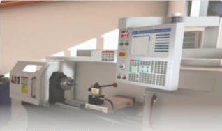
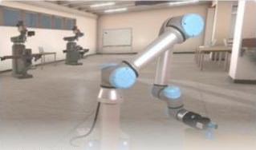
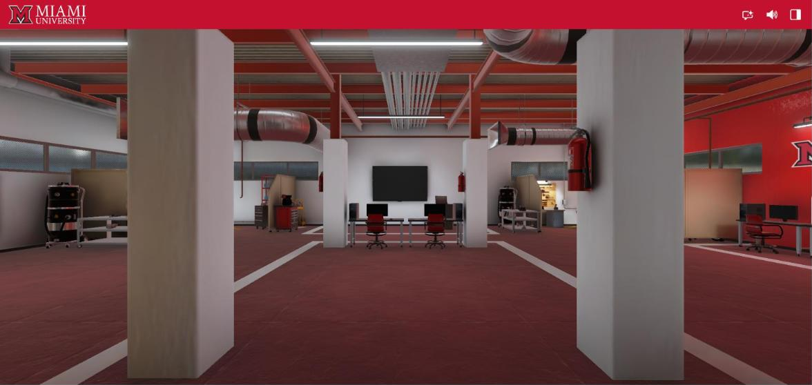
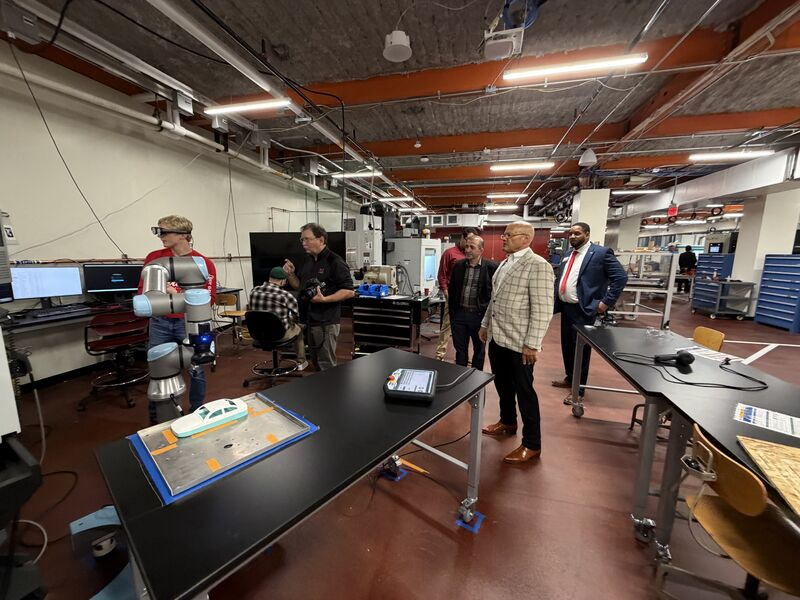
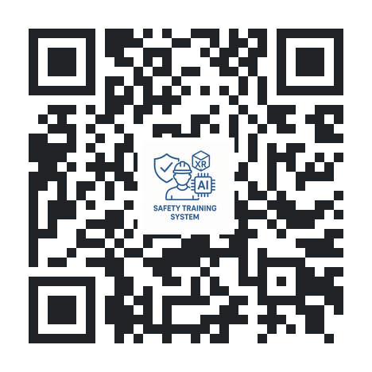
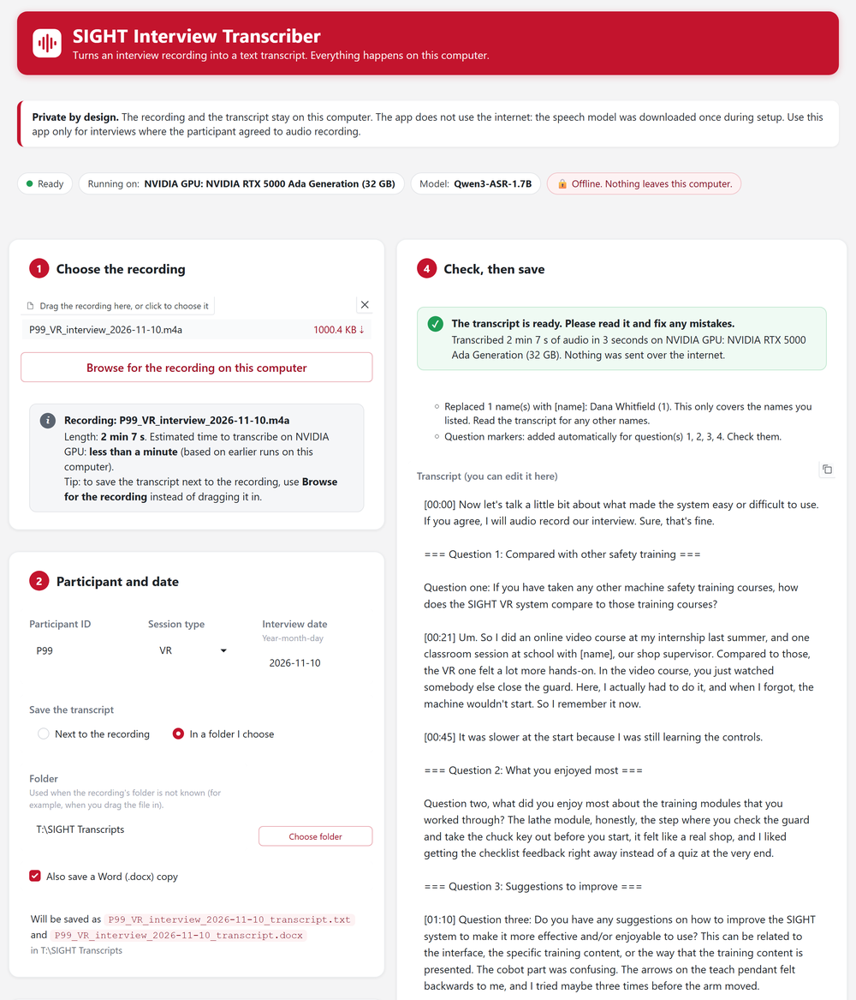

## Meeting Goals

```{=html}
<div class="agenda-bar">
  <div class="seg" style="flex:2;">1</div>
  <div class="seg" style="flex:10;">2</div>
  <div class="seg" style="flex:35;">3</div>
  <div class="seg" style="flex:5;">4</div>
  <div class="seg" style="flex:5;">5</div>
  <div class="seg" style="flex:3;">6</div>
</div>
<div class="agenda-grid g6">
  <div class="pop" style="--d:0"><div class="ag-n">1 <span>· 2 min</span></div><div class="ag-t">Minutes and action items</div><div class="ag-p">Fadel</div></div>
  <div class="pop" style="--d:1"><div class="ag-n">2 <span>· 10 min</span></div><div class="ag-t">Administrative updates</div><div class="ag-p">Fadel</div></div>
  <div class="pop" style="--d:2"><div class="ag-n">3 <span>· 35 min</span></div><div class="ag-t">The SIGHT IRB work and pre-pilot testing</div><div class="ag-p">Fadel, Austin, and Michael; outreach updates from Mohammad</div></div>
  <div class="pop" style="--d:3"><div class="ag-n">4 <span>· 5 min</span></div><div class="ag-t">Industry partner</div><div class="ag-p">Ram (MaxByte)</div></div>
  <div class="pop" style="--d:4"><div class="ag-n">5 <span>· 5 min</span></div><div class="ag-t">Risk log</div><div class="ag-p">All</div></div>
  <div class="pop" style="--d:5"><div class="ag-n">6 <span>· 3 min</span></div><div class="ag-t">Wrap-up</div><div class="ag-p">Action items, next steps</div></div>
</div>
<div class="callout-red pop" style="--d:7; font-size:0.62em; margin-top:1.1em;"><strong>New to the study?</strong> Part 3 starts from the beginning: what we test, who takes part, what one session looks like, and where the data goes.</div>
```


## Recap: What We Covered in Meeting 28 (Oct 30)

::: {style="font-size: 0.66em;"}

::: {.columns}

::: {.column width="50%"}

[**Administrative / BWC**]{style="color:#c3142d;"}

- BWC **approved the Q5 report** and the October 22 grant meeting; the September/October documents are pending.
- **Track 3 abstract** (two pages) is due **Nov 16, 5 PM ET**.
- Everyone on the grant completes **COI training and the FCOI form**; new hires complete **CITI** first.
- Receipts go in the PCard folder when requested; emails are written in **your own voice**.

:::

::: {.column width="50%"}

[**The experimental plan**]{style="color:#c3142d;"}

- Participants train in **VR first, then AR** (the Sept 11 decision), with **one participant ID** across both.
- **One assessment module per machine**; sessions of **about 2 hours**; **$75 per session**.
- Recruit **40** so that **36** complete both sessions.
- Participation must be **voluntary**: never part of a course grade.
- The lab monitors (24-inch) differ from the **27-inch** monitors in the IRB.

:::

:::

[**Minutes:** the Meeting 28 minutes are up for approval today; the full text is in the appendix.]{style="color:#3E5468;"}

:::


## Action Items from Meeting 28

```{=html}
<table class="mu-table" style="font-size:0.54em; table-layout:fixed;">
<thead><tr><th style="width:21%;">Responsible Party</th><th style="width:40%;">Action Item</th><th style="width:13%;">Due Date</th><th style="width:26%;">Status</th></tr></thead>
<tbody>
<tr><td><strong>Jay</strong></td><td>Coordinate and submit the IRB amendment</td><td>Nov 6</td><td><input type="checkbox" data-key="ai-irb"> Revisions drafted Nov 10 (Part 3)</td></tr>
<tr><td><strong>Usman / Om</strong></td><td>CITI training; certificates to Jay</td><td>Nov 1</td><td><input type="checkbox" data-key="ai-citi"></td></tr>
<tr><td><strong>All team members</strong></td><td>COI training and the FCOI form</td><td>ASAP</td><td><input type="checkbox" data-key="ai-coi"> Checklist in Part 2</td></tr>
<tr><td><strong>Austin / Arthur</strong></td><td>AR sign-in through Firebase; one participant ID across VR and AR</td><td>Before pre-pilots</td><td><input type="checkbox" data-key="ai-id"></td></tr>
<tr><td><strong>Fadel / Arthur / Lora</strong></td><td>AR assessments; do the AR machines operate?</td><td>Before pre-pilots</td><td><input type="checkbox" data-key="ai-ar"> No AR assessment (TAM and interview only); only the mill is non-operational; lathe and cobot run with safeguards (proposed to the IRB)</td></tr>
<tr><td><strong>Jay</strong></td><td>Monitor size: change the IRB or get monitors</td><td>With the amendment</td><td><input type="checkbox" data-key="ai-mon"></td></tr>
<tr><td><strong>Mohammad</strong></td><td>Reply to the ENT 252 instructor: voluntary, never graded</td><td>Nov 2</td><td><input type="checkbox" data-key="ai-ent"></td></tr>
<tr><td><strong>Fadel</strong></td><td>Submit the Track 3 abstract</td><td>Nov 16</td><td><input type="checkbox" data-key="ai-track3"></td></tr>
<tr><td><strong>Mohammad</strong></td><td>MaxByte items; the Makino visit</td><td>ASAP</td><td><input type="checkbox" data-key="ai-mayyas"></td></tr>
<tr><td><strong>MU team</strong></td><td>Start pre-pilot testing</td><td>By Nov 13</td><td><input type="checkbox" data-key="ai-pp"> First session: <strong>Fri, Nov 20</strong></td></tr>
</tbody>
</table>
```


# Administrative Updates {.center .inverse}

Fadel Megahed and Mohammad Mayyas


## Status of BWC Deliverables and Requirements

<div style="font-size: 0.68em;">

- [**Approved by BWC:**]{style="color:#2e7d32;"} the Q5 quarterly report (D7.4) and the October 22 quarterly grant meeting (D3.4).
- [**Pending BWC review:**]{style="color:#8a6d00;"} the September/October meeting documents (D2.9). BWC reviews them after every team submits.
- [**Next:**]{style="color:#c3142d;"} the two-page **Track 3 abstract**, due **Monday, Nov 16, 5 PM ET**.

</div>

```{=html}
<table class="mu-table bwc" style="font-size:0.54em; margin-top:0.35em;">
<thead><tr><th style="width:11%;">Deliverable</th><th>Description</th><th style="width:19%;">Due</th><th style="width:17%; text-align:center;">Status</th></tr></thead>
<tbody>
<tr><td>7.4</td><td>Quarterly progress report, Quarter 5</td><td>Oct 9, 2026</td><td style="text-align:center;"><span class="pill pill-green">Approved</span></td></tr>
<tr><td>3.4</td><td>Quarterly grant meeting (PI and PM attended Oct 22)</td><td>Oct 23, 2026</td><td style="text-align:center;"><span class="pill pill-green">Approved</span></td></tr>
<tr><td>2.9</td><td>September/October project team meeting documents</td><td>Nov 13, 2026</td><td style="text-align:center;"><span class="pill pill-gold">Pending review</span></td></tr>
<tr><td>Track 3</td><td>Two-page abstract</td><td>Nov 16, 2026, 5 PM ET</td><td style="text-align:center;"><span class="pill pill-red">Due in 3 days</span></td></tr>
<tr><td>2.10</td><td>November/December project team meeting documents</td><td>Jan 15, 2027</td><td style="text-align:center;"><span class="pill pill-blue">Scheduled</span></td></tr>
<tr><td>7.5</td><td>Quarterly progress report, Quarter 6</td><td>Jan 15, 2027</td><td style="text-align:center;"><span class="pill pill-blue">Scheduled</span></td></tr>
</tbody>
</table>
```


## Trainings: CITI to Run Sessions; COI and FCOI for the Grant

```{=html}
<div class="tr3">
  <div class="trc gate pop" style="--d:0">
    <div class="req-i">&#127891;</div>
    <div class="req-h">CITI human subjects</div>
    <div class="req-t"><b>Needed to run sessions.</b> Without it, a team member is not listed on the IRB and does not run sessions. The study still runs with the others. New hires send the certificate to Jay.</div>
    <a class="go-btn" href="https://miamioh.edu/research-innovation/departments-offices/research-compliance/human-subjects/training.html" target="_blank" rel="noopener">Miami's instructions</a>
  </div>
  <div class="trc pop" style="--d:1">
    <div class="req-i" style="background:#3E5468;">&#9878;&#65039;</div>
    <div class="req-h">COI training</div>
    <div class="req-t"><b>A grant requirement</b> for everyone on the grant, including undergraduates (CITI COI: Public Health Service course). Not needed to run a session.</div>
    <a class="go-btn" href="https://miamioh.edu/research-innovation/departments-offices/research-compliance/financial-conflicts.html" target="_blank" rel="noopener">Miami's guidance</a>
  </div>
  <div class="trc pop" style="--d:2">
    <div class="req-i" style="background:#3E5468;">&#128221;</div>
    <div class="req-h">FCOI form</div>
    <div class="req-t"><b>A grant requirement</b>, completed after the COI training: at least once a year, and whenever something new comes up.</div>
    <a class="go-btn" href="https://docs.google.com/forms/d/e/1FAIpQLSf1QDG3jZprSQt2uBu152tPtiUBSWitN375k2tjgEr5s73kmg/viewform" target="_blank" rel="noopener">Open the form</a>
  </div>
</div>
<table class="trm byrole pop" style="--d:4">
<thead><tr class="grp"><th></th><th colspan="4" class="pi">PIs</th><th colspan="2" class="gra">GRAs</th><th colspan="2" class="ura">URAs</th></tr><tr><th></th><th class="pi">Fadel<br>Megahed</th><th class="pi">Arthur<br>Carvalho</th><th class="pi">Mohammad<br>Mayyas</th><th class="pi">Jay<br>Shan</th><th class="gra">Austin<br>Hamilton</th><th class="gra">Michael<br>Wise</th><th class="ura">Om<br>Raval</th><th class="ura">Usman<br>Asif</th></tr></thead>
<tbody>
<tr class="gate"><th>CITI</th><td class="pi"><input type="checkbox" data-key="tr-fm-citi"></td><td class="pi"><input type="checkbox" data-key="tr-ac-citi"></td><td class="pi"><input type="checkbox" data-key="tr-mm-citi"></td><td class="pi"><input type="checkbox" data-key="tr-js-citi"></td><td class="gra"><input type="checkbox" data-key="tr-ah-citi"></td><td class="gra"><input type="checkbox" data-key="tr-mw-citi"></td><td class="ura"><input type="checkbox" data-key="tr-or-citi"></td><td class="ura"><input type="checkbox" data-key="tr-ua-citi"></td></tr>
<tr class=""><th>COI</th><td class="pi"><input type="checkbox" data-key="tr-fm-coi"></td><td class="pi"><input type="checkbox" data-key="tr-ac-coi"></td><td class="pi"><input type="checkbox" data-key="tr-mm-coi"></td><td class="pi"><input type="checkbox" data-key="tr-js-coi"></td><td class="gra"><input type="checkbox" data-key="tr-ah-coi"></td><td class="gra"><input type="checkbox" data-key="tr-mw-coi"></td><td class="ura"><input type="checkbox" data-key="tr-or-coi"></td><td class="ura"><input type="checkbox" data-key="tr-ua-coi"></td></tr>
<tr class=""><th>FCOI</th><td class="pi"><input type="checkbox" data-key="tr-fm-fcoi"></td><td class="pi"><input type="checkbox" data-key="tr-ac-fcoi"></td><td class="pi"><input type="checkbox" data-key="tr-mm-fcoi"></td><td class="pi"><input type="checkbox" data-key="tr-js-fcoi"></td><td class="gra"><input type="checkbox" data-key="tr-ah-fcoi"></td><td class="gra"><input type="checkbox" data-key="tr-mw-fcoi"></td><td class="ura"><input type="checkbox" data-key="tr-or-fcoi"></td><td class="ura"><input type="checkbox" data-key="tr-ua-fcoi"></td></tr>
</tbody>
</table>
```


## Team Assignment: Om and Usman Work with Jay and Michael

```{=html}
<div class="team4">
  <div class="tgroup pop" style="--d:0">
    <div class="tg-h">Point people</div>
    <div class="tg-row">
      <div class="person"><b>Jay Shan</b><span>Co-PI · leads the IRB amendment<br>SIGHT Test Hub admin</span></div>
      <div class="person"><b>Michael Wise</b><span>Graduate research assistant<br>AR materials; backs up the lathe and cobot</span></div>
    </div>
  </div>
  <div class="link pop" style="--d:1">&#8644;</div>
  <div class="tgroup pop" style="--d:2">
    <div class="tg-h">New research assistants</div>
    <div class="tg-row">
      <div class="person"><div class="avatar ura">OR</div><b>Om Raval</b><span>Student researcher<br>AM Hub subteam</span></div>
      <div class="person"><div class="avatar ura">UA</div><b>Usman Asif</b><span>Student researcher, AM Hub subteam<br>About nine years in occupational safety</span></div>
    </div>
  </div>
</div>
<div class="path5">
  <div class="chev pop" style="--d:4"><b>1 · CITI</b><span>Certificates to Jay</span></div>
  <div class="chev pop" style="--d:5"><b>2 · IRB listing</b><span>Added in the amendment</span></div>
  <div class="chev pop" style="--d:6"><b>3 · Get ready</b><span>Hub access, training videos, the VR packet</span></div>
  <div class="chev pop" style="--d:7"><b>4 · P99 dry run</b><span>By Nov 18</span></div>
  <div class="chev hot pop" style="--d:8"><b>5 · First pre-pilot</b><span>Fri, Nov 20, run together</span></div>
</div>
<div class="note pop" style="--d:9; margin-top:16px; font-size:0.58em;">Jay and Michael are the point people for both new research assistants until the first sessions run smoothly.</div>
```


# The SIGHT IRB Work and Pre-Pilot Testing {.center .inverse}

Fadel Megahed, with Austin Hamilton and Michael Wise<br>Starting from the beginning, for anyone new to the study


## What We Are Testing

```{=html}
<div class="what-q pop" style="--d:0">SIGHT trains people to work safely on real machines. In this study, <em>people try both of our training tools</em> and tell us how useful and easy they are.</div>
<div class="what-grid">
  <div>
    <div class="what-h pop" style="--d:1">Three machines in the AM Hub</div>
    <div class="mach3">
      <figure class="pop" style="--d:2"><figcaption>CNC lathe<span>Haas TL-1</span></figcaption></figure>
      <figure class="pop" style="--d:3"><figcaption>Manual mill<span>Bridgeport-style</span></figcaption></figure>
      <figure class="pop" style="--d:4"><figcaption>Cobot<span>UR5e collaborative robot</span></figcaption></figure>
    </div>
  </div>
  <div>
    <div class="what-h pop" style="--d:5">Two ways to train</div>
    <div class="ways">
      <figure class="pop" style="--d:6"><figcaption>VR: a virtual lab<span>sightvr.org, on a monitor with a mouse and keyboard</span></figcaption></figure>
      <figure class="pop" style="--d:7"><figcaption>AR: guidance at the real machine<span>Magic Leap 2 headset</span></figcaption></figure>
    </div>
  </div>
</div>
<div class="measure">
  <div class="pop" style="--d:8"><b>Before</b>Demographics, a job hazard analysis quiz, attitudes toward technology</div>
  <div class="pop" style="--d:9"><b>During</b>What each person reaches, where they need help, and how long it takes</div>
  <div class="pop" style="--d:10"><b>After</b>One assessment module per machine (VR session)</div>
  <div class="pop" style="--d:11"><b>Their view</b>Usefulness and ease of use (TAM), and a short interview</div>
</div>
```


## Who Takes Part, and How Often

::: {.kicker}
Adults (18 or older) from Miami and from Ohio manufacturers. Joining is **voluntary**, and anyone can stop at any time. Everyone does **VR first, then AR** (decided Sept 11; the reasons are in the appendix).
:::

```{=html}
<div class="cohort-wrap" data-stepper>
  <div class="cohort" data-n="40" data-drop="4"></div>
  <div class="c-side">
    <div class="c-row"><div class="c-n">40</div><div class="c-t"><b>people recruited</b>the number promised to BWC</div></div>
    <div class="c-row drop fragment stepper-show" data-stepper-frag><div class="c-n">&minus;4</div><div class="c-t"><b>expected to drop out</b>about 10%, typical for a two-session study (Lora)</div></div>
    <div class="c-row done fragment" data-stepper-frag><div class="c-n">36</div><div class="c-t"><b>complete both sessions</b>BWC's success metric (90%). If more drop out, we keep recruiting.</div></div>
  </div>
</div>
<div class="two-sess fragment" data-stepper-frag>
  <div class="ts ts-vr"><b>Session 1 · VR</b>sightvr.org on a monitor · about 2 hours<span class="usd">$75</span></div>
  <div class="ts-gap">about 1 week</div>
  <div class="ts ts-ar"><b>Session 2 · AR</b>Headset at the real machines · about 2 hours<span class="usd">$75</span></div>
</div>
```


## One VR Session, as It Happens



```{=html}
<div class="sim-note"><b>Simulated data</b> P99 is a made-up participant; every answer, time, and mark on these forms is invented for this walkthrough.</div>
```


## One AR Session, as It Happens




## The AR Session: What We Will Propose to the IRB

```{=html}
<div class="decided pop" style="--d:0; font-size:0.66em;">&#10003; Agreed Nov 12: the mill's spindle stays <u>off</u>; the CNC lathe and the cobot run behind their own safeguards. The amendment explains why this stays low risk.</div>
<div class="arplan">
  <div class="arm pop" style="--d:1"><span class="mchip m-mill">Manual mill</span><div class="arm-h">Circuit breaker off</div>
    <div class="arm-t">The spindle cannot run, so the mill is <b>non-operational</b>, as the IRB approved. Participants still move the table and turn the handwheels and spindle handles, for the tactile feel of each step.</div></div>
  <div class="arm pop" style="--d:2"><span class="mchip m-lathe">CNC lathe</span><div class="arm-h">Runs behind its door</div>
    <div class="arm-t">The lathe runs, always behind its closed door (guard), which encloses the cut. There is <b>no risk of injury different from everyday activity</b>.</div></div>
  <div class="arm pop" style="--d:3"><span class="mchip m-cobot">Cobot</span><div class="arm-h">Runs slowly, with layers of protection</div>
    <div class="arm-t">It runs at <b>reduced speed</b>. The AR shows a <b>zone the participant must not enter</b> (the robot's hit area), and its <b>collision sensors</b> stop it on contact, which prevents crushing injuries.</div></div>
</div>
<div class="two" style="grid-template-columns:1fr 1.1fr; gap:26px; margin-top:16px;">
  <div class="pop" style="--d:4; font-size:0.56em; line-height:1.42;"><b style="color:#c3142d;">Why the IRB needs to hear this:</b> the approved protocol has participants engage with non-operational machines, and the IRB was concerned about the risk of injury. The amendment names the checks before every AR session: breaker off and the spindle confirmed not to start, the lathe door closed, the cobot set to reduced speed with collision detection on and the zone shown in AR, and a trained team member at the emergency stops.</div>
  <div class="pop" style="--d:5">
    <div class="lead-q" style="font-size:0.62em;">November 12: Fadel, Austin, and Michael finalized the AR materials</div>
    <div class="can-edit" data-key="ar-final" contenteditable="true" style="min-height:5.5em; font-size:0.56em;" data-placeholder="What we finalized: the modules for each machine, the AR packet, the sign-in (no AR assessment: the TAM and the interview)"></div>
  </div>
</div>
```


## What Changes in the Consent Form

::: {.kicker}
Proposed revision, **pending IRB approval**. Jay submits it with the amendment.
:::

```{=html}
<div class="chg-grid">
  <div class="cc pop" style="--d:0"><div class="ic">&#9201;&#65039;</div><h5>Session length</h5><div class="was">About 90 minutes</div><div class="now">About <b>2 hours</b></div></div>
  <div class="cc pop" style="--d:1"><div class="ic">&#128179;</div><h5>Compensation</h5><div class="was">Not in the form</div><div class="now"><b>$75 Visa gift card</b> at the end of each session</div></div>
  <div class="cc pop" style="--d:2"><div class="ic">&#128221;</div><h5>After the training</h5><div class="was">A feedback questionnaire</div><div class="now"><b>One assessment per machine</b> (VR only), the questionnaire, and an <b>interview</b></div></div>
  <div class="cc new pop" style="--d:3"><div class="ic">&#129302;</div><h5>Reading the forms</h5><div class="now">Scanned to a private study website. <b>OpenAI helps read handwriting</b> and find themes in de-identified text; a person checks.</div></div>
  <div class="cc new pop" style="--d:4"><div class="ic">&#127897;&#65039;</div><h5>Interview audio</h5><div class="now">Recorded <b>only if the participant ticks "I agree"</b>; transcribed <b>on the SIGHT workstation</b> by a local, open-source model; deleted as soon as the RA verifies the transcript</div></div>
  <div class="cc pop" style="--d:5"><div class="ic">&#128451;&#65039;</div><h5>Storage</h5><div class="was">For the duration of the project</div><div class="now">At least <b>three years</b> after the study</div></div>
  <div class="cc pop" style="--d:6"><div class="ic">&#8617;&#65039;</div><h5>Withdrawal and results</h5><div class="now">Responses kept <b>unless the participant asks</b>; only <b>aggregate results</b> and unidentified quotes</div></div>
  <div class="cc pop" style="--d:7"><div class="ic">&#9986;&#65039;</div><h5>Removed and fixed</h5><div class="now">Nordic questionnaire <b>dropped</b>: two questionnaires, not three. Contact email <b>corrected</b> (maimioh to miamioh)</div></div>
</div>
<div class="keep pop" style="--d:9"><strong>To settle:</strong> the data-sharing paragraph (the draft removes it; Meeting 28 kept it). <strong>Unchanged:</strong> the 27-inch monitor (see the risk log) · two pages. <strong>New for AR:</strong> see the previous slide.</div>
```


## What Changes in the Protocol

```{=html}
<div class="proto">
  <div class="pop" style="--d:0">
    <div class="lead-q" style="font-size:0.68em;">Where every file goes (Google Drive)</div>
<div class="tree"><span class="d">SIGHT Pilot Testing/</span>
├─ <span class="d">Signed Consent Forms/</span>  <span class="c">names, never an ID</span>
│   └─ <span class="x">Consent_2026-11-10.pdf</span>
└─ <span class="d">P99/</span>  <span class="c">one folder per participant</span>
    ├─ <span class="d">VR/</span>
    │   ├─ <span class="f">P99_VR_packet_2026-11-10.pdf</span>
    │   └─ <span class="f">P99_VR_interview_2026-11-10_transcript.txt</span>
    │        <span class="c">only with consent; the audio never goes to Drive</span>
    └─ <span class="d">AR/</span>  <span class="c">about one week later</span></div>
    <div class="note" style="margin-top:8px; font-size:0.5em;">The paper consent form stays in the project's locked storage.</div>
  </div>
  <div class="plist">
    <div class="pop" style="--d:1"><i>&#9997;&#65039;</i><span><b>Consent step:</b> check the audio choice before the interview; never write the ID on the consent form.</span></div>
    <div class="pop" style="--d:2"><i>&#128290;</i><span><b>IDs and file names:</b> P1 to P42, with the names shown on the left.</span></div>
    <div class="pop" style="--d:3"><i>&#128196;</i><span><b>Questionnaires:</b> on paper in the packet, not online forms.</span></div>
    <div class="pop" style="--d:4"><i>&#127897;&#65039;</i><span><b>Interview:</b> not recorded, answers on the packet's interview pages; recorded, transcribed on the SIGHT workstation, and the recording deleted once the transcript is verified.</span></div>
    <div class="pop" style="--d:5"><i>&#128179;</i><span><b>Payment:</b> $75 per session, even if it ends early. Receipts stay with the consent forms.</span></div>
    <div class="pop" style="--d:6"><i>&#9203;</i><span><b>Close-out:</b> within 24 hours, archive in Drive, enter in the Hub, and a second person checks.</span></div>
    <div class="pop" style="--d:7"><i>&#128272;</i><span><b>8.0 Data Security</b><span class="badge">NEW</span> who can sign in, where each kind of data lives, the AI reading, and deletion at the end of the study.</span></div>
  </div>
</div>
<div class="lora pop" style="--d:9; font-size:0.54em; margin-top:12px; border-left:5px solid #2563A8; padding-left:12px;"><b style="color:#2563A8;">Lora's comments to settle:</b> "We were explicit about the 27&Prime; in the IRB protocol." &nbsp;·&nbsp; "We do say in the IRB that these would be done on paper."</div>
```


## Where Every Piece of Paper Goes

```{=html}
<div class="dp" data-stepper>
<svg viewBox="0 0 1000 350" role="img" aria-label="Data path: the session's paper splits. The consent form goes to locked storage and a separate Drive folder. The packet is scanned, archived in Drive, entered in the SIGHT Test Hub, checked by a second person, and downloaded by admins.">
  <defs>
    <g id="page"><rect x="-11" y="-14" width="22" height="28" rx="3" fill="#ffffff" stroke="#1f2326" stroke-width="2"/><line x1="-6" y1="-6" x2="6" y2="-6" stroke="#1f2326" stroke-width="2"/><line x1="-6" y1="0" x2="6" y2="0" stroke="#1f2326" stroke-width="2"/><line x1="-6" y1="6" x2="3" y2="6" stroke="#1f2326" stroke-width="2"/></g>
  </defs>
  <path id="dpTop" d="M70,175 C150,175 150,90 245,90 L935,90" fill="none" stroke="#c9c9c9" stroke-width="6" stroke-linecap="round"/>
  <path id="dpBot" d="M70,175 C150,175 150,262 245,262 L420,262" fill="none" stroke="#3E5468" stroke-width="6" stroke-dasharray="2 12" stroke-linecap="round"/>
  <g>
    <use href="#page"><animateMotion dur="7s" repeatCount="indefinite" begin="0s"><mpath href="#dpTop"/></animateMotion></use>
    <use href="#page"><animateMotion dur="7s" repeatCount="indefinite" begin="2.33s"><mpath href="#dpTop"/></animateMotion></use>
    <use href="#page"><animateMotion dur="7s" repeatCount="indefinite" begin="4.66s"><mpath href="#dpTop"/></animateMotion></use>
    <circle r="11" fill="#3E5468"><animateMotion dur="4s" repeatCount="indefinite" begin="1s"><mpath href="#dpBot"/></animateMotion></circle>
  </g>
  <g class="st" data-k="1" transform="translate(70,175)"><circle r="44"/><text class="em" text-anchor="middle" dominant-baseline="central">&#128194;</text><text class="lb" y="66" text-anchor="middle">One session</text><text class="sb" y="84" text-anchor="middle">paper for one ID</text></g>
  <g class="st" data-k="3" transform="translate(245,90)"><circle r="40"/><text class="em" text-anchor="middle" dominant-baseline="central">&#128424;&#65039;</text><text class="lb" y="62" text-anchor="middle">Scan</text><text class="sb" y="80" text-anchor="middle">one PDF, within 24 h</text></g>
  <g class="st" data-k="4" transform="translate(420,90)"><circle r="40"/><text class="em" text-anchor="middle" dominant-baseline="central">&#128193;</text><text class="lb" y="62" text-anchor="middle">Google Drive</text><text class="sb" y="80" text-anchor="middle">the archive</text></g>
  <g class="st" data-k="5" transform="translate(595,90)"><circle r="40"/><text class="em" text-anchor="middle" dominant-baseline="central">&#129302;</text><text class="lb" y="62" text-anchor="middle">SIGHT Test Hub</text><text class="sb" y="80" text-anchor="middle">AI reads, RA confirms</text></g>
  <g class="st ok" data-k="6" transform="translate(770,90)"><circle r="40"/><text class="em" text-anchor="middle" dominant-baseline="central">&#9989;</text><text class="lb" y="62" text-anchor="middle">Second check</text><text class="sb" y="80" text-anchor="middle">a different person</text></g>
  <g class="st ok" data-k="6" transform="translate(935,90)"><circle r="40"/><text class="em" text-anchor="middle" dominant-baseline="central">&#128202;</text><text class="lb" y="62" text-anchor="middle">Download</text><text class="sb" y="80" text-anchor="middle">admins only</text></g>
  <g class="st lock" data-k="2" transform="translate(245,262)"><circle r="40"/><text class="em" text-anchor="middle" dominant-baseline="central">&#128274;</text><text class="lb" y="62" text-anchor="middle">Locked storage</text><text class="sb" y="80" text-anchor="middle">the paper consent form</text></g>
  <g class="st lock" data-k="2" transform="translate(420,262)"><circle r="40"/><text class="em" text-anchor="middle" dominant-baseline="central">&#128450;&#65039;</text><text class="lb" y="62" text-anchor="middle">Signed Consent Forms</text><text class="sb" y="80" text-anchor="middle">its own Drive folder</text></g>
  <g transform="translate(700,262)"><rect x="-200" y="-34" width="400" height="68" rx="12" fill="#fff5f6" stroke="#c3142d" stroke-width="3"/><text x="0" y="-6" text-anchor="middle" style="font: bold 18px Lato, sans-serif; fill:#c3142d;">Consent forms never reach the Hub</text><text x="0" y="18" text-anchor="middle" style="font: 15px Lato, sans-serif; fill:#1f2326;">They carry names, so they never carry an ID.</text></g>
</svg>
<div class="dp-cap">
  <div class="on">Every session produces two kinds of paper. <strong>Click to follow each one.</strong></div>
  <div>One session: the participant forms and the RA packet, printed for one ID, plus a <strong>signed consent form</strong>.</div>
  <div>The consent form carries the participant's <strong>name</strong>. It goes to locked storage and is scanned into its own folder as <code>Consent_YYYY-MM-DD.pdf</code>.</div>
  <div>Within 24 hours, the forms and the RA packet are scanned together as <strong>one PDF</strong>: <code>P99_VR_packet_YYYY-MM-DD.pdf</code>.</div>
  <div>The PDF, and the interview transcript if recorded, go in <code>P99/VR</code> in the shared SIGHT Pilot Testing folder. Drive is the <strong>archive</strong>. The recording itself stays on the SIGHT workstation until the transcript is verified, then it is deleted.</div>
  <div>The RA uploads the same PDF to the <strong>SIGHT Test Hub</strong>. AI reads every page; the RA checks and confirms every field.</div>
  <div>A <strong>second person</strong> checks the session. Admins then download the scored data as Excel or CSV.</div>
</div>
</div>
<span class="fragment stepper"></span><span class="fragment stepper"></span><span class="fragment stepper"></span><span class="fragment stepper"></span><span class="fragment stepper"></span><span class="fragment stepper"></span>
```


## The SIGHT Test Hub in Five Steps

```{=html}
<div class="hub-what2">A private study website that turns each session's scanned paper into checked data: <b>18 pages per VR session</b>, every field confirmed by a named person. Nobody types answers into a spreadsheet. <span class="hw-n">Clips: the made-up test session P99, sped up.</span></div>
<div class="stage hubstage">
  <video controls muted loop playsinline preload="metadata" data-autoplay src="clips/hub_upload.mp4" poster="clips/hub_upload_poster.jpg"></video>
  <div>
    <button class="pick on" data-src="clips/hub_upload.mp4"><b>1. Upload the scan</b>The browser identifies every page, even out of order or upside down, and drops the consent page before anything is uploaded.</button>
    <button class="pick" data-src="clips/hub_review.mp4"><b>2. Review and confirm</b>Scan on the left, readings on the right, unsure fields first in yellow. The RA fixes, blacks out any name, and confirms.</button>
    <button class="pick" data-src="clips/hub_transcript.mp4"><b>3. The interview</b>With consent, the RA uploads the transcript made on the SIGHT workstation; the Hub fills in the four answers from its question markers. No audio reaches the Hub.</button>
    <button class="pick" data-src="clips/hub_check.mp4"><b>4. A second person checks</b>Someone who confirmed none of the pages marks the session checked.</button>
    <button class="pick" data-src="clips/hub_admin.mp4"><b>5. Admins</b>Add people, download Excel and CSV. A weekly backup goes to an admin-only Drive folder.</button>
  </div>
</div>
<div class="hub-strip">
  
  <div class="hs-a"><a href="https://sight-test-hub.vercel.app" target="_blank" rel="noopener">sight-test-hub.vercel.app</a><span>Sign in with your <b>Miami Google account</b>; you must also be on the Hub's <b>People</b> list.</span></div>
  <div class="hs-r"><b>Research assistants</b> upload, review, confirm, and check others' sessions; they never see scores or downloads, so they stay blind.</div>
  <div class="hs-r ad"><b>Admins (Fadel, Arthur, Jay)</b> also add people, unlock a confirmed page, and see scores and downloads.</div>
</div>
```


## Safeguards Built Into the Hub

```{=html}
<div class="safe">
  <div class="sg pop" style="--d:0"><div class="ic">&#128683;</div><b>Consent pages stay off</b><span>The browser finds and drops them before upload.</span></div>
  <div class="sg pop" style="--d:1"><div class="ic">&#11035;</div><b>Names are blacked out</b><span>On the image, and replaced by [name] in readings and transcripts.</span></div>
  <div class="sg pop" style="--d:2"><div class="ic">&#9989;</div><b>A person confirms every field</b><span>No model reading reaches a download without that.</span></div>
  <div class="sg pop" style="--d:3"><div class="ic">&#128101;</div><b>Two people per session</b><span>The checker confirmed none of its pages.</span></div>
  <div class="sg pop" style="--d:4"><div class="ic">&#128584;</div><b>RAs stay blind</b><span>No scores, charts, or downloads while data collection runs.</span></div>
  <div class="sg pop" style="--d:5"><div class="ic">&#127897;&#65039;</div><b>Audio stays local</b><span>Recorded only with consent, transcribed on the SIGHT workstation, deleted once the RA verifies the transcript. The Hub never gets audio.</span></div>
  <div class="sg pop" style="--d:6"><div class="ic">&#128274;</div><b>Not used for training</b><span>OpenAI's API, with storage off, reads handwriting and helps find themes in de-identified interview text. Per OpenAI, API data does not train its models.</span></div>
  <div class="sg pop" style="--d:7"><div class="ic">&#129534;</div><b>Every change is logged</b><span>Who changed what, and when. Weekly backup for admins.</span></div>
</div>
<div class="so-what pop" style="--d:9; font-size:0.62em;">At the end of the study, the Hub's database and images are deleted. The Drive archive is kept for at least three years after the study ends.</div>
```


## Interviews Are Transcribed on the SIGHT Workstation

::: {.kicker}
**Decided Nov 12.** With consent, the RA transcribes the interview **on the SIGHT workstation** with a local, open-source speech model, in an app the SIGHT team built. **No audio leaves the computer.**
:::

```{=html}
<div class="lt">
  <div class="lt-shot pop" style="--d:0"></div>
  <div>
    <div class="lt-lane yes pop" style="--d:1"><div class="lt-lh">&#9989; The participant ticks "I agree" to audio</div>
      <div class="lt-steps">
        <div><b>1</b>Record on the study recorder; copy it to the SIGHT workstation only</div>
        <div><b>2</b>Transcribe with the SIGHT Interview Transcriber; listed names become [name]</div>
        <div><b>3</b>Check it against the recording, then delete the recording right away</div>
        <div><b>4</b>Upload the .txt to the Hub (the four answers fill in) and to Drive; delete it from the computer</div>
      </div>
    </div>
    <div class="lt-lane no pop" style="--d:2"><div class="lt-lh">&#10006; The participant declines</div>
      <div class="lt-no">The RA writes the answers on the packet's interview pages. They are scanned and read with the other pages.</div>
    </div>
    <table class="lt-speed pop" style="--d:3">
      <thead><tr><th>A 10-minute interview on</th><th>Time</th></tr></thead>
      <tbody>
        <tr><td>A computer with an NVIDIA GPU (measured)</td><td><b>about 11 s</b></td></tr>
        <tr><td>CPU only, 4 cores (from the mock test)</td><td>about 6 min</td></tr>
        <tr><td>A typical laptop (estimate)</td><td>8 to 15 min</td></tr>
      </tbody>
    </table>
    <div class="lt-todo pop" style="--d:4"><b>Before the P99 dry run (Nov 18)</b>
      <ol>
        <li><b>The Hub:</b> live since Nov 12 with the transcript upload (no audio upload); test it with the mock interview.</li>
        <li><b>The SIGHT workstation:</b> install the app and transcribe the mock interview during the dry run.</li>
      </ol>
    </div>
  </div>
</div>
```


## What Was Said vs What the App Wrote




## The Road to the First Pre-Pilot

```{=html}
<div class="days">
  <div class="day done pop" style="--d:0"><div class="dd"><span>Tue</span><b>10</b><span>Nov</span></div><div class="dt">Consent form and protocol revised; VR assessments agreed (Fadel, Arthur); Hub live</div><span class="pill pill-green">Done</span></div>
  <div class="day done pop" style="--d:1"><div class="dd"><span>Thu</span><b>12</b><span>Nov</span></div><div class="dt">AR materials finalized (Fadel, Austin, Michael); Hub updated for transcripts and AR sessions</div><span class="pill pill-green">Done</span></div>
  <div class="day today pop" style="--d:2"><div class="dd"><span>Fri</span><b>13</b><span>Nov</span></div><div class="dt">Today: everyone learns the changes (Meeting 29)</div><span class="pill pill-red">Today</span></div>
  <div class="day pop" style="--d:3"><div class="dd"><span>Mon</span><b>16</b><span>Nov</span></div><div class="dt">Track 3 abstract to BWC, 5 PM ET</div><span class="pill pill-blue">BWC</span></div>
  <div class="day pop" style="--d:4"><div class="dd"><span>Wed</span><b>18</b><span>Nov</span></div><div class="dt">P99 dry run: scanner, Hub, timing, cost</div><span class="pill pill-gold">Due</span></div>
  <div class="day goal pop" style="--d:5"><div class="dd"><span>Fri</span><b>20</b><span>Nov</span></div><div class="dt">First pre-pilot session</div><span class="pill" style="background:#fff; color:#c3142d;">Goal</span></div>
</div>
<div class="two" style="gap:26px; margin-top:22px;">
  <div class="pop" style="--d:7; font-size:0.6em; line-height:1.45;"><strong style="color:#c3142d;">Decide today</strong><br>&#9312; The monitor size (27-inch in the IRB)<br>&#9313; Who, where, and what time on Nov 20<br>&#9314; Dates for the other five pre-pilot sessions<div style="margin-top:10px;"><strong style="color:#3E5468;">Rules</strong><br>Six pre-pilot sessions, all complete by <b>Dec 18</b>. Pre-pilot participants are team members, separate from the 40. No real participant is recorded until the IRB approves the revised form. Before the dry run, RAs watch the five training videos; the Hub checklist for the dry run is in the appendix.</div></div>
  <div class="can-edit pop" data-key="pp-logistics" contenteditable="true" style="--d:8; min-height:8.5em; font-size:0.58em;" data-placeholder="Nov 20: participant(s), RA, checker, room, time"></div>
</div>
```


## Outreach Updates: Recruiting Through a Course, and Makino

```{=html}
<div class="two" style="gap:30px; margin-top:0.2em;">
  <div class="mc pop" style="--d:0; font-size:0.62em;">
    <h4>Recruiting through a course (ENT 252)</h4>
    The instructor offered to help us reach students, which we appreciate. On Oct 30 the team agreed on how this can work: the instructor may tell students about the study and the $75 per session, and <strong>joining stays voluntary and separate from any grade</strong>.
    <div class="can-edit" data-key="ent252" contenteditable="true" style="min-height:5em;" data-placeholder="Update and next step"></div>
  </div>
  <div class="mc blue pop" style="--d:1; font-size:0.62em;">
    <h4>Makino</h4>
    Mohammad reached out to David Fox and the Makino team about a visit to present the VR modules and to explore commercialization pathways. The Miami workforce liaison leads the formal relationship.
    <div class="can-edit" data-key="makino" contenteditable="true" style="min-height:5em;" data-placeholder="Update and next step"></div>
  </div>
</div>
<div class="note pop" style="--d:3; margin-top:12px; font-size:0.54em;">Updates from Mohammad Mayyas.</div>
```


# Industry Partner Collaboration {.inverse .center}

MaxByte


## MaxByte: Recent Developments in the AM Hub

<div style="font-size: 0.85em; margin-bottom: 0.6em;">
[**Ram and the MaxByte team**]{style="color:#c3142d;"} are welcome to share their screen if they have slides on their current work in the AM Hub.
</div>

<div style="font-size: 0.72em;">**Live notes and questions:**</div>
<div class="can-edit" data-key="maxbyte-notes" contenteditable="true" style="min-height: 12em;" data-placeholder="Type live notes here; they persist in this browser."></div>


# Risk Mitigation and Wrap-Up {.inverse .center}

All Project Members


## Risk Mitigation and Log Updates

```{=html}
<table class="mu-table" style="font-size:0.54em;">
<thead><tr><th style="width:34%;">Risk</th><th>Mitigation</th><th style="width:14%; text-align:center;">Status</th></tr></thead>
<tbody>
<tr><td>The IRB does not yet cover what we plan to run</td><td>Consent form and protocol revisions are drafted; Jay submits one amendment.</td><td style="text-align:center;"><span class="pill pill-red">Open</span></td></tr>
<tr><td>Lab monitors (24-inch) differ from the IRB (27-inch)</td><td>Change the IRB in the same amendment, or get monitors.</td><td style="text-align:center;"><span class="pill pill-red">Open</span></td></tr>
<tr><td>AI reading of participant data; interview audio</td><td>No consent forms or names in the Hub; a person confirms every field. Interviews are transcribed on the SIGHT workstation; no audio leaves it.</td><td style="text-align:center;"><span class="pill pill-gold">In progress</span></td></tr>
<tr><td>Running the lathe and the cobot in AR</td><td>Mill breaker off; lathe door closed; cobot at reduced speed, with collision sensors and the AR no-go zone; proposed in the amendment.</td><td style="text-align:center;"><span class="pill pill-red">Open</span></td></tr>
<tr><td>New research assistants are not yet ready</td><td>Jay and Michael work with Om and Usman; training videos; the P99 dry run.</td><td style="text-align:center;"><span class="pill pill-gold">In progress</span></td></tr>
<tr><td>Students are unavailable after classes end on Dec 4</td><td>First pre-pilot Nov 20; recruit non-student participants too.</td><td style="text-align:center;"><span class="pill pill-red">Open</span></td></tr>
<tr><td>Recruitment pressure compromises voluntary consent</td><td>IRB-approved recruitment only; no grade depends on joining.</td><td style="text-align:center;"><span class="pill pill-gold">In progress</span></td></tr>
<tr><td>Only one person could run the AR system</td><td>Michael backs up the CNC lathe and cobot; Jay is certified on the mill.</td><td style="text-align:center;"><span class="pill pill-green">Mitigated</span></td></tr>
<tr><td>Magic Leap 2 is discontinued</td><td>Backup headset received and tested.</td><td style="text-align:center;"><span class="pill pill-green">Mitigated</span></td></tr>
<tr class="nr"><td class="edit-text" contenteditable="true" data-key="nr1-risk" data-placeholder="New risk"></td><td class="edit-text" contenteditable="true" data-key="nr1-mit" data-placeholder="Mitigation (owner)"></td><td class="edit-text" contenteditable="true" data-key="nr1-st" data-placeholder="Status" style="text-align:center;"></td></tr>
<tr class="nr"><td class="edit-text" contenteditable="true" data-key="nr2-risk" data-placeholder="New risk"></td><td class="edit-text" contenteditable="true" data-key="nr2-mit" data-placeholder="Mitigation (owner)"></td><td class="edit-text" contenteditable="true" data-key="nr2-st" data-placeholder="Status" style="text-align:center;"></td></tr>
<tr class="nr"><td class="edit-text" contenteditable="true" data-key="nr3-risk" data-placeholder="New risk"></td><td class="edit-text" contenteditable="true" data-key="nr3-mit" data-placeholder="Mitigation (owner)"></td><td class="edit-text" contenteditable="true" data-key="nr3-st" data-placeholder="Status" style="text-align:center;"></td></tr>
</tbody>
</table>
```

<div class="note" style="font-size:0.5em; margin-top:6px;">Click a blank row to add a new or evolving risk; entries stay in this browser.</div>


## Upcoming BWC Deadlines

```{=html}
<div class="tl tl-short">
  <div class="tl-line"></div>
  <div class="tl-month" style="left:28.6%;">Dec 1</div>
  <div class="tl-month" style="left:50.8%;">Dec 15</div>
  <div class="tl-month" style="left:77.8%;">Jan 1</div>
  <div class="tl-today" style="left:0%;"><span>Today<br>Nov 13</span></div>
  <div class="tl-item down" style="left:4.8%;"><div class="tl-stub"></div><div class="tl-dot"></div><div class="tl-label"><b>Nov 16</b>, 5 PM ET<br>Track 3 abstract<br><span class="pill pill-red">Next up</span></div></div>
  <div class="tl-item up" style="left:11.1%;"><div class="tl-stub"></div><div class="tl-dot" style="border-color:#585E60;"></div><div class="tl-label"><b>Nov 20</b><br>First pre-pilot session<br><span class="pill pill-gray">Project</span></div></div>
  <div class="tl-item down" style="left:33.3%;"><div class="tl-stub"></div><div class="tl-dot" style="border-color:#585E60;"></div><div class="tl-label"><b>Dec 4</b><br>Classes end; finals Dec 7 to 11<br><span class="pill pill-gray">Calendar</span></div></div>
  <div class="tl-item up" style="left:55.6%;"><div class="tl-stub"></div><div class="tl-dot"></div><div class="tl-label"><b>Dec 18</b><br>All six pre-pilot sessions complete<br><span class="pill pill-red">Due</span></div></div>
  <div class="tl-item up" style="left:100%;"><div class="tl-stub"></div><div class="tl-dot"></div><div class="tl-label"><b>Jan 15, 2027</b><br>Nov./Dec. meeting documents (D2.10) and the Q6 report (D7.5)<br><span class="pill pill-blue">Scheduled</span></div></div>
</div>
```

<div class="callout-red" style="font-size: 0.6em; margin-top:0;">
**Today's meeting is reported to BWC** with the November/December documents (D2.10), via OIA as separate files.
</div>

::: {style="text-align:center; font-size: 0.6em; margin-top:0.4em;"}
Contacts: Fadel Megahed (fmegahed@miamioh.edu) · Mohamed Farrag, PM (farragm2@miamioh.edu).
:::


## Action Items and Next Steps

<div style="font-size: 0.72em;">**Captured live (owner, item, due date):**</div>
<div class="can-edit" data-key="action-items" contenteditable="true" style="min-height: 11em; font-size: 0.9em;" data-placeholder="Owner: item (due date)"></div>

::: {style="font-size: 0.66em; margin-top: 0.6em;"}
- **Nov 16, 5 PM ET:** the Track 3 abstract goes to BWC.
- **By Nov 18:** the P99 dry run through the lab scanner and the SIGHT Test Hub.
- **Arthur (follow-up):** make SIGHT VR open each assessment at the assigned module (CNC Module 4, Mill Module 5, Cobot Module 2) instead of Module 1, before the first pre-pilot.
- **Fri, Nov 20:** the first pre-pilot session (Jay, Om, and Usman).
- **Dec 18:** all six pre-pilot sessions complete.
:::


# Appendix {.center .inverse}

Reference slides, not presented in the meeting


## Meeting 28 Minutes (October 30, 2026)




## Session Order: VR Before AR (Decided Sept 11)

::: {.kicker}
The original design (Meeting 25) assigned the order at random. In the **Sept 11 breakout**, the team chose **VR first for everyone**. Two reasons, in our own words:
:::

```{=html}
<div class="stage">
  <video controls preload="metadata" playsinline src="clips/sep11_untrain.mp4" poster="clips/sep11_untrain_poster.jpg"></video>
  <div>
    <button class="pick on" data-src="clips/sep11_untrain.mp4"><b>Training carries over</b>Lora: "once we train them once, they don't untrain." The second session always benefits from the first.</button>
    <button class="pick" data-src="clips/sep11_mill_risk.mp4"><b>The real machine comes second</b>Fadel: AR on the mill is "the most dangerous experiment that we will have." Seeing the machines in VR first lowers that risk.</button>
    <div class="callout-red" style="font-size:0.56em; margin-top:10px;">Within each session, the <strong>machine order</strong> rotates (see "Machine Order Within a Session").</div>
  </div>
</div>
```


## Machine Order Within a Session: Six Orders for 42 Participant IDs

::: {.kicker}
Each participant ID gets one of six orders, so that **each machine comes first for 14 of the 42 IDs**. The packet prints the order on its cover.
:::

```{=html}
<table class="orders">
<thead><tr><th>Order</th><th>First</th><th></th><th>Second</th><th></th><th>Third</th><th>Participant IDs</th></tr></thead>
<tbody>
<tr class="pop" style="--d:0"><td>1</td><td><span class="mchip m-mill">Mill</span></td><td class="arrow">&rarr;</td><td><span class="mchip m-lathe">CNC lathe</span></td><td class="arrow">&rarr;</td><td><span class="mchip m-cobot">Cobot</span></td><td>P1, P7, P13, P19, P25, P31, P37</td></tr>
<tr class="pop" style="--d:1"><td>2</td><td><span class="mchip m-mill">Mill</span></td><td class="arrow">&rarr;</td><td><span class="mchip m-cobot">Cobot</span></td><td class="arrow">&rarr;</td><td><span class="mchip m-lathe">CNC lathe</span></td><td>P2, P8, P14, P20, P26, P32, P38</td></tr>
<tr class="pop" style="--d:2"><td>3</td><td><span class="mchip m-lathe">CNC lathe</span></td><td class="arrow">&rarr;</td><td><span class="mchip m-mill">Mill</span></td><td class="arrow">&rarr;</td><td><span class="mchip m-cobot">Cobot</span></td><td>P3, P9, P15, P21, P27, P33, P39</td></tr>
<tr class="pop" style="--d:3"><td>4</td><td><span class="mchip m-lathe">CNC lathe</span></td><td class="arrow">&rarr;</td><td><span class="mchip m-cobot">Cobot</span></td><td class="arrow">&rarr;</td><td><span class="mchip m-mill">Mill</span></td><td>P4, P10, P16, P22, P28, P34, P40</td></tr>
<tr class="pop" style="--d:4"><td>5</td><td><span class="mchip m-cobot">Cobot</span></td><td class="arrow">&rarr;</td><td><span class="mchip m-mill">Mill</span></td><td class="arrow">&rarr;</td><td><span class="mchip m-lathe">CNC lathe</span></td><td>P5, P11, P17, P23, P29, P35, P41</td></tr>
<tr class="pop" style="--d:5"><td>6</td><td><span class="mchip m-cobot">Cobot</span></td><td class="arrow">&rarr;</td><td><span class="mchip m-lathe">CNC lathe</span></td><td class="arrow">&rarr;</td><td><span class="mchip m-mill">Mill</span></td><td>P6, P12, P18, P24, P30, P36, P42</td></tr>
</tbody>
</table>
<div class="note pop" style="--d:7; margin-top:8px; font-size:0.54em;">Rule: participant <em>n</em> uses order ((<em>n</em> &minus; 1) mod 6) + 1. The walkthrough "One VR Session, as It Happens" follows <strong>P99</strong>, our made-up test participant: ((99 &minus; 1) mod 6) + 1 = order 3 (CNC lathe, mill, cobot).</div>
```


## VR Session: Participant Forms (Blank, 10 Pages)

::: {.kicker}
What the **participant** fills in, blank: 10 pages. Scroll and zoom.
:::




## VR Session: Research Assistant Packet (Blank, 12 Pages)

::: {.kicker}
What the **research assistant** fills in, blank: 12 pages. Scroll and zoom. The study password is removed from this copy.
:::




## AR Session: Research Assistant Packet (Blank, 11 Pages)

::: {.kicker}
What the **research assistant** fills in at the real machines: 11 pages, with the machine checks, one observation sheet per machine, and the interview. The participant fills in only a cover and the TAM ([2 pages](SIGHT_AR_participant_forms_blank.pdf){target="_blank"}). No machine assessment in AR.
:::




## Consent Form: Proposed Revision for the IRB Amendment (Draft)




## SIGHT Interview Transcriber: Recorded Run on the Mock P99 Interview

```{=html}
<div class="tdemo" data-go="27.6" data-ready="35.2" data-finish="59.7" data-phase="wait">
  <div class="tdoc">
    <div class="tdoc-bar"><span class="tdoc-file">P99_VR_interview_2026-11-10_transcript.txt</span><span class="tdoc-tag">DRAFT</span></div>
    <div class="tdoc-state">
      <div class="tdoc-wave"><i></i><i></i><i></i><i></i><i></i><i></i><i></i><i></i><i></i></div>
      <div class="tdoc-msg">Waiting for the RA to click Transcribe</div>
      <div class="tdoc-bar2"><div></div></div>
    </div>
    <div class="tdoc-scroll">
      <div class="tdoc-head">
        <div><b>Participant ID</b> P99 &middot; <b>Session</b> VR &middot; <b>Interview</b> 2026-11-10 &middot; <b>Length</b> 1 min 56 s</div>
        <div><b>Transcribed</b> on this computer, with no internet use (Qwen3-ASR-1.7B, NVIDIA GPU)</div>
        <div><b>Names</b> 1 replaced with [name] &middot; <b>Question markers</b> 1, 2, 3, 4 &middot; <b>Checked by</b> ________</div>
      </div>
      <div class="tdoc-body"></div>
      <div class="tdoc-done"><b>Saved as .txt and .docx.</b> Next, the RA listens to the whole recording and fixes any mistakes, deletes the recording, uploads the .txt to the Hub and Drive, then deletes it from the computer.</div>
    </div>
  </div>
  <div>
    <video class="tdemo-vid" muted loop playsinline preload="auto" data-autoplay src="clips/transcriber_demo.mp4" poster="clips/transcriber_demo_poster.jpg"></video>
    <div class="tchips">
      <button data-t="2.8"><b>1</b>Choose the recording</button>
      <button data-t="12.4"><b>2</b>ID and date fill in</button>
      <button data-t="20.9"><b>3</b>List any names</button>
      <button data-t="26.7"><b>4</b>Transcribe</button>
      <button data-t="40.2"><b>5</b>Read and check</button>
      <button data-t="51.1"><b>6</b>Save</button>
    </div>
    <div class="note">A real run on a computer with an NVIDIA GPU, not sped up: 1 min 56 s of made-up audio (two ElevenLabs voices), transcribed in 6 seconds (a little over a minute on a 4-core CPU). Left: the file it saved, replayed slowly so it can be read.</div>
  </div>
  <script type="text/plain" class="tdemo-src">
[00:00] Now let's talk a little bit about what made the system easy or difficult to use. If you agree, I will audio record our interview. Sure, that's fine.

=== Question 1: Compared with other safety training ===

Question one: If you have taken any other machine safety training courses, how does the SIGHT VR system compare to those training courses? Um, so I did an online video course at my internship last summer.

[00:23] And one classroom session at school with [name], our shop supervisor, compared to those, the VR one felt a lot more hands-on. In the video course, you just watch somebody else close the guard. Here, I actually had to do it, and when I forgot, the machine wouldn't start. So I remember it now. It was slower at the start because I was still learning the controls.

=== Question 2: What you enjoyed most ===

[00:46] Question two, what did you enjoy most about the training modules that you worked through? The lathe module, honestly, the step where you check the guard and take the chuck key out before you start, it felt like a real shop, and I liked getting the checklist feedback right away instead of a quiz at the very end.

=== Question 3: Suggestions to improve ===

Question three, do you have any suggestions on how to improve the SIGHT system to make it more effective and or enjoyable to use?

[01:12] This can be related to the interface, the specific training content, or the way that the training content is presented. The cobot part was confusing. The arrows on the teach pendant felt backwards to me, and I tried maybe three times before the arm moved. A short demo video before that module would help a lot. Also, the speed setting step was hard to find. Maybe highlight it or put it first.

=== Question 4: What to keep ===

[01:37] Question four: Are there aspects of the SIGHT system that we make sure to keep in any future revisions? Keep the step-by-step checklist, and keep the part where the machine just won't run if you skip a safety step. That's what made it stick for me. Thank you. That's all of my questions.
  </script>
</div>
```


## Training Videos for Research Assistants

```{=html}
<div class="stage trainstage">
  <video controls preload="metadata" playsinline src="clips/train_overview.mp4" poster="clips/train_overview_poster.jpg"></video>
  <div>
    <button class="pick on" data-src="clips/train_overview.mp4"><b>1. The study and the data path · 7:30</b>The two sessions, the packets, consent first, the VR lab, the Hub, and privacy. Start here.</button>
    <button class="pick" data-src="clips/train_ra_vr_session.mp4"><b>2. Running a VR session · 4:51</b>The cover, the two-hour plan, scripts word for word, help levels, the interview, and the close-out.</button>
    <button class="pick" data-src="clips/train_hub_entering.mp4"><b>3. Entering a session in the Hub · 4:10</b>Upload, unsure fields, many blanks, two marks, blacking out names, the interview transcript, and the check.</button>
    <button class="pick" data-src="clips/train_hub_admin.mp4"><b>4. Admin tasks · 2:57</b>People and roles, downloads, removing a transcript, scores, the backup, and accuracy.</button>
    <button class="pick" data-src="clips/train_transcriber.mp4"><b>5. Transcribing an interview · 3:10</b>The SIGHT Interview Transcriber on the SIGHT workstation: the recording, the app, checking the words, and deleting the audio.</button>
  </div>
</div>
<div class="note" style="margin-top:8px; font-size:0.52em;">Narrated videos, built from the real packets and the Hub with the made-up test ID P99. The study password appears in no packet and no video; RAs get it on a separate printed login card that is never scanned.</div>
```


## P99 Dry Run: Hub Functions to Test Before November 20

::: {.kicker}
One made-up session (**P99**) through the lab scanner and the live Hub, **by Nov 18**. What should the Hub do?
:::

```{=html}
<table class="traps wide pop" style="--d:0">
  <thead><tr><th style="width:24%;">Function</th><th style="width:38%;">On the paper</th><th>The Hub should</th></tr></thead>
  <tbody>
    <tr><td>Blank-item warning</td><td>Leave 5 GATT items blank</td><td class="fragment">Warn about many blanks before the RA confirms</td></tr>
    <tr><td>Unsure answers</td><td>Circle two numbers on one TAM item</td><td class="fragment">Mark the item unsure and show it first</td></tr>
    <tr><td>Corrections</td><td>Cross out an answer and write a new one</td><td class="fragment">Read the new answer</td></tr>
    <tr><td>Names</td><td>Write a full name in the observation notes</td><td class="fragment">Write [name]; the RA blacks it out on the image</td></tr>
    <tr><td>Clock times</td><td>Write 2:05, 14:05, and 2.05 pm</td><td class="fragment">Read all three as times</td></tr>
    <tr><td>Page order</td><td>Shuffle pages and scan one upside down</td><td class="fragment">Identify every page and turn it upright</td></tr>
    <tr><td>Consent pages</td><td>Put a fake consent form in the scan</td><td class="fragment">Drop it in the browser; never upload it</td></tr>
    <tr><td>Interview transcript</td><td>Record a mock interview with a made-up name; transcribe it with the app</td><td class="fragment">Accept the .txt, fill the four answers from its markers, keep [name]</td></tr>
  </tbody>
</table>
```


## Review Questions on the Protocol Changes

::: {.kicker}
Answer out loud, then **click a card** to check.
:::

```{=html}
<div class="flip-grid">
  <div class="flip pop" style="--d:0"><div class="flip-in"><div class="flip-f">Where does the participant ID go on the consent form?<span>Click to check</span></div><div class="flip-b"><span><b>Nowhere.</b> The consent form and the packet must never be linkable.</span></div></div></div>
  <div class="flip pop" style="--d:1"><div class="flip-in"><div class="flip-f">Which pages go in the scan?<span>Click to check</span></div><div class="flip-b"><span><b>The participant forms and the RA packet</b>, as one PDF. Never the consent form.</span></div></div></div>
  <div class="flip pop" style="--d:2"><div class="flip-in"><div class="flip-f">When do we record the interview?<span>Click to check</span></div><div class="flip-b"><span><b>Only if the participant ticked "I agree"</b>, and only after the IRB approves the revised form.</span></div></div></div>
  <div class="flip pop" style="--d:3"><div class="flip-in"><div class="flip-f">What does a participant receive, and when?<span>Click to check</span></div><div class="flip-b"><span><b>A $75 Visa gift card</b> at the end of each session, even if it ended early.</span></div></div></div>
  <div class="flip pop" style="--d:4"><div class="flip-in"><div class="flip-f">Who can check a session in the Hub?<span>Click to check</span></div><div class="flip-b"><span><b>A team member who confirmed none of its pages.</b></span></div></div></div>
  <div class="flip pop" style="--d:5"><div class="flip-in"><div class="flip-f">How soon is a session entered?<span>Click to check</span></div><div class="flip-b"><span><b>Within 24 hours:</b> archive in Drive, then enter in the Hub.</span></div></div></div>
</div>
<div class="note" style="margin-top:12px; font-size:0.56em; text-align:center;">Anything unclear? Tell Jay, so the amendment and the packets answer it.</div>
```
