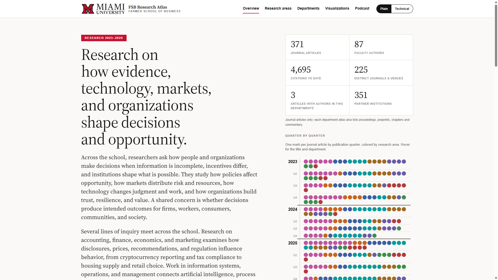
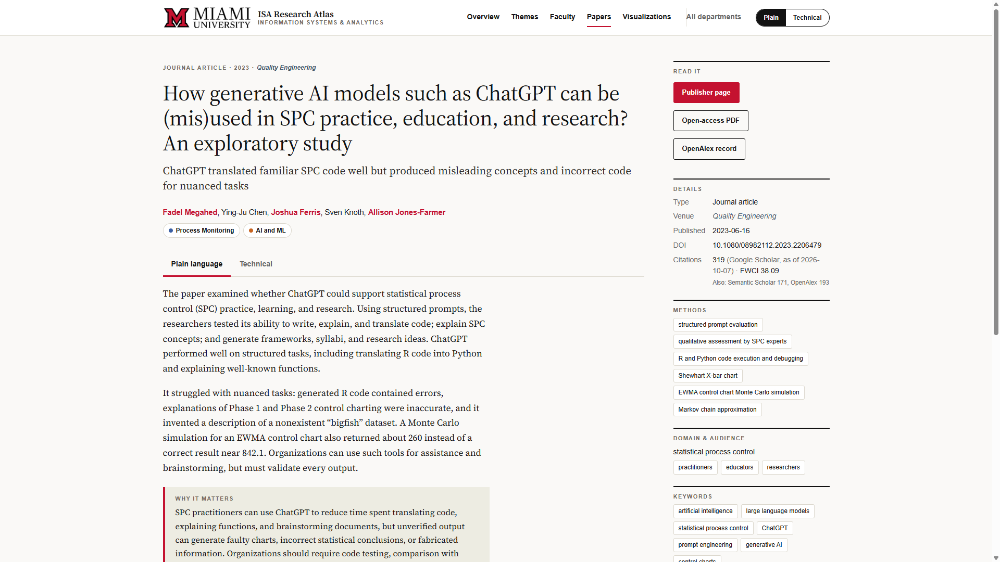
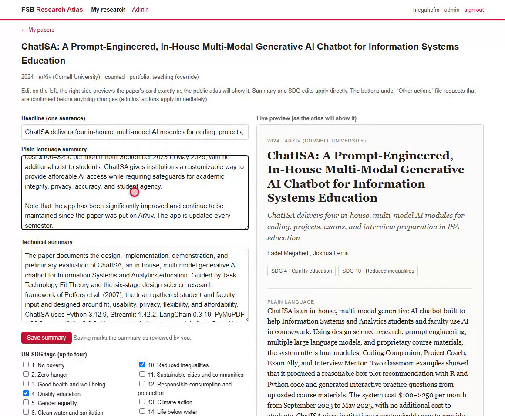
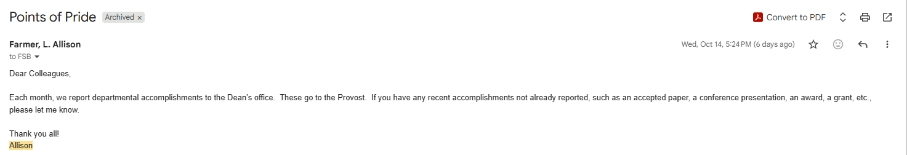
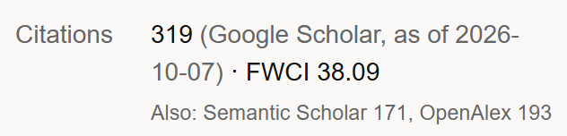
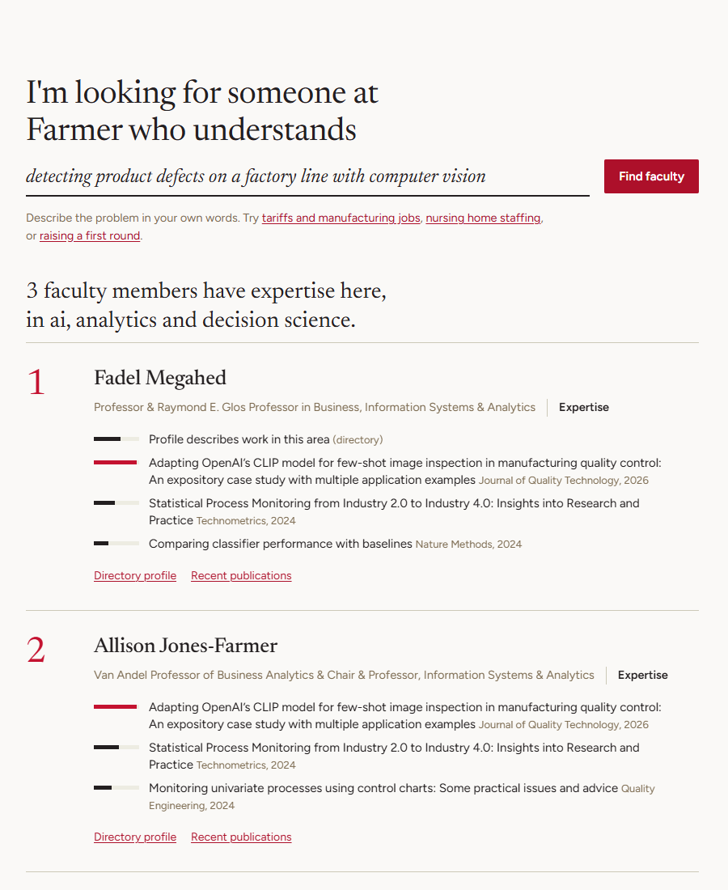

## {.title-red background-color="#c3142d" background-image="qr/qr_repo.png" background-size="10%" background-position="99% 95%"}

```{=html}
<div class="title-wrap">
  <div class="title-text">
    <div class="eyebrow">Guest talk · ISA 387: Designing Business Systems · Prof. Skip Benamati</div>
    <h1>The FSB Research Atlas</h1>
    <div class="sub">Designing a Business System with Claude Code</div>
    <div class="who">
      <b>Fadel M. Megahed</b><br>
      Farmer School of Business, Miami University<br>
      fmegahed@miamioh.edu · October 21, 2026<br><br>
      Source code: <a class="on-red" href="https://github.com/fmegahed/fsb-research-atlas">github.com/fmegahed/fsb-research-atlas</a>
    </div>
  </div>
  <div class="title-collage">
    
    
    
  </div>
</div>
```

::: notes
(0:30) Thank Skip. One sentence on who I am. Today: a real business system I designed and built over about a month with an AI coding agent, Claude Code. You will see the problem it solves, the product, its design, data and automation, how I built it, what it cost, and how to build on it. The QR code at the bottom right is the source code.
:::


## The Dilemma: One Record in Many Systems

```{=html}
<div class="dilemma">
  <svg class="hub" viewBox="0 0 720 560" role="img" aria-label="One accepted paper connected to seven systems that each hold a copy">
    <defs><marker id="hub-ah" viewBox="0 0 10 10" refX="9" refY="5" markerWidth="6" markerHeight="6" orient="auto"><path d="M0,0 L10,5 L0,10 z" fill="#c3142d"/></marker></defs>

    <g class="fragment" data-fragment-index="1">
      <path class="spoke" d="M360,280 L360,82"/>
      <path class="spoke" d="M360,280 L571,149"/>
      <path class="spoke" d="M360,280 L623,327"/>
      <path class="spoke" d="M360,280 L477,469"/>
      <path class="spoke" d="M360,280 L243,469"/>
      <path class="spoke" d="M360,280 L97,327"/>
      <path class="spoke auto" d="M360,280 L149,149"/>
      <circle r="5" class="packet"><animateMotion dur="2.2s" begin="0s" repeatCount="indefinite" path="M360,280 L360,82"/></circle>
      <circle r="5" class="packet"><animateMotion dur="2.2s" begin="0.3s" repeatCount="indefinite" path="M360,280 L571,149"/></circle>
      <circle r="5" class="packet"><animateMotion dur="2.2s" begin="0.6s" repeatCount="indefinite" path="M360,280 L623,327"/></circle>
      <circle r="5" class="packet"><animateMotion dur="2.2s" begin="0.9s" repeatCount="indefinite" path="M360,280 L477,469"/></circle>
      <circle r="5" class="packet"><animateMotion dur="2.2s" begin="1.2s" repeatCount="indefinite" path="M360,280 L243,469"/></circle>
      <circle r="5" class="packet"><animateMotion dur="2.2s" begin="1.5s" repeatCount="indefinite" path="M360,280 L97,327"/></circle>
      <circle r="5" class="packet auto"><animateMotion dur="2.2s" begin="1.8s" repeatCount="indefinite" path="M360,280 L149,149"/></circle>
    </g>

    <!-- the record -->
    <rect x="262" y="206" width="200" height="172" rx="16" fill="#faf9f7"/>
    <path d="M330,222 h46 l18,18 v80 h-64 z" fill="#fff" stroke="#c3142d" stroke-width="2.5"/>
    <path d="M376,222 v18 h18" fill="none" stroke="#c3142d" stroke-width="2.5"/>
    <path d="M340,258 h44 M340,272 h44 M340,286 h30" stroke="#ccc9b8" stroke-width="3" stroke-linecap="round"/>
    <text x="362" y="342" text-anchor="middle" class="lbl">One accepted paper</text>

    <!-- seven systems -->
    <g transform="translate(360,82)"><circle r="30" class="node-c"/><g class="glyph"><rect x="-11" y="-13" width="22" height="26" rx="3"/><path d="M-6,-5h12M-6,1h12M-6,7h8"/></g><text y="-58" text-anchor="middle" class="lbl">Sedona</text><text y="-42" text-anchor="middle" class="role">annual activity reports</text></g>
    <g transform="translate(571,149)"><circle r="30" class="node-c"/><g class="glyph"><rect x="-14" y="-10" width="28" height="20" rx="3"/><circle cx="-6" cy="-1" r="3.5"/><path d="M2,-3h7M2,3h7"/></g><text y="48" text-anchor="middle" class="lbl">Academ</text><text y="64" text-anchor="middle" class="role">faculty records</text></g>
    <g transform="translate(623,327)"><circle r="30" class="node-c"/><text y="9" text-anchor="middle" style="font-size:26px; font-weight:900; fill:#3e5468;">$</text><text y="48" text-anchor="middle" class="lbl">Cayuse</text><text y="64" text-anchor="middle" class="role">grants</text></g>
    <g transform="translate(477,469)"><circle r="30" class="node-c"/><g class="glyph"><rect x="-11" y="-11" width="22" height="22" rx="2"/><path d="M-11,-3.7h22M-11,3.7h22M-3.7,-11v22M3.7,-11v22"/></g><text y="48" text-anchor="middle" class="lbl">Google Sheets</text><text y="64" text-anchor="middle" class="role">department trackers</text></g>
    <g transform="translate(243,469)"><circle r="30" class="node-c"/><g class="glyph"><path d="M-9,-13h12l6,6v20h-18z M3,-13v6h6"/><path d="M-5,-1h10M-5,4h10"/></g><text y="48" text-anchor="middle" class="lbl">CVs</text><text y="64" text-anchor="middle" class="role">Word and PDF files</text></g>
    <g transform="translate(97,327)"><circle r="30" class="node-c"/><g class="glyph"><rect x="-13" y="-10" width="26" height="20" rx="2"/><path d="M-13,-4h26"/></g><text y="48" text-anchor="middle" class="lbl">Faculty websites</text><text y="64" text-anchor="middle" class="role">personal pages</text></g>
    <g transform="translate(149,149)"><circle r="30" class="node-c"/><g class="glyph"><path d="M-14,-3 L0,-10 L14,-3 L0,4 Z M-8,0 v6 q8,5 16,0 v-6"/></g><text y="48" text-anchor="middle" class="lbl">Google Scholar</text><text y="64" text-anchor="middle" class="role">adds papers itself or suggests</text><text y="80" text-anchor="middle" class="role">them, by profile setting</text></g>

    <g class="fragment drift" data-fragment-index="2">
      <g transform="translate(402,70)"><rect width="206" height="24" rx="12"/><text x="103" y="16.5" text-anchor="middle">entered before the final version</text></g>
      <g transform="translate(20,86)"><rect width="196" height="24" rx="12"/><text x="98" y="16.5" text-anchor="middle">preprint and article both listed</text></g>
      <g transform="translate(14,262)"><rect width="166" height="24" rx="12"/><text x="83" y="16.5" text-anchor="middle">still shows the preprint</text></g>
      <g transform="translate(516,410)"><rect width="110" height="24" rx="12"/><text x="55" y="16.5" text-anchor="middle">not added yet</text></g>
      <text x="362" y="364" text-anchor="middle" class="center-q">Which copy is current?</text>
    </g>
  </svg>

  <ul class="dl-points">
    <li class="always"><b>The same records live in many places.</b>Sedona, Academ, Cayuse, Google Sheets, CVs, faculty websites, and Google Scholar profiles each hold part of the picture.</li>
    <li class="fragment" data-fragment-index="1"><b>Every new item is entered again, in each one.</b>An accepted paper, a grant, or an award is typed into most of these systems by hand. Google Scholar adds papers itself or suggests them for approval, depending on the profile settings.</li>
    <li class="fragment" data-fragment-index="2"><b>Tracking becomes difficult.</b>Each copy is updated at a different time, so the copies disagree and nobody can say which one is current.</li>
  </ul>
</div>
```

::: notes
(1:15) This is the problem as faculty and administrators live it. Click 1: one accepted paper has to be entered in Sedona for the annual report, in Academ, in a department Google Sheet, on a CV, and on a personal website, and grants go through Cayuse. Google Scholar is different (blue line): depending on the profile settings, it adds papers automatically or suggests them and the faculty member accepts, which is also how a preprint and the article end up listed twice. Click 2: those copies drift apart, so tracking who did what becomes difficult. In ISA 387 terms: there is no single system of record.
:::


## The Dilemma: Requests and Accreditation

```{=html}
<div class="exhibit">
  
  <div class="cap">A request sent to faculty on October 14, 2026 (signature removed).</div>
</div>
<div class="req-grid">
  <div>
    <div class="subhead" style="margin-top:4px;">Every month</div>
    <svg class="chain" viewBox="0 0 560 150" role="img" aria-label="Accomplishments pass from faculty to the chair, the dean's office, and the provost every month">
      <defs><marker id="ch-ah" viewBox="0 0 10 10" refX="9" refY="5" markerWidth="7" markerHeight="7" orient="auto"><path d="M0,0 L10,5 L0,10 z" fill="#ccc9b8"/></marker></defs>
      <path class="arrow" d="M100,52 L168,52"/><path d="M-11,-6 L0,0 L-11,6 z" transform="translate(172,52)" fill="#ccc9b8"/>
      <path class="arrow" d="M248,52 L316,52"/><path d="M-11,-6 L0,0 L-11,6 z" transform="translate(320,52)" fill="#ccc9b8"/>
      <path class="arrow" d="M396,52 L464,52"/><path d="M-11,-6 L0,0 L-11,6 z" transform="translate(468,52)" fill="#ccc9b8"/>
      <g><rect class="env" x="-8" y="-6" width="16" height="12" rx="2"/><path d="M-8,-6 L0,1 L8,-6" fill="none" stroke="#c3142d" stroke-width="1.4"/><animateMotion dur="3.6s" repeatCount="indefinite" path="M100,52 L172,52 M248,52 L320,52 M396,52 L468,52"/></g>
      <g><rect class="env" x="-8" y="-6" width="16" height="12" rx="2"/><path d="M-8,-6 L0,1 L8,-6" fill="none" stroke="#c3142d" stroke-width="1.4"/><animateMotion dur="3.6s" begin="1.2s" repeatCount="indefinite" path="M100,52 L172,52 M248,52 L320,52 M396,52 L468,52"/></g>
      <g transform="translate(62,52)" class="person"><circle cy="-14" r="10"/><path d="M-20,22 q20,-34 40,0 z"/></g>
      <g transform="translate(210,52)" class="person"><circle cy="-14" r="10"/><path d="M-20,22 q20,-34 40,0 z"/></g>
      <g transform="translate(358,52)" class="person"><circle cy="-14" r="10"/><path d="M-20,22 q20,-34 40,0 z"/></g>
      <g transform="translate(506,52)" class="person"><circle cy="-14" r="10"/><path d="M-20,22 q20,-34 40,0 z"/></g>
      <text x="62" y="102" text-anchor="middle" class="who">Faculty</text>
      <text x="210" y="102" text-anchor="middle" class="who">Chair</text>
      <text x="358" y="102" text-anchor="middle" class="who">Dean's office</text>
      <text x="506" y="102" text-anchor="middle" class="who">Provost</text>
    </svg>
    <div class="fig-label">Each level collects the same accomplishments again and passes them up. Requests like this arrive on top of the regular reports.</div>
  </div>
  <div>
    <div class="subhead" style="margin-top:4px;">Every accreditation review (AACSB)</div>
    <div class="fig-label">Every intellectual contribution in the review window, by faculty member, type, and journal quality. For <b>2020 to 2025</b>: <b>856 works</b>.</div>
    <div class="stack"><div class="grow live" style="width:34.5%; background:#3b5fa3"></div><div class="grow live" style="width:62.6%; background:#c3142d"></div><div class="grow live" style="width:2.9%; background:#a08a15"></div></div>
    <div class="stack-legend"><span style="--c:#3b5fa3">Basic 295</span><span style="--c:#c3142d">Applied 536</span><span style="--c:#a08a15">Teaching 25</span></div>
    <div class="fig-label" style="margin-top:12px;"><b>122 of 145</b> tenure-line faculty published in the window.</div>
    <div class="waffle live" id="waffle"></div>
  </div>
</div>
<script>
  (() => { const w = document.getElementById('waffle'); if (!w || w.children.length) return;
    for (let i = 0; i < 145; i++) { const d = document.createElement('i'); if (i < 122) d.className = 'on'; d.style.setProperty('--i', i); w.appendChild(d); } })();
</script>
```

::: notes
(1:15) The second half of the dilemma. The email is real, from last week: each month, the chair collects accomplishments for the dean's office, which sends them to the provost. Each level collects the same items again. On top of that comes accreditation. For AACSB, the school reports every intellectual contribution for the review window, by person, by type, and by journal quality: 856 works for 2020 to 2025, with 122 of 145 tenure-line faculty publishing. Before the Atlas, that was assembled by hand. Transition: the Atlas collects these records once, lets faculty correct them, and gives every report the same numbers. Here it is in five minutes.
:::


## Overview Video

```{=html}
<div class="video-box">
  <video id="atlas-video" data-chapters controls preload="metadata" poster="video/poster.png">
    <source src="video/atlas_overview.mp4" type="video/mp4">
  </video>
  <div class="chapters" data-video="atlas-video">
    <button data-t="0"><b>0:00</b>Introduction</button>
    <button data-t="29"><b>0:29</b>Public atlas</button>
    <button data-t="115"><b>1:55</b>Numbers</button>
    <button data-t="129"><b>2:09</b>Faculty app</button>
    <button data-t="190"><b>3:10</b>Chairs</button>
    <button data-t="212"><b>3:32</b>Dean's office</button>
    <button data-t="274"><b>4:34</b>Governance</button>
    <button data-t="289"><b>4:49</b>Closing</button>
  </div>
  <div class="xsmall muted" style="margin-top:6px;">Recorded September 18, 2026. Some counts have changed since then after faculty review. Also on YouTube: <a href="https://youtu.be/73JrWLZGCwE">youtu.be/73JrWLZGCwE</a></div>
</div>
```

::: notes
(5:00) Click play. If running long, use the chapter links: skip from Chairs (3:10) to Governance (4:34). The video was produced from code too: Playwright recorded the screens, ElevenLabs voiced the script, and ffmpeg assembled it. The counts in the video are from Sep 18; the Lessons slide explains why they changed.
:::


## Key Numbers

```{=html}
<div class="kn">
  <div class="kn-col" style="--c:#c3142d">
    <div class="kn-h">The system</div>
    <div class="kn-sub">Public atlas, January 2023 to October 2026</div>
    <div class="kn-hero"><span class="v" data-to="614">614</span><span class="l">research works by Farmer School faculty, 371 of them journal articles</span></div>
    <div class="kn-grid">
      <div><span class="v" data-to="167">167</span><span class="l">active faculty</span></div>
      <div><span class="v" data-to="7">7</span><span class="l">departments</span></div>
      <div><span class="v" data-to="4695">4,695</span><span class="l">citations to those journal articles</span></div>
      <div><span class="v" data-to="44">44</span><span class="l">department themes in 8 school-wide areas</span></div>
    </div>
  </div>
  <div class="kn-col" style="--c:#3b5fa3">
    <div class="kn-h">The build</div>
    <div class="kn-sub">August 21 to September 22, 2026</div>
    <div class="kn-hero"><span class="v" data-to="14">14</span><span class="l">days with commits, working with Claude Code</span></div>
    <div class="kn-grid">
      <div><span class="v" data-to="245">245</span><span class="l">commits, 237 of them co-authored by Claude</span></div>
      <div><span class="v" data-to="21021">21,021</span><span class="l">lines of code</span></div>
      <div><span class="v" data-to="38">38</span><span class="l">automated test files</span></div>
      <div><span class="v" data-to="574">574</span><span class="l">AI paper summaries, each editable by its authors</span></div>
    </div>
  </div>
</div>
<div class="src">Sources: config/units/*/faculty.json, data/units/*/works.json, data/school/atlas.json, data/shared/summaries, and the git log of the repository at the October 7, 2026 refresh.</div>
```

::: notes
(0:45) Top row: the system's scope. Bottom row: what one person plus an AI agent produced in 14 working days. 237 of 245 commits carry "Co-Authored-By: Claude". The lines of code exclude data files.
:::


## System Architecture

```{=html}
<svg class="arch" viewBox="0 0 1200 500" role="img" aria-label="Architecture: data sources feed a monthly pipeline, which writes to a git repository; the repository feeds four outputs.">
  <defs>
    <marker id="ah" viewBox="0 0 10 10" refX="9" refY="5" markerWidth="7" markerHeight="7" orient="auto-start-reverse"><path d="M0,0 L10,5 L0,10 z" fill="#c3142d"/></marker>
    <marker id="ah-slate" viewBox="0 0 10 10" refX="9" refY="5" markerWidth="7" markerHeight="7" orient="auto-start-reverse"><path d="M0,0 L10,5 L0,10 z" fill="#3e5468"/></marker>
  </defs>
  <text class="col-h" x="10" y="22">SOURCES</text>
  <text class="col-h" x="330" y="22">PIPELINE</text>
  <text class="col-h" x="690" y="22">STORAGE</text>
  <text class="col-h" x="975" y="22">OUTPUTS</text>

  <g class="fragment" data-fragment-index="1">
    <circle class="dot" cx="18" cy="53" r="6"/><text class="t" x="34" y="58">OpenAlex</text><text class="s" x="34" y="76">works, authors, venues</text>
    <circle class="dot" cx="18" cy="115" r="6"/><text class="t" x="34" y="120">Semantic Scholar</text><text class="s" x="34" y="138">citations, abstracts</text>
    <circle class="dot" cx="18" cy="177" r="6"/><text class="t" x="34" y="182">Crossref</text><text class="s" x="34" y="200">DOIs, abstracts</text>
    <circle class="dot" cx="18" cy="239" r="6"/><text class="t" x="34" y="244">Google Scholar via SerpApi</text><text class="s" x="34" y="262">citation counts</text>
    <circle class="dot" cx="18" cy="301" r="6"/><text class="t" x="34" y="306">NSF and NIH</text><text class="s" x="34" y="324">federal grants</text>
    <circle class="dot" cx="18" cy="363" r="6"/><text class="t" x="34" y="368">Open-access PDFs</text><text class="s" x="34" y="386">full text for summaries</text>
    <circle class="dot" cx="18" cy="425" r="6"/><text class="t" x="34" y="430">Wayback Machine</text><text class="s" x="34" y="448">past faculty directories</text>
    <path class="flow" d="M250,60 C290,60 290,276 318,276"/>
    <path class="flow" d="M250,122 C290,122 290,276 318,276"/>
    <path class="flow" d="M250,184 C290,184 290,276 318,276"/>
    <path class="flow" d="M250,246 C290,246 290,276 318,276"/>
    <path class="flow" d="M250,308 C290,308 290,276 318,276"/>
    <path class="flow" d="M250,370 C290,370 290,276 318,276"/>
    <path class="flow" d="M250,432 C290,432 290,276 318,276"/><path class="ahd" d="M-11,-5.5 L0,0 L-11,5.5 z" transform="translate(320,276) rotate(0)"/>
  </g>

  <g class="fragment" data-fragment-index="2">
    <text class="t" x="330" y="58">Monthly pipeline</text>
    <text class="s" x="330" y="76">TypeScript, src/refresh.ts</text>
    <line class="pline" x1="345" y1="100" x2="345" y2="452"/>
    <circle class="pn" cx="345" cy="100" r="11"/><text class="pnum" x="345" y="104" text-anchor="middle">1</text><text class="st" x="366" y="105">Roster: who is on the faculty</text>
    <circle class="pn" cx="345" cy="139" r="11"/><text class="pnum" x="345" y="143" text-anchor="middle">2</text><text class="st" x="366" y="144">Fetch works from OpenAlex</text>
    <circle class="pn pn-ai" cx="345" cy="178" r="11"/><text class="pnum-ai" x="345" y="182" text-anchor="middle">3</text><text class="st" x="366" y="183">Check uncertain author matches</text><text class="ai" x="600" y="183" text-anchor="end">AI</text>
    <circle class="pn" cx="345" cy="217" r="11"/><text class="pnum" x="345" y="221" text-anchor="middle">4</text><text class="st" x="366" y="222">Add venues, abstracts, grants</text>
    <circle class="pn" cx="345" cy="256" r="11"/><text class="pnum" x="345" y="260" text-anchor="middle">5</text><text class="st" x="366" y="261">Collect citations</text>
    <circle class="pn" cx="345" cy="295" r="11"/><text class="pnum" x="345" y="299" text-anchor="middle">6</text><text class="st" x="366" y="300">Reconcile sources, remove duplicates</text>
    <circle class="pn" cx="345" cy="334" r="11"/><text class="pnum" x="345" y="338" text-anchor="middle">7</text><text class="st" x="366" y="339">Download open-access full text</text>
    <circle class="pn pn-ai" cx="345" cy="373" r="11"/><text class="pnum-ai" x="345" y="377" text-anchor="middle">8</text><text class="st" x="366" y="378">Summarize each new paper</text><text class="ai" x="600" y="378" text-anchor="end">AI</text>
    <circle class="pn pn-ai" cx="345" cy="412" r="11"/><text class="pnum-ai" x="345" y="416" text-anchor="middle">9</text><text class="st" x="366" y="417">Assign research themes</text><text class="ai" x="600" y="417" text-anchor="end">AI</text>
    <circle class="pn" cx="345" cy="451" r="11"/><text class="pnum" x="345" y="455" text-anchor="middle">10</text><text class="st" x="366" y="456">Verify, then build the site</text>
    <path class="flow" d="M610,276 C650,276 655,150 690,150"/><path class="ahd" d="M-11,-5.5 L0,0 L-11,5.5 z" transform="translate(694,150) rotate(0)"/>
  </g>

  <g class="fragment" data-fragment-index="3">
    <path class="cyl" d="M695,60 L695,228 A105,16 0 0 0 905,228 L905,60"/>
    <ellipse class="cyl" cx="800" cy="60" rx="105" ry="16"/>
    <text class="t" x="800" y="104" text-anchor="middle">Git repository</text>
    <text class="s" x="800" y="122" text-anchor="middle">GitHub, used as the database</text>
    <text class="s" x="800" y="160" text-anchor="middle">config/: faculty lists, rules</text>
    <text class="s" x="800" y="180" text-anchor="middle">data/: works, summaries, citations</text>
    <path class="cyl2" d="M700,300 L700,362 A100,12 0 0 0 900,362 L900,300"/>
    <ellipse class="cyl2" cx="800" cy="300" rx="100" ry="12"/>
    <text class="t" x="800" y="334" text-anchor="middle">Postgres (Neon)</text>
    <text class="s" x="800" y="352" text-anchor="middle">decision records from the app</text>
    <path class="flow" d="M800,286 L800,252"/><path class="ahd" d="M-11,-5.5 L0,0 L-11,5.5 z" transform="translate(800,248) rotate(-90)"/>
    <text class="s" x="812" y="274">hourly fold job</text>
    <g transform="translate(712,433)"><path class="icon" d="M10,-6 A11,11 0 1 0 11,4" style="stroke:#3e5468"/><path d="M6,-11 L12,-6 L5,-2" fill="none" stroke="#3e5468" stroke-width="2" stroke-linejoin="round"/></g>
    <text class="t" x="736" y="430">GitHub Actions</text>
    <text class="s" x="736" y="448">monthly refresh, hourly fold, rebuild</text>
  </g>

  <g class="fragment" data-fragment-index="4">
    <g class="icon"><rect x="976" y="50" width="30" height="22" rx="2"/><path d="M991,72 v7 M983,79 h16"/></g>
    <text class="t" x="1022" y="60">Public website</text><text class="s" x="1022" y="78">static HTML on Vercel</text><a href="https://fsbresearch.vercel.app"><text class="s svg-link" x="1022" y="95">fsbresearch.vercel.app</text></a>
    <g class="icon"><rect x="980" y="168" width="22" height="18" rx="3"/><path d="M984,168 v-5 a7,7 0 0 1 14,0 v5"/></g>
    <text class="t" x="1022" y="172">Signed-in app</text><text class="s" x="1022" y="190">Next.js, Google sign-in,</text><text class="s" x="1022" y="207">roles for faculty, chairs, deans</text>
    <g class="icon"><path d="M980,268 h14 l8,8 v26 h-22 z"/><path d="M985,284 h12 M985,291 h12"/></g>
    <text class="t" x="1022" y="282">Reports</text><text class="s" x="1022" y="300">AACSB and annual reports,</text><text class="s" x="1022" y="317">Quarto, exported to Word</text>
    <g class="icon"><rect x="985" y="378" width="12" height="20" rx="6"/><path d="M979,392 a12,12 0 0 0 24,0 M991,404 v6 M985,410 h12"/></g>
    <text class="t" x="1022" y="392">Monthly podcast</text><text class="s" x="1022" y="410">AI-written script,</text><text class="s" x="1022" y="427">ElevenLabs voices</text>
    <path class="flow" d="M905,140 C940,140 940,66 968,66"/><path class="ahd" d="M-11,-5.5 L0,0 L-11,5.5 z" transform="translate(970,66) rotate(0)"/>
    <path class="flow" d="M905,140 C940,140 940,178 968,178"/><path class="ahd" d="M-11,-5.5 L0,0 L-11,5.5 z" transform="translate(970,178) rotate(0)"/>
    <path class="flow" d="M905,140 C940,140 940,288 968,288"/><path class="ahd" d="M-11,-5.5 L0,0 L-11,5.5 z" transform="translate(970,288) rotate(0)"/>
    <path class="flow" d="M905,140 C940,140 940,396 968,396"/><path class="ahd" d="M-11,-5.5 L0,0 L-11,5.5 z" transform="translate(970,396) rotate(0)"/>
    <path class="flow-edit" d="M968,196 C935,196 935,331 904,331"/><path class="ahd slate" d="M-11,-5.5 L0,0 L-11,5.5 z" transform="translate(902,331) rotate(180)"/>
  </g>
</svg>
<div class="callout-red small" style="margin-top:2px;">Design choice: JSON files in git serve as the database. Every change is versioned, reviewable, and reversible, and the public site needs no database server.</div>
```

::: notes
(1:30) Walk left to right, one click per column. Sources: seven, mostly free APIs. Pipeline: ten steps; the three red ones use AI. Storage: the key design decision. Git is the system of record; the only database is Postgres for app edits, and an hourly job folds those edits back into git (the slate arrow is an edit coming back from the app). Outputs: four products from the same records. For an ISA 387 audience: this is a level-0 data flow diagram.
:::


## Data Sources

```{=html}
<div class="two-col">
  <div>
    <table class="mu-table" style="font-size:0.54em;">
      <thead><tr><th style="width:30%;">Source</th><th>What it provides</th><th style="width:26%;">Access</th></tr></thead>
      <tbody>
        <tr><td><b>OpenAlex</b></td><td>Works, authors, institutions, venues</td><td>Free API key</td></tr>
        <tr><td><b>Semantic Scholar</b></td><td>Citation counts, abstracts</td><td>Free API key</td></tr>
        <tr><td><b>Crossref</b></td><td>DOIs, abstracts, publication metadata</td><td>Free API</td></tr>
        <tr><td><b>Google Scholar</b></td><td>Citation counts from faculty profiles</td><td>SerpApi, $75 per month</td></tr>
        <tr><td><b>NSF and NIH</b></td><td>Federal grants</td><td>Free APIs</td></tr>
        <tr><td><b>Open-access full text</b></td><td>PDFs for the AI summaries</td><td>arXiv, Europe PMC, publishers</td></tr>
        <tr><td><b>Wayback Machine</b></td><td>Faculty directory for past years</td><td>Free</td></tr>
      </tbody>
    </table>
    <div class="subhead" style="margin-top:16px;">Data problems the pipeline handles</div>
    <ul class="quirks">
      <li>OpenAlex merges different people who share a name.</li>
      <li>arXiv records list some authors as "Last, First".</li>
      <li>AIS eLibrary labels every item "Journal of the AIS".</li>
      <li>One paper can appear as a preprint, a dataset, and an article.</li>
    </ul>
  </div>
  <div>
    <div class="eyebrow">One paper, three citation counts</div>
    <div class="cite-title">How generative AI models such as ChatGPT can be (mis)used in SPC practice, education, and research? An exploratory study</div>
    <div class="cite-meta">Quality Engineering, 2023 · counts as of October 7, 2026</div>
    <svg class="dotplot" viewBox="0 0 520 160" role="img" aria-label="Citation counts: Google Scholar 319, OpenAlex 193, Semantic Scholar 171">
      <line x1="150" x2="500" y1="132" y2="132" stroke="#bdbab0"/>
      <text class="axis" x="150" y="152" text-anchor="middle">0</text><text class="axis" x="250" y="152" text-anchor="middle">100</text><text class="axis" x="350" y="152" text-anchor="middle">200</text><text class="axis" x="450" y="152" text-anchor="middle">300</text>
      <text class="lbl" x="0" y="31">Google Scholar</text><line class="stem grow live" x1="150" x2="469" y1="26" y2="26"/><circle cx="469" cy="26" r="8" fill="#c3142d" stroke="#faf9f7" stroke-width="2"/><text class="val" x="484" y="31">319</text>
      <text class="lbl" x="0" y="71">OpenAlex</text><line class="stem grow live" x1="150" x2="343" y1="66" y2="66"/><circle cx="343" cy="66" r="8" fill="#3e5468" stroke="#faf9f7" stroke-width="2"/><text class="val" x="358" y="71">193</text>
      <text class="lbl" x="0" y="111">Semantic Scholar</text><line class="stem grow live" x1="150" x2="321" y1="106" y2="106"/><circle cx="321" cy="106" r="8" fill="#3e5468" stroke="#faf9f7" stroke-width="2"/><text class="val" x="336" y="111">171</text>
    </svg>
    <div class="fig-label" style="font-size:0.56em; margin-top:6px;">Rule: show Google Scholar when available, then Semantic Scholar, then OpenAlex, and label the source. The public page shows it:</div>
    
  </div>
</div>
```

::: notes
(1:15) Seven sources, almost all free. Google Scholar has no API, so it goes through a paid service. The example is my own paper: the three sources disagree by almost 2 to 1, so the system needs a written rule, and the site labels which source it used. The four data problems are documented in the project's CLAUDE.md so the AI agent handles them the same way every time.
:::


## Where AI Is Used

```{=html}
<div class="cols3">
  <div style="--c:#c3142d">
    <h3>Generated by AI</h3>
    <ul>
      <li>Plain-language and technical summary of each paper <span class="tag">(gpt-5.6-luna)</span></li>
      <li>Department themes and the eight school-wide areas</li>
      <li>A check on uncertain author matches</li>
      <li>AACSB category (basic, applied, teaching) and UN SDG tags</li>
      <li>Draft narrative for reports</li>
      <li>Monthly podcast script <span class="tag">(gpt-5.6-sol)</span> and voices <span class="tag">(ElevenLabs)</span></li>
      <li>Theme artwork <span class="tag">(gpt-image-1.5)</span></li>
    </ul>
  </div>
  <div style="--c:#3b5fa3">
    <h3>Computed by code</h3>
    <ul>
      <li>Counting works and faculty</li>
      <li>Removing duplicate records</li>
      <li>Choosing the citation source</li>
      <li>Applying the reporting window and journal lists</li>
      <li>Building report tables</li>
      <li>Verifying output before anything is published</li>
    </ul>
    <div class="callout-red" style="font-size:0.54em; margin-top:16px;">Average cost of one AI paper summary: <b>$0.003</b></div>
  </div>
  <div style="--c:#585e60">
    <h3>Reviewed by faculty</h3>
    <div class="browser" style="margin-top:4px;"><div class="bar"><i></i><i></i><i></i><span>Signed-in app: edit a paper</span></div></div>
    <div style="font-size:0.5em; line-height:1.35; margin-top:8px; color:#585e60;">Faculty edit any summary or tag and preview the public page before saving.</div>
  </div>
</div>
```

::: notes
(1:00) The split is deliberate. AI writes text and suggests categories. Anything that is counted or reported is computed by deterministic code, so the same input always gives the same number. Faculty have the final word on AI text through the app. Cost: 574 summaries cost $1.85 in total, about a third of a cent each.
:::


## Automation and Governance

```{=html}
<div class="metro" style="--c:#3b5fa3">
  <div class="metro-label"><b>Monthly refresh</b>GitHub Actions, 7th of each month</div>
  <div class="metro-track" style="--n:6; --dur:7s">
    <div class="rail"></div><div class="train"></div>
    <div class="stops">
      <div class="stop"><i></i><b>Scheduled run</b><span>starts on its own</span></div>
      <div class="stop"><i></i><b>Fetch</b><span>new works and citations</span></div>
      <div class="stop"><i></i><b>AI summaries</b><span>new papers only</span></div>
      <div class="stop"><i></i><b>Checks</b><span>stop the run if counts look wrong</span></div>
      <div class="stop"><i></i><b>Commit and deploy</b><span>data to git, site to Vercel</span></div>
      <div class="stop"><i></i><b>Digest issue</b><span>what changed this month</span></div>
    </div>
  </div>
</div>
<div class="metro" style="--c:#c3142d">
  <div class="metro-label"><b>Faculty edit</b>signed-in app</div>
  <div class="metro-track" style="--n:5; --dur:6s">
    <div class="rail"></div><div class="train"></div>
    <div class="stops">
      <div class="stop"><i></i><b>Faculty member edits</b><span>a summary, tags, or a wrong paper</span></div>
      <div class="stop"><i></i><b>Decision record</b><span>saved in Postgres: who, what, why</span></div>
      <div class="stop"><i></i><b>Hourly fold job</b><span>writes it to config/ as a commit</span></div>
      <div class="stop"><i></i><b>Rebuild</b><span>site, app data, and reports</span></div>
      <div class="stop"><i></i><b>Live</b><span>about 15 to 20 minutes later</span></div>
    </div>
  </div>
</div>
<div class="gov">
  <div class="term">
    <div class="tbar"><i></i><i></i><i></i><span>git log · September 29, 2026 · author: atlas-app</span></div>
<pre><code><span class="k">app: 7 decisions (7 disclaim-work)</span>

- removed: W4392713307 from [faculty] (finance) by [faculty]
- removed: W4385210481 from [faculty] (finance) by [faculty]
<span class="c">  ... 5 more</span>

Decision-Id: 87285c1e-3e71-49d4-a477-03143b7de395</code></pre>
  </div>
  <div>
    <div class="subhead" style="margin-top:0;">Governance rules</div>
    <ul class="rules">
      <li>Every number traces to a source record.</li>
      <li>Every edit is logged and can be reverted.</li>
      <li>The app writes only to Postgres; only the fold job writes to git.</li>
      <li>Miami Google sign-in; what you see depends on your role.</li>
      <li>No charts that rank departments against each other.</li>
    </ul>
  </div>
</div>
```

::: notes
(1:15) Two processes. Top: nobody has to run the monthly update; it runs, checks itself, and reports. This also answers the monthly "Points of Pride" request: the digest lists what is new. Bottom: a faculty edit becomes an auditable record and then a git commit. The terminal shows a real commit from Sep 29: a finance faculty member removed seven papers that OpenAlex had wrongly attached to them (name redacted here). This is the audit trail a business system needs.
:::


## Development Process

```{=html}
<div class="metro" style="--c:#c3142d; grid-template-columns:0 1fr; gap:0; margin-bottom:26px;">
  <div></div>
  <div class="metro-track" style="--n:6">
    <div class="rail" style="opacity:0.5"></div>
    <div class="stops">
      <div class="stop"><i></i><b>Requirements</b><span>question-and-answer sessions with Claude before any code</span></div>
      <div class="stop"><i></i><b>Design</b><span>5 written specs, 1,308 lines</span></div>
      <div class="stop"><i></i><b>Plan</b><span>5 task-by-task plans, 2,505 lines</span></div>
      <div class="stop"><i></i><b>Build</b><span>Claude Code writes the code; I review each change</span></div>
      <div class="stop"><i></i><b>Test</b><span>38 test files, written before the code they check</span></div>
      <div class="stop"><i></i><b>Maintain</b><span>CLAUDE.md project rules, 3 scheduled workflows</span></div>
    </div>
  </div>
</div>
```

::: {.r-stack}

```{=html}
<div class="term" style="width:100%; height:300px;">
  <div class="tbar"><i></i><i></i><i></i><span>CLAUDE.md · project rules Claude reads at the start of every session</span></div>
<pre><code>- `config/units/&lt;unit&gt;/faculty.json` is hand-curated; scripts preserve its manual fields.
  Never regenerate it from scratch.
- The site is generated into `site/` by `src/build-site.ts` from `site-template/` (CSS/JS);
  edit the template and rebuild, never `site/` directly.
- OpenAlex merges same-named authors. `fetch` keeps matches without a Miami affiliation on the
  authorship; `attribute` (LLM, cached) decides which of those weak matches to keep.
- Monthly automation: `.github/workflows/monthly-refresh.yml` runs `npm run refresh` on the 7th
  and commits `data/` to `main`. `prune` and `verify` guard unattended runs.</code></pre>
</div>
```

```{=html}
<div class="term fragment" style="width:100%; height:300px;">
  <div class="tbar"><i></i><i></i><i></i><span>Design · docs/superpowers/specs/2026-09-22-atlas-app-design.md</span></div>
<pre><code><span class="k">## 1. Purpose and principles</span>
1. Git stays the source of truth. The app never mutates pipeline inputs directly. Every edit
   is a decision record in Postgres; a fold job turns applied records into commits to the
   same config/** files a human editor would touch.
2. Every change is attributable and reversible. Decision records carry actor, role-at-time,
   scope, payload, evidence note, and the commit that landed them.
3. The public site is untouched. Everything here is behind sign-in.
4. Descriptive, never ranked.</code></pre>
</div>
```

```{=html}
<div class="term fragment" style="width:100%; height:300px;">
  <div class="tbar"><i></i><i></i><i></i><span>Plan · docs/superpowers/plans/2026-09-22-atlas-app.md</span></div>
<pre><code><span class="k">## Global Constraints</span>
- Git stays source of truth: the app never writes repo files at runtime; only `app-fold.yml` commits.
- Domain restriction `miamioh.edu` enforced server-side on every session and every API route.
- Licensed AJG/JCR raw files never served; derived per-work columns only.
- No em dashes in user-facing copy.

<span class="k">### Task 3: Auth and roles</span>
Steps: failing role tests (one per role + non-miamioh rejection) -> implement -> pass -> commit.</code></pre>
</div>
```

:::

::: notes
(1:30) The same SDLC students learn in this course, run at a much faster pace. Before Claude wrote code, we went through requirements questions, a written spec, and a step-by-step plan. Click through the three real files: the CLAUDE.md rules file, the app's design principles, and the plan's constraints and first test-first task. My job was the decisions in these files and reviewing the result; Claude Code did most of the typing.
:::


## Development Timeline



::: notes
(0:45) The lines draw in as the slide opens. Most of the system was built on four days: Aug 27 alone had 76 commits (marker 2), and on Sep 17 the signed-in app went from spec to deployed software in one day (marker 5). The bottom panel shows the code growing to about 21,000 lines. After Sep 22, only the blue line moves: the system maintains itself through the monthly refresh and faculty edits. Hover over any day for its numbers.
:::


## Costs

```{=html}
<div class="costs">
  <div>
    <div class="stats-label">To build · August 21 to September 22</div>
    <div class="big">about $202</div>
    <div class="big-l">plus 14 days of my time</div>
    <ul class="cost-lines">
      <li><span>Claude Max 20x, one month <span class="muted">(shared across all my projects)</span></span><span>$200</span></li>
      <li><span>OpenAI API, all logged calls to date <span class="muted">(at least)</span></span><span>$2.27</span></li>
    </ul>
    <div class="stats-label" style="margin-top:28px;">Per AI paper summary</div>
    <div class="big" style="font-size:1.8em;">$0.003</div>
    <div class="big-l">Every AI call records its token cost.</div>
  </div>
  <div>
    <div class="stats-label">To run · about $118 per month</div>
    <div class="cbars">
      <div class="cbar"><div class="nm">SerpApi Developer plan<small>Google Scholar citations</small></div><div class="tr"><div class="fl" style="width:100%"></div></div><div class="vl">$75</div></div>
      <div class="cbar"><div class="nm">ElevenLabs Creator plan<small>podcast voices</small></div><div class="tr"><div class="fl" style="width:29.3%"></div></div><div class="vl">$22</div></div>
      <div class="cbar"><div class="nm">Vercel Pro<small>hosting, shared across projects</small></div><div class="tr"><div class="fl" style="width:26.7%"></div></div><div class="vl">$20</div></div>
      <div class="cbar"><div class="nm">OpenAI API<small>new summaries, podcast script</small></div><div class="tr"><div class="fl" style="width:1.3%"></div></div><div class="vl">&lt; $1</div></div>
    </div>
    <div class="free"><b>$0:</b> Neon Postgres (free tier), GitHub Actions (included minutes), and the OpenAlex, Semantic Scholar, Crossref, NSF, and NIH APIs.</div>
  </div>
</div>
```

::: notes
(1:00) Real numbers. The SerpApi plan, Vercel plan, and Neon tier were read from the accounts on Oct 20. The OpenAI figure is a floor: it sums the costs logged in the repository, which misses re-runs. Vercel Pro and ElevenLabs Creator are list prices; Vercel also hosts other projects. The Claude subscription covers all my work, so it is an upper bound for this project. The largest running cost is Google Scholar access. Point for business students: the main cost was my time, not software.
:::


## Lessons Learned

```{=html}
<div class="lessons">
  <div class="lesson"><div class="n">1</div><div><div class="h">Write the design before the code</div><div class="b">Five specs and five plans set the scope before Claude wrote code. CLAUDE.md kept the project rules in place from one session to the next.</div></div></div>
  <div class="lesson"><div class="n">2</div><div><div class="h">Check AI and source data against the original</div><div class="b">OpenAlex merges different people who share a name. An AI check flags weak matches, and faculty remove wrong papers in the app.</div></div></div>
  <div class="lesson"><div class="n">3</div><div><div class="h">Treat early numbers as drafts</div><div class="b">The video reports 917 works for the 2020 to 2025 AACSB cycle. After a Google Scholar authorship review, the count is 856.</div></div></div>
  <div class="lesson"><div class="n">4</div><div><div class="h">Put checks into automation</div><div class="b">The monthly run stops when its checks fail, and every change is a git commit that can be reverted.</div></div></div>
  <div class="lesson"><div class="n">5</div><div><div class="h">Get feedback from users early</div><div class="b">The Research Committee reviewed the app in September. Their comments became GitHub issues #11 to #21, worked through on September 22.</div></div></div>
  <div class="lesson"><div class="n">6</div><div><div class="h">Track costs from the first day</div><div class="b">Every AI call records its token cost, so spending per paper and per month is known, not estimated.</div></div></div>
</div>
```

::: notes
(1:00) Six lessons; spend the most time on 2 and 3. The AI agent is fast and confident, and so are the data sources. Both can be wrong. The fix is design: written rules, deterministic counting, human review, and an audit trail. My role was deciding what to build, writing the rules, and reviewing the output.
:::


## Extension: Expertise Finder

```{=html}
<div class="ext">
  <div class="browser"><div class="bar"><i></i><i></i><i></i><span>fsb-expertise.vercel.app</span></div></div>
  <div>
    <div class="eyebrow">A second system built on the Atlas data</div>
    <p class="ext-p">Companies, media, and collaborators describe a problem in their own words and see the one to five Farmer School faculty with that expertise, each backed by specific papers or a public profile. If nobody matches, the page says so.</p>
    <p class="ext-p">It reads the Atlas's records: 132 faculty, 693 faculty-paper links from journal articles since 2020, and public directory profiles.</p>
    <div class="subhead" style="margin-bottom:12px;">How it decides</div>
    <div class="metro-track" style="--n:3; --c:#c3142d;">
      <div class="rail" style="opacity:0.5"></div>
      <div class="stops">
        <div class="stop"><i></i><b>1 · Shortlist</b><span>one AI request reads the whole roster and picks finalists</span></div>
        <div class="stop"><i></i><b>2 · Read the evidence</b><span>one request per finalist rates each paper and the profile</span></div>
        <div class="stop"><i></i><b>3 · Code ranks</b><span>at most five faculty; only papers above a relevance threshold</span></div>
      </div>
    </div>
    <div class="callout-red" style="font-size:0.5em; margin-top:14px; line-height:1.4;">The AI model rates; it does not write text. Each answer is a typed judgment (a choice, a yes or no, or a score) from TypeSafe's Jev model.</div>
    <div class="mini-stats">
      <div class="stat"><div class="v">1 day</div><div class="l">to build: September 21, 9 commits</div></div>
      <div class="stat"><div class="v">$0.002</div><div class="l">per search (approximate)</div></div>
      <div class="stat"><div class="v">1 to 2 s</div><div class="l">per search</div></div>
      <div class="ext-qr"><a href="https://fsb-expertise.vercel.app">fsb-expertise.vercel.app</a></div>
    </div>
  </div>
</div>
```

::: notes
(1:00) An extension I built on top of the Atlas in one day. A different user group, companies and the media, gets a different interface on the same records. The example query is "detecting product defects on a factory line with computer vision"; the results list three ISA faculty and the papers behind each match. The design follows the same split as the Atlas: the AI model only rates (choices, yes or no, scores), and code does the ranking and applies thresholds, so it cannot invent an expert or a paper. Cost and speed figures are from the project README.
:::


## Building on This Project

```{=html}
<div class="build">
  <div>
    <div class="qr-main"><div class="u"><a href="https://github.com/fmegahed/fsb-research-atlas">github.com/fmegahed/fsb-research-atlas</a></div></div>
    <div class="qr-small">
      <div><a href="https://fsbresearch.vercel.app">Live site</a></div>
      <div><a href="https://youtu.be/73JrWLZGCwE">Video</a></div>
      <div><a href="https://fsb-expertise.vercel.app">Expertise finder</a></div>
    </div>
  </div>
  <div>
    <div class="subhead" style="margin-top:0;">How to start</div>
    <ol class="start">
      <li>Clone the repository; read <code>README.md</code> and <code>CLAUDE.md</code>.</li>
      <li>Read one spec in <code>docs/superpowers/specs/</code> to see how a feature was designed.</li>
      <li>Run <code>npm install</code> and <code>npm test</code>.</li>
      <li>Open Claude Code in the folder and ask it to explain the architecture.</li>
    </ol>
    <div class="subhead" style="margin-top:18px;">Ideas for extensions</div>
    <ul class="ideas">
      <li>Adapt it to another school or university</li>
      <li>Add student research and capstone projects</li>
      <li>Track grants and funding over time</li>
      <li>A chat assistant over the atlas data</li>
      <li>An accessibility review of the public site</li>
      <li>Better author disambiguation</li>
    </ul>
    <h2 style="margin-top:0.8em;">Questions?</h2>
  </div>
</div>
```

::: notes
(1:15) The public repository is a copy of the code with licensed journal lists and internal HR and report data removed. Everything else is there: the pipeline, the website templates, the signed-in app, the GitHub Actions workflows, the specs and plans, and CLAUDE.md. Any of the extension ideas would make a good class or capstone project. Then open for questions.
:::
